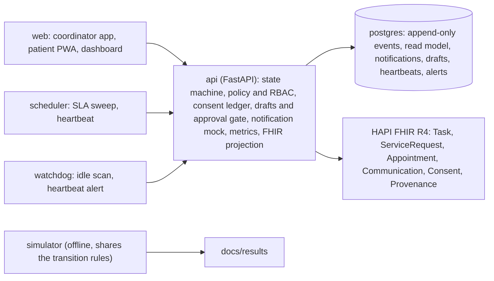

# Screening Closure

[](https://github.com/Nandish3010/screening-closure/actions/workflows/check.yml)

The CI badge is not current: GitHub Actions has been unavailable (billing), so changes are merged on a green local `make check` or `make check-full` recorded in a pull request comment (see "Continuous integration").

Every actionable screening result has a named owner, a clock, an audit trail, and a clinician-signed closure. Nothing is diagnosed. Patient messages are logged to a mock (nothing reaches a phone) and the FHIR `Appointment` is a proposed stub, not real scheduling.

**Outcome, in a simulation on synthetic data (literature-anchored scenario):** colonoscopy within 180 days rises from 51.0% to 66.8%, a completion ratio of about 1.31 at 180 days. That ratio is calibrated to published navigation trials: `orchestration.programme_reach` (0.55) was fitted so the ratio matches the pooled navigation risk ratio of 1.27 (pooled interval 1.10 to 1.46), and it was deliberately not refitted after the B21 timing change. The model shows the mechanism and what drives it, not new evidence of effect. Only the Azulay comparison is independent of that calibration; the Coronado 2025 comparison is not independent and the Coronado 2021 one only partly (the "reach decision (circularity)" paragraph in validation.md). Cases lost without anyone told (silent loss) fall from 45.3% to 20.6% at programme level (under the 0.55 reach assumption); among the cases the programme reaches it is 0%, which is true by construction (every reached case has an owner and a timer). Held-out validation is mixed. It passed for the Azulay ratio, for the baseline completion level of typical US usual care, and for exactly two timing claims: about 12% of positives have a colonoscopy within 30 days under today's unmanaged process (11.7% simulated against 14.7% in Australia; provisional, the source is secondary), and the median time to colonoscopy among completers in the managed arm is about 6 weeks (43 days against 37 at Kaiser). It failed for managed programmes: the held-out managed-programme completion levels are under-predicted by 13 to 16 points (Scotland 75.0% against 62.4%, England 76.0% against 62.4%, Kaiser at 30 days 33.3% against 17.4%). The other timing rows still fail and stay withdrawn, and this repository still makes no claim about days saved or days sooner. See [docs/results/validation.md](docs/results/validation.md). Details and intervals: [docs/results/results.md](docs/results/results.md).

**An Abu Dhabi-shaped baseline (sensitivity run, not the headline):** the 51.0% above is a US-calibrated usual-care baseline. With the baseline anchored to the 30.5% Abu Dhabi audit (Emirati nationals, 2015 to 2016, before IFHAS V10; overlay `simulator/params.abudhabi.yaml`, `make evaluate-abudhabi`), colonoscopy within 360 days moves from 30.6% to 38.8% (+8.2 points, literature anchored, synthetic). The overlay treats the loss the audit does not explain as unrecoverable in both arms, so it understates the mechanism, and the reach and every orchestration parameter are unchanged. See "Sensitivity: an Abu Dhabi-shaped baseline" in [docs/results/results.md](docs/results/results.md).

**Health outcomes, modelled (M7-3, synthetic):** about 1.76 colorectal cancer deaths within 5 years avoided per 1,000 positives (95% PSA interval 1.16 to 2.90), about 31 a year in Abu Dhabi (20 to 51), from published delay, stage and survival studies; not measured, not clinician-reviewed. See [docs/results/outcomes.md](docs/results/outcomes.md).

**Under finite colonoscopy capacity (same scenario, synthetic):** at base capacity the 180-day gain is +15.7 points (95% CI +15.4 to +16.0), the 90-day gain is near zero (+0.7, +0.5 to +0.9; 90-day figures depend on the simulator's timing, which is mostly not validated, see [docs/results/validation.md](docs/results/validation.md)), and the gain largely disappears when slots are short: at 70% of base supply the 180-day gain is +5.2 points. Base capacity is a calibrated scale device, not a measurement. See "Under finite capacity" in [docs/results/results.md](docs/results/results.md) and [docs/evidence.md](docs/evidence.md) section 12.

**Capacity, in the same simulation (literature-anchored scenario):** 36.0% fewer staff minutes per case the system handles (literature-anchored, in reach, 95% CI 34.9 to 36.9) and 19.7% programme-level under the 0.55 reach assumption (95% CI 19.1 to 20.2); synthetic; minutes from published time studies and assumptions.\* **The 40% target is not met in realistic scenarios** (36.0% in reach, 19.7% programme level, literature anchored). The upper range comes close (40.0%, 95% CI 39.0 to 40.9; the central estimate is a hair under 40), and that scenario is a mechanism ceiling, not a forecast, and its interval straddles the line. Coordinator time falls 36.1% (anchored) to 70.2% (upper range); specialist time rises (+22.6% anchored, +43.3% upper range) because more patients reach colonoscopy, which is the outcome; owner-clinician time roughly doubles in the current routing (+94.1% anchored, +162.6% in the upper range) and the planned fix is routing escalations to nurse navigators after the clinician review.

\* From `make evaluate` regenerated for B21 (docs/results/results.md, generated_at 25 October 2026, git commit db1d13d4a482; Human effort section): 20 replications x 2,000 synthetic cases; minutes from published time studies (sourced-adjacent) and assumptions.

**All data in this repository is synthetic: a Synthea v3.3.0 cohort plus a seeded simulator, with no real patient, clinician or facility data.**

## What changed in M6

- **Judge tour and `/judge` (C13, PR #14).** The header has a "Judge tour" button: a 7-step, read-only, non-modal overlay (the problem, a case timeline, the closure guard, the agency inbox, the effort counter, the numbers, a summary) that only navigates and reads. `/judge` is the one-page summary: positioning line, headline with its caveats, links to the repository documents, `make check`. The C12 design pass (tokens, status chips, worklist columns, timeline node types, light and dark) landed with it. See [web/README.md](web/README.md).
- **Live reply triage (D15, PR #15).** `make triage-serve` starts a host-side MLX server on 127.0.0.1:8765 (`/health`, `/classify`); the API reaches it through `TRIAGE_REMOTE_URL` (in compose, `host.docker.internal:8765`). A deterministic opt-out keyword gate (English, Arabic, Arabizi) runs before any model and an opt-out always goes to a person; any error, a 2 s timeout or a malformed answer fails safe to `needs_human`. Precision of the auto-handled replies is 96.2% on the synthetic test set ([docs/results/triage/eval.md](docs/results/triage/eval.md), [tools/triage/README.md](tools/triage/README.md), [model card](docs/governance/reply-triage-card.md)).
- **Claude as a model provider (A35, PR #13, ADR-043, HZ-42).** Haiku drafts and Sonnet plans the agency queue, behind the same validator, approval gate and template fallback, with a daily spend cap and an offline replay cache ([docs/governance/ai-boundary.md](docs/governance/ai-boundary.md) section 9; `make claude-smoke`, `make claude-record`, `make redteam-generate`). The cache is not recorded yet: the owner's API key needs workspace scope (the API answers 400 and asks for `anthropic-workspace-id`), so the demo falls back to templates with abstention reason `cache_miss`.
- **Observability and deployment templates (F14, PR #11).** OpenTelemetry metrics and traces, `GET /metrics` behind a token, and `make up-obs` (Collector, Prometheus, Grafana; dashboard [config/grafana/dashboards/closure.json](config/grafana/dashboards/closure.json); 13 alert rules). A Helm chart ([deploy/helm](deploy/helm)) and an Azure Bicep template for UAE North ([deploy/bicep](deploy/bicep)) are written and have never been applied; see [docs/governance/deployment.md](docs/governance/deployment.md).
- **DPIA and ADHICS (E18, PR #10).** [docs/governance/dpia.md](docs/governance/dpia.md) (PDPL, with GDPR Article 35 as the reference model) and [docs/governance/adhics-controls.md](docs/governance/adhics-controls.md): 68 rows, 7 met, 36 partly, 17 not met, 4 not applicable, 4 to verify. The ADHICS V2 text could not be retrieved, so every id except CM 4.2 is marked to verify. New hazards HZ-39 to HZ-41.
- **The signer must be the closer, and referrals are held (A36, PR #12, ADR-044).** The closure guard in the state machine now checks that the signer is the closer (the route check stays as a second layer). While consent is withdrawn or `share_with_specialist` is false, `handoff_requested` and `handoff_accepted` are refused and the bounce is not planned; the referral resumes with a fresh response window. The model checker now covers 23,730 abstract states ([docs/governance/verification.md](docs/governance/verification.md)).
- **Fast checks (F15, PR #9).** `make check` is the fast tier (16 stages, about 2.5 minutes); `make check-full` adds the simulator-heavy checks (about 11 minutes). Timings: [docs/results/check-timing.md](docs/results/check-timing.md).
- **Merge process.** GitHub Actions is unavailable (billing), so each pull request was merged on a green local `make check` or `make check-full` with the stack up, recorded as a PR comment ("Merged on green local check (Actions unavailable: billing)") with the stage list. This was the owner's decision.

## What this is / is not

This is a deterministic closure engine for one pathway: a positive FIT (faecal immunochemical test) result, then a confirmatory colonoscopy, then a clinician-signed closure. It tracks each case, nudges, escalates to humans, and closes only with evidence. It is not a diagnostic tool. Models are used in four places, drafting patient messages for human approval, ordering the worklist by a calibrated risk score, planning the agency's work queue, and classifying inbound patient replies, plus automatic sending of clinician-pre-approved deterministic templates; no model and no agent can move a case between states, approve a message, change consent or close a case.

**Automatic patient messages are OFF until a clinician signs.** The pre-approved message templates are sent by the automation only under `config/outreach_policy.yaml`, and the shipped policy is **unsigned** (`approved_by: null`): an unsigned policy sends nothing (the automation counts and logs what it held back, `outreach_held`, reason `policy_unsigned`). No clinician has reviewed any template or rule (H1 is open; the AI-simulated reviews in `docs/governance/` are not that sign-off). The compose demo sets `OUTREACH_DEMO_APPROVAL=1`, which treats the policy as signed by **"DEMO PLACEHOLDER (clinical sign-off pending, H1)"**; the web app then shows a persistent amber banner with that text on the case page and the dashboard, `GET /health` reports `outreach.demo_approval`, and the API refuses to start with the switch on outside `APP_ENV=dev`. A real signature in the file wins over the switch.

People act on decisions and conversations; the system does the rest. The phone call after an escalation is the evidence-based intervention, not waste; automation prepares it, a person makes it.

## Judge path in 5 minutes

Prerequisites: Docker, the `.venv` from the Quickstart below, and `make web-install` once. The first time only, the demo needs a saved state (the first seed takes about 12 minutes; later runs are fast):

```
make demo-seed && make demo-stage && make demo-snapshot
```

Then:

0. In a separate terminal on the host, `make triage-serve` (port 8765) so the reply-triage step reads replies live; if it is not running, replies fail safe to a person. One-time setup is in [tools/triage/README.md](tools/triage/README.md).
1. `make up` starts the stack.
2. `make demo-reset` brings the database, the FHIR store and the simulation clock back to the snapshot (about 25 s).
3. Start the web app against the real API, not the in-browser mock that `make web-dev` serves by default: `cd web && VITE_API_ADAPTER=http VITE_API_URL=http://localhost:8000 npm run dev`. Open the three surfaces at http://localhost:5173: the coordinator app at `/coordinator`, the closure dashboard at `/dashboard`, and the patient PWA (switch the role to Patient from a case page, or open `/patient/<caseId>`). Press **Judge tour** in the header for a 7-step read-only walk through the surfaces, or open `/judge` for the one-page summary.
4. `make evaluate` regenerates every evaluation number in `docs/results` (about 25 to 30 s on 10 cores, measured 22 October 2026, now including the capacity layer; simulator/README.md).
5. `make check` runs the fast tier (16 stages, about 2.5 minutes on a 10-core Mac, listed under Tests and checks); `make check-full` adds the simulator-heavy checks (about 11 minutes).

The scripted walkthrough is [docs/submission/demo-script.md](docs/submission/demo-script.md).

## Quickstart (about 60 seconds, plus the one-time venv)

A fresh clone has no `.venv`. The Makefile uses `.venv` when it exists and otherwise falls back to a bare `python3` with no packages, which is enough for `make up` and `make test` (the latter then runs inside the api container) but not for `make demo-seed`, `make evaluate` or `make demo-scenario`. Create it first, with two lines:

```
python3 -m venv .venv
.venv/bin/pip install -e 'api[dev]'
```

Or run `sh tools/check/fresh_clone.sh` (`make fresh-clone`), which clones the committed state into a temporary directory, creates the venv there and runs the whole sequence below against its own compose project and ports.

```
cp .env.example .env
make up
curl localhost:8000/health
make test
```

The stack runs offline once the images are pulled. Postgres is on host port 5433, HAPI FHIR on 8080, the API on 8000, each bound to 127.0.0.1 only. `make up` first runs two one-shot containers (`db-init`, `migrate`) that create the databases and apply the schema as the database owner; the API then runs as the unprivileged role `closure_app` (ADR-029).

The web app is not a compose service. Run `make web-install` once, then `make web-dev` and open http://localhost:5173. It uses the mock adapter by default. For the real API: `cd web && VITE_API_ADAPTER=http VITE_API_URL=http://localhost:8000 npm run dev`.

`make evaluate` regenerates every number in `docs/results`; `make evaluate-check` proves the result is byte-for-byte reproducible. `make demo-seed` loads the Synthea cohort into HAPI and creates the cases in the API. **The first `make demo-seed` takes about 12 minutes**: Synthea runs in a container to generate the cohort, and then HAPI loads 364 patients. A rerun is fast: it reuses the Synthea output in `data/synthea/out` and skips the load when HAPI already has patients. After it, `make demo-stage && make demo-snapshot` stages the second demo case and saves the demo state, and `make demo-reset` brings it back in about 25 s.

## Architecture



- Event sourcing: the `events` table is append-only (triggers reject UPDATE, DELETE and TRUNCATE, with one scoped exception: since migration 016 a single `SECURITY DEFINER` function, `erasure_scrub_case`, may scrub personal data for an approved erasure; the ordinary application role still cannot). State comes from replay. An append validates the event, then writes it in one transaction with the case row locked.
- Closure invariant: `close` needs an `evidence_ref` that resolves in HAPI and a `signed_by` from a physician (`primary_care_owner` or `specialist_owner`), checked inside the state machine; outside dev the API refuses to start without evidence verification or a database. It is property-tested (T-A1).
- A working-day SLA engine drives an escalation ladder to named humans.
- The watchdog finds open cases nobody is touching, and heartbeats make a stopped scheduler raise an alert.
- Every event is projected to HAPI FHIR R4 resources. Messages go to a logged notification mock only, and the `Appointment` resource is a proposed stub (no slot time is modelled).
- Models sit at the edges and cannot move a case, approve a message, change consent or close a case ([AI boundary](docs/governance/ai-boundary.md)).
- The simulator is offline. It imports the API's pathway loader and calls `apply()`/`step()` for each transition, so the transition rules and the closure guard are shared. Since M7-1 ([PR #25](https://github.com/Nandish3010/screening-closure/pull/25)) it also runs the API's own read model and sweep: `simulator/sim/machine.py` folds each case's events into `app.state_machine.CaseModel` and asks `app.sweep.next_due_at` and `app.sweep.plan_case` what is due, so SLA timers, breaches, the escalation ladder, coalescing and the bounce of an unanswered referral are the API's code, on the API's calendar (`config/calendar.yaml`, Asia/Dubai). The simulator adds behaviour only: who answers, how fast, and the one fault the API cannot have by construction (a missed timer). A conformance test (`simulator/tests/test_sweep_conformance.py`) replays every simulated case through the real event store and `app.sweep.run_sweep` and requires the same event log, event for event.

Detail: [docs/submission/technical-documentation.md](docs/submission/technical-documentation.md).

## Why a programme would buy it

Capacity first: grow screening without growing coordinators. The same mechanism that lifts colonoscopy completion from 51% to 67% in the simulation (synthetic, literature-anchored, US-calibrated baseline, before capacity limits) takes over the routine steps of each case, so coordinator hours per handled case fall by more than a third in the literature-anchored scenario (synthetic, assumed minutes), and people keep the decisions and the conversations. Outcomes come with the capacity: more patients reach colonoscopy and fewer are lost without anyone told.

The saving is in coordinator hours, not in cost per case. At wage ratios taken from published UAE salary pages (a clinician 4 times and a specialist 10 times a coordinator; graded sourced-adjacent, not an official pay scale; [docs/evidence-wages.md](docs/evidence-wages.md)), weighted staff time per case goes up, not down: 125.0 coordinator-equivalent minutes at baseline against 138.7 under the literature-anchored scenario at programme level (+10.9%), 125.3 against 150.2 in reach (+19.9%) and 147.5 in the upper range (+18.0%). Across the ranges in that note (clinician 3 to 6, specialist 8 to 15) the programme-level change stays positive, +6.2% to +17.6% (`python3 tools/pilot/cost_model.py`). The specialist ratio is what moved it: at the earlier assumed ratios of 3 and 4 the same minutes gave roughly flat weighted time (+1.8%). The commercial claim is therefore capacity plus outcomes, and the pilot measures the minutes (time-and-motion study, KPI K9 in [docs/pilot-plan.md](docs/pilot-plan.md)). The business case ([docs/commercial/business-case.md](docs/commercial/business-case.md)) says the same thing more bluntly: avoided downstream cost alone does not pay the illustrative fee (figures and method in that document), so the case rests on freed coordinator capacity and on whether the Department of Health sets a follow-up standard, which is to verify. No buyer exists and no price has been tested.

What would be sold is a programme licence across four pathways (FIT positives, blood-based screening positives, breast and cervical recall; only FIT is built), with Abu Dhabi's public health programme as the hypothesised buyer. At central volumes (about 24,600 actionable cases a year) the operator's cost to serve is about AED 1.71 million a year with hosting at Azure UAE North list prices, so an illustrative licence of AED 2.0 million has a 14% margin and a 21-month payback on the integration and pathway work. Avoided treatment cost from the FIT pathway covers 69% of that licence and labour is a net cost in the current routing, so the buyer pays for safety and outcomes: about 4,400 positives a year that the simulation says would otherwise be lost without anyone told, and about 42 advanced cancers avoided (95% interval 29 to 84; synthetic, assumption-based, from the [outcomes model](docs/results/outcomes.md); [business case](docs/commercial/business-case.md) section 9, generated by `python3 tools/pilot/cost_model.py --pricing`). The first step is a 90-day read-only shadow run at a provider, which sends nothing to patients ([go-to-market](docs/commercial/go-to-market.md)); the [buyer map](docs/commercial/buyer-map.md) and a ready-to-send [outreach kit](docs/commercial/outreach/README.md) (pilot brief, letter of intent, emails) are for the owner to find that provider. Nobody has been contacted.

## What is in the box

| Service | What it does | Port |
|---|---|---|
| `postgres` | Events, read model, notifications, drafts, heartbeats, alerts (database `closure`); HAPI's tables (database `hapi`) | 5433 (host, 127.0.0.1) |
| `db-init`, `migrate` | One-shot: create the extra databases; apply the schema and set the API role's password | none |
| `fhir` | HAPI FHIR R4 server, receives the projection | 8080 (127.0.0.1) |
| `api` | FastAPI engine (non-root, unprivileged database role) | 8000 (127.0.0.1) |
| `scheduler` | Periodic SLA sweep, writes a heartbeat | none |
| `watchdog` | Idle-case scan, alerts on a stale heartbeat | none |
| `web` | Vite and React app, started with `make web-dev` | 5173 |
| `synthea` | Cohort generator, compose profile `tools`, run with `make synthea` | none |

```
config/      pathway definitions (states, transitions, SLAs, escalation ladder), calendar
api/         FastAPI app, state machine, migrations, tests
scheduler/   SLA sweep service
watchdog/    idle scan and heartbeat alert service
simulator/   behaviour simulator, evaluation harness, cohort loading scripts
web/         coordinator app, patient PWA, dashboard
tools/       check, load, pilot, review and synthea scripts
docs/        results, governance, review packs, submission documents
project/     plan, tracker, decisions, log, test cases
```

## Make targets

| Group | Target | Meaning |
|---|---|---|
| Run | `up`, `down`, `logs` | Build and start, stop, and follow logs for the compose stack |
| Run | `reset` | Wipe volumes (cases and FHIR data) and rebuild |
| Run | `synthea`, `demo-seed`, `demo-seed-clean` | Generate the cohort in a container; load it and create cases; delete generated files |
| Test | `test` | Unit and property tests, no database |
| Test | `verify` | Exhaustive model check of the state machine (`tools/verify/`, ADR-038): 23,730 abstract states, 8 invariants, about a minute, no database |
| Test | `test-db` (`test-db-create`, `test-db-reset`) | Integration tests against `closure_test`; create or recreate that database |
| Test | `test-chaos` | Chaos-marked tests: duplicate delivery, clock skew and store failures through the fault harness (F3), a sweep killed part-way (F4), bad model output and consent withdrawn mid-send (F5), and the scheduler container stopped and restarted with the watchdog alert |
| Test | `test-oidc` | The committed Keycloak realm against a real Keycloak (own compose project, throw-away passwords; skips without Docker) |
| Run | `oidc-up`, `oidc-down` | Start the local OIDC provider (Keycloak, a UAE PASS stand-in) and put the API in `AUTH_MODE=oidc`; back to dev mode (A29) |
| Test | `test-tools` | Cross-cutting tests in `tests/` |
| Test | `test-security` | Secrets and repo hygiene scan; RBAC matrix (F7); no PHI in route parameters or in the logs of an in-process demo walk (F8) |
| Test | `rbac-matrix` | Rewrite `docs/governance/rbac-matrix.md` from the app; `test-security` fails if the file differs |
| Test | `test-phi-logs` | The F8 log scan against the running stack's service logs; writes a few synthetic marker cases, run it on a throwaway stack |
| Test | `test-demo` | T-E9 and T-E10 against the running stack: the scenario repeats identically after a reset, and the reset restores the snapshot's state (about 4 minutes) |
| Test | `test-e2e-live` | Playwright against the running stack: the full flow, the declined-handoff re-route and T-C16 (stops the scheduler container); skips if the API is down |
| Test | `test-load`, `load-check` | Sweep timing at 1k, 10k, 100k cases and rewrite `docs/results/load.md`; the 1k size only |
| Evaluation | `evaluate`, `simulate`, `evaluate-check` | Regenerate `docs/results`; one arm, one run; prove reproducibility |
| Evaluation | `sensitivity`, `sensitivity-check` | One-at-a-time parameter sensitivity sweep, written to `docs/results/sensitivity.*`; prove it reproduces |
| Docs and checks | `check` | Run every stage below in order |
| Docs and checks | `docs-check`, `tracker-lint` | Links, tables and markers in docs; tracker and test-case consistency |
| Web | `web-install`, `web-dev`, `web-build`, `web-test`, `web-e2e` (`test-e2e`) | Install, dev server, build, unit tests, Playwright |
| Review packs | `review-packs`, `review-packs-check`, `test-review-packs` | Build the clinician and Arabic packs; fail on drift; test them |
| Demo | `demo-scenario` (`UNTIL=<step>`) | Run the scripted story for the named synthetic patient through the API, optionally up to one step (E8, `tools/demo/README.md`) |
| Demo | `demo-stage` | Walk the second seeded case to `confirmatory_completed`, owned by the specialist login, through the API; safe to rerun (E9, `tools/demo/README.md`) |
| Demo | `demo-snapshot`, `demo-restore`, `demo-reset` | Save the demo state (stages the second case first); restore it; one-click reset (restore, reset the clock, check the state fingerprint) |
| Demo | `demo-kill-scheduler` (`RUNS=3`) | Kill-the-scheduler rehearsal: stop the scheduler, wait for the alert, restart, check no event was lost (F11) |
| Demo | `agency-run` | One agency run on demand against the running stack (`POST /agency/run` as the supervisor), printing the summary; the compose stack sets `AGENCY_EVERY_SWEEPS=0`, so the scheduler never starts one itself and the demo snapshot stays deterministic (A22, `tools/demo/README.md`) |
| Risk score | `risk-report`, `risk-check` | Retrain the loss-to-follow-up risk score and rewrite its report and score card (D10); fail if the committed files differ from a fresh run |
| Reproducibility | `fresh-clone` | Clone the repository into a temporary directory and run the fresh-clone steps there, with the checklist for the second machine (F12) |
| Test | `test-offline` | The demo scenario with api, HAPI and Postgres on a network with no route out, in its own project (Docker only; a few minutes) |

## Sign-in (identity modes)

Two modes, chosen by `AUTH_MODE` (A29, ADR-040). `dev` (the default) keeps the passwordless dev login for the demo and the mock; its tokens now expire after 8 hours on the wall clock. `oidc` verifies JWTs from an OpenID Connect provider (signature by JWKS, issuer, audience, expiry), maps the token's role to one of the six roles and derives the opaque actor from the provider's `sub`; outside `APP_ENV=dev` the API starts only in this mode. `make oidc-up` starts a local Keycloak that stands in for UAE PASS (demo passwords generated per run into a git-ignored file) and the web app signs in with the authorization code flow and PKCE (`VITE_AUTH_MODE=oidc`). It is not UAE PASS and nothing here claims its behaviour. Details, what is missing (MFA policy, Emirates ID claims, revocation): [docs/governance/identity.md](docs/governance/identity.md).

## Tests and checks

`make check` (F15) is the fast tier and runs 16 stages concurrently (a pool of min(cores, 6); `CHECK_SERIAL=1` for one at a time): test, verify, test-db, web-test, web-build, web-e2e (after web-build), docs-check, tracker-lint, test-security, test-tools, test-redteam, load-check, review-packs-check, test-review-packs, effort-check and evaluate-smoke (the evaluate determinism check at 1 replication). `make check-full` also runs the simulator-heavy checks: sensitivity-check, the full evaluate-check (in place of the smoke), validate-check, evaluate-capacity-check, risk-check and calibrate-check. `make check` adds those by itself when the diff against main touches simulator/, config/pathways/, tools/calibration/, docs/results/, api/app/risk/ or the engine modules the simulator imports (the rule is in tools/check/run_check.py); `CHECK_HEAVY=1` or `0` overrides it. Without `CHECK_KEEP_GOING=1` no new stage starts after a failure. The serial run took 13.5 minutes at the M5 final merge and 14.7 minutes before the speed-up; the fast tier takes 2 minutes 25 seconds and the full tier 10 minutes 56 seconds (docs/results/check-timing.md). test-db and load-check are SKIPPED loudly (not passed) when Postgres on :5433 is down, and calibrate-check when the gitignored downloads are absent (`make calibrate-fetch` once). Set `E2E_PORT` if port 4173 is taken by another preview.

At the M5 final merge (project/LOG.md, line "M5-final", 2026-10-18), `make check` was green over 17 of 17 stages: 2154 api and simulator tests, 230 integration, 287 web unit, 51 e2e, 188 tool tests, 72 security-gate tests, 19 pack tests, 20 effort tests, 21 calibration tests. Outside it: `make test-chaos` 45 passed, `make test-demo` 2 passed, `make test-e2e-live` 3 passed, `make test-offline` 17 of 17.

The state machine is also model-checked exhaustively by `make verify` (`tools/verify/model_check.py`, [docs/governance/verification.md](docs/governance/verification.md)): 23,730 abstract states (three slices), 8 invariants, and 8 seeded mutations (M8 removes the physician check), all caught. It found one real bug, now fixed: an approved draft could be sent while an opt-out or wrong-number hold was open (ADR-038).

The closure rule has its own property test: `api/tests/test_state_machine.py::test_never_closed_without_evidence_and_human_signoff`.

## Continuous integration

**The workflows below are defined but not currently running: GitHub Actions is unavailable (billing), so the badge at the top is not current.** Pull requests are merged on a green local `make check` (or `make check-full`) with the stack up, recorded as a PR comment. The text below describes what the workflows do when Actions is available.

GitHub Actions runs `.github/workflows/check.yml` on every push and pull request to `main`: `unit` (Python 3.12: `make test`, `evaluate-check`, `docs-check`, `tracker-lint`, `test-security`, `test-tools`, `review-packs-check`, `effort-check`), `db` (Postgres 16 and HAPI FHIR as service containers: `make test-db`; the HAPI tests skip if HAPI does not start) and `web` (Node 22: unit tests, build, Playwright e2e on the mock adapter). `heavy` (`sensitivity-check`, `risk-check`) runs nightly and on demand. Stages that need the whole compose stack (`load-check`, `test-offline`, `test-demo`, the live e2e) are not in `check.yml`.

`.github/workflows/fresh-clone.yml` (manual and weekly) runs `tools/check/fresh_clone.sh` on a clean runner with a reduced Synthea population (60) and uploads the timing report as an artifact. It is the automated stand-in for the second-machine check; a run on a real second machine (H5) is still a human task.

## Submission documents

- [Submission index](docs/submission/README.md), [technical documentation](docs/submission/technical-documentation.md), [demo script](docs/submission/demo-script.md)
- Results: [results](docs/results/results.md), [metrics](docs/results/metrics.md), [load test](docs/results/load.md), [scalability evidence on a three-node kind cluster](docs/results/scale.md) (1,000,000 cases, leader fail-over, a 2-hour soak, a capacity plan; includes what is not met)
- Basis: [evidence](docs/evidence.md), [assumptions and limitations](docs/assumptions-limitations.md), [design choices](docs/design-choices.md), [data provenance](docs/data-provenance.md), [pilot plan](docs/pilot-plan.md)
- Governance: [decision matrix](docs/governance/decision-matrix.md), [hazard log](docs/governance/hazard-log.md), [AI boundary](docs/governance/ai-boundary.md), [regulatory mapping](docs/governance/regulatory-mapping.md), [Malaffi adapter plan](docs/governance/malaffi-adapter-plan.md), [pilot hardening checklist](docs/governance/pilot-hardening.md) (what must change before real patients), [red-team suite](docs/governance/red-team.md) (731 adversarial cases, `make test-redteam`)
- Review packs: [clinician pack](docs/review/clinician-pack.md), [Arabic pack](docs/review/arabic-pack.md)
- Project: [plan](project/PLAN.md), [tracker](project/TRACKER.md), [decisions](project/DECISIONS.md)

## Status

As of 25 Oct 2026 (M5 fix wave plus the M6 changes listed above), built: the core loop, the simulator and evaluation, the interfaces (on the mock adapter and against the real stack), the AI drafting edge, the risk score, the reviewer packs, the governance documents, the chaos, RBAC, PHI and offline checks, and the demo scenario with its one-click reset.

Open (project/TRACKER.md):

- The fresh-clone script is built (F12, `make fresh-clone`); its run on a second machine is still a human task (H5).
- The 100,000-case sweep meets its 5 s target at the default worker count (A20). The committed run in docs/results/load.md shows 8.72 s single process, 3.93 s through `POST /scheduler/sweep` with 4 workers (the default, A17) and 3.17 s with 10 workers, on a shared laptop. The first sweep after migration 012 reads every case once (20.4 s with 4 workers). The scalability run in [docs/results/scale.md](docs/results/scale.md) (three-node kind cluster, in-cluster Postgres, after the M7-7 fixes) measures the same 100,000-case sweep at 2.65 s (1 worker) and 1.52 s (4 workers); the two harnesses differ and are reconciled in the technical documentation, section 10. That run also lists what is not met: API memory not flat, the soak sweep cadence at 77.6% of nominal, the 1,000,000-case daily burst not inside one loop, and two unbounded metrics routes. A follow-up run is in progress, so those lines may be updated.
- In review, not done: the messy-case scenarios have no dedicated test (B5); the parameter-override metadata test and the docs-numbers checker are missing (B10).
- Clinician review (H1) and native Arabic review (H2) are pending. The Arabic text is an unreviewed draft.
- Not ready for real patients: OIDC login is built against a local Keycloak that stands in for UAE PASS (A29, ADR-040; UAE PASS itself is not connected or verified, [docs/governance/identity.md](docs/governance/identity.md)); tokens expire (dev tokens after 8 hours, OIDC access tokens at their `exp`), but there is no revocation; erasure is built (A32) but its conflict with record-retention law is still to verify; there is a wall-clock mode and leader election for several replicas (`CLOCK_MODE`, `make up-scale`, [docs/governance/operations.md](docs/governance/operations.md)) but the demo runs on the simulation clock, and the HL7 v2 adapter (A28) is not connected to or certified by Malaffi, and there is no DoH cloud authorisation. The checklist is [docs/governance/pilot-hardening.md](docs/governance/pilot-hardening.md).

## Licence

MIT. See [LICENSE](LICENSE).

The Synthea jar (Apache 2.0) is downloaded at run time by `tools/synthea/run.sh` and is not vendored. The HAPI FHIR image keeps its own licence.
