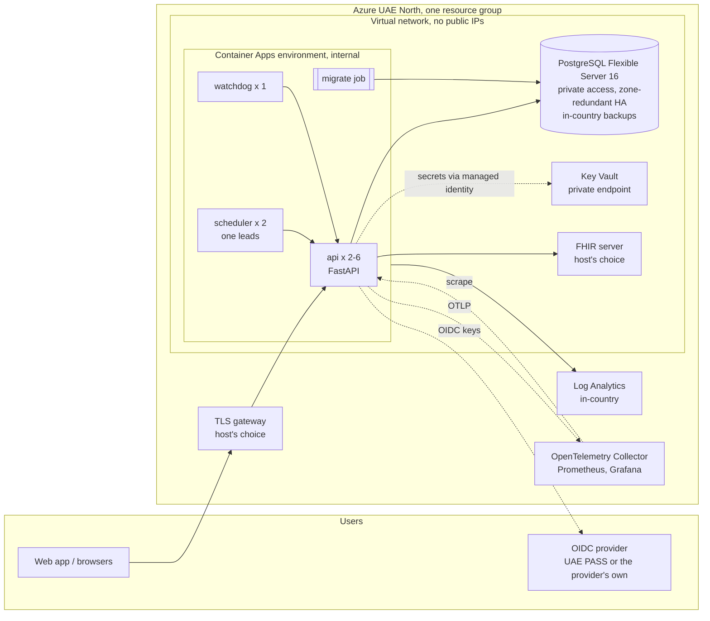

# Deployment: templates, authorisation, backups, SLOs

What it would take to run the system outside a laptop, and what has to be agreed before anyone does. The templates under `deploy/` are checked in CI (`helm lint`, `helm template`, `bicep build`) and never applied: **nothing here has been deployed, and nothing is a deployment claim.** The prototype runs on synthetic data only. Hosting for real patient data is decided by [ADR-026](../../project/DECISIONS.md) (a provider-approved environment first, a DoH-authorised cloud second) and is blocked until the authorisation below exists. The application-side behaviour (leader election, clock modes, metrics) is in [operations.md](operations.md); the checklist rows are in [pilot-hardening.md](pilot-hardening.md).

## Choices

| Question | Choice | Why |
|---|---|---|
| Infrastructure as code | **Azure Bicep** (`deploy/bicep`) | Azure-only target (UAE North), so a cloud-neutral tool buys nothing; Bicep has no state file to protect or leak (ARM holds the state), no provider to download, and `bicep build` validates fully offline in CI. Terraform's `validate` needs the `azurerm` provider downloaded and a state backend to be useful, and the state would hold the database password. |
| Runtime | **Azure Container Apps** in an internal, VNet-integrated environment (Bicep), and a **Helm chart** for any Kubernetes including AKS (`deploy/helm`) | The workloads are three small stateless containers and a job: nothing needs a cluster operator, node patching or a service mesh, which keeps the operational and attack surface small for a first pilot. The chart exists because a provider-approved environment (ADR-026, first choice) is more likely to be Kubernetes than Azure. Both use the same images and the same settings. |
| Database | PostgreSQL Flexible Server 16, private access only | The system needs Postgres features it already uses (advisory locks, `FILE_COPY` templates in tests, row triggers). Managed HA and point-in-time restore replace hand-run failover. |
| Secrets | Azure Key Vault (RBAC, purge protection, no public access, private endpoint) read through a managed identity | No secret in a template, a parameter file or an image. |
| Region | UAE North only (the `location` parameter allows nothing else) | Health information must not leave the UAE (ADHICS CM 4.2, Federal Law 2 of 2019). Backups are not geo-redundant for the same reason. |

## Architecture



The scheduler and watchdog hold no database credentials and speak only HTTP to the API. The schema owner's credentials exist only in the migrate job. `/metrics` is not routed through the gateway; the metrics stack reaches the API inside the network.

## How to deploy

Prerequisites (none of them is in this repository): a subscription with UAE North, a container registry in the same region holding the three images (`screening-closure-api`, `-scheduler`, `-watchdog`; build from `api/`, `scheduler/`, `watchdog/`), an OIDC client for the API, the FHIR server the host approves, and a TLS gateway.

### Azure (Bicep)

1. `cp deploy/bicep/main.example.bicepparam deploy/bicep/main.bicepparam` and edit: name prefix, environment, Key Vault administrators (a group's object id), registry, OIDC issuer (https), FHIR URL, CORS origin.
2. First pass, infrastructure only (`deployApps=false`):
   ```
   az group create -n <rg> -l uaenorth
   PG_ADMIN_PASSWORD="$(openssl rand -base64 36)" \
   az deployment group create -g <rg> -f deploy/bicep/main.bicep -p deploy/bicep/main.bicepparam
   ```
   The password is generated by the pipeline and ends up only in Key Vault (`postgres-admin-password`).
3. Create the database roles once (from a host inside the network): the schema owner connects as `closure_owner`; migration 009 creates `closure_app` and the migrate job sets its password from `app-db-password`.
4. Put the secrets in the vault: `database-url` (as `closure_app`), `migrate-database-url` (as the owner), `app-db-password`, `dev-auth-secret`, `scheduler-service-token`, `watchdog-service-token`, `automation-service-token`, `agency-service-token`, `metrics-scrape-token`. Tokens and `dev-auth-secret`: random, 32 bytes or more, all different. The API refuses to start otherwise (`app.auth.assert_secure_config`).
5. Grant the output `appIdentityClientId`'s principal `AcrPull` on the registry.
6. Second pass with `deployApps=true`; then run the migration job (`az containerapp job start`) before each new image tag, then roll the apps.
7. Create the config (calendar, pathway, providers, outreach policy, agency) as mounted files or bake them into the image; **the outreach policy ships unsigned and an unsigned policy sends nothing** until the clinical lead signs it (H1).

### Kubernetes (Helm)

```
kubectl -n closure create configmap screening-closure-config \
  --from-file=calendar.yaml=config/calendar.yaml --from-file=colorectal_fit.yaml=config/pathways/colorectal_fit.yaml \
  --from-file=providers.yaml=config/providers.yaml --from-file=outreach_policy.yaml=config/outreach_policy.yaml \
  --from-file=agency.yaml=config/agency.yaml
# a Secret named screening-closure-secrets with the keys in values.yaml (secrets.placeholders), from Key Vault or your secret manager
helm lint deploy/helm/screening-closure --set secrets.create=true
helm upgrade --install closure deploy/helm/screening-closure -n closure -f my-values.yaml
```

The chart runs the migration as a pre-install and pre-upgrade hook, so the Secret and ConfigMap must exist first. Pods run as non-root with a read-only root filesystem (the only writable path is an `emptyDir` at `/tmp`), no capabilities and the runtime-default seccomp profile; probes use `/health`; a default-deny network policy then allows only scheduler and watchdog to the API, the API to the database, FHIR server, identity provider and (if set) the collector, and the ingress controller and Prometheus to the API port. The ingress template does not route `/metrics` anywhere special and the gateway should not publish it; Prometheus scrapes the Service from inside the cluster with the scrape token. `helm template` with the placeholder values is what CI renders.

Every value is a parameter (`values.yaml`, `main.bicep`); the committed ones are placeholders (`REGISTRY`, `*.example.invalid`, `CHANGE_ME`, documentation CIDRs).

## What DoH authorisation is still required

The cloud rule is the blocker, not the code. ADHICS v0.9 control CM 4.2 says a healthcare entity shall not use cloud services or infrastructure to store, process or share health information, shall keep it inside the UAE, and shall not share even de-identified health information with third parties without the regulator's authorisation ([regulatory-mapping.md](regulatory-mapping.md) section 3; ADR-026). The current version (V2, 2024) was not retrieved, so whether the rule stands is **to verify**. Before any real patient data touches the Azure templates:

1. **Written DoH authorisation** of the specific hosting for health information (the exception route CM 4.2 describes), naming region, provider and the services used (database, vault, container platform, logging). Without it, the first choice in ADR-026 applies: the provider's own approved environment, where the Helm chart is the template and the Bicep is not used.
2. Authorisation (or confirmation it is not needed) for **every secondary store**: backups, Log Analytics, the metrics and trace backends, the container registry. All must be in-country; the Bicep keeps them in UAE North and disables geo-redundancy.
3. Confirmation of whether the service is itself a regulated entity or a third party, and which ADHICS tier applies; any assessment the regulator requires of the vendor.
4. Remote administration and disaster recovery from inside the UAE (the DoH Responsible AI Standard asks the same of compute, storage and support access).
5. The identity provider, FHIR server and messaging channel the pilot uses, each agreed with its operator (pilot-hardening.md).
6. Retention and erasure settled with the data protection lead (erasure.md section 6), before any backup policy is final.

## Backups and restore

**Database.** Flexible Server takes automatic backups and keeps them `postgresBackupRetentionDays` (35 at most) with point-in-time restore inside that window; storage is zone-redundant where the region allows and **never geo-redundant** (the copy must stay in UAE North). Prod also runs zone-redundant HA with automatic failover. Restore creates a new server:

```
az postgres flexible-server restore -g <rg> -n <new-name> --source-server <name> --restore-time <UTC time>
```

then point `database-url` and `migrate-database-url` at it, run the migrate job (it checks migration checksums, then applies nothing new), and start the apps. Wall clock mode is on, so the restored log is consistent with real time; the leader lease row restores with a stale holder and expires within the TTL.

**FHIR store.** Back up and restore the FHIR server together with the case database to the same instant: the cases hold references into it, and the API verifies closure evidence against it. If they diverge, the projection queue and the evidence check show it (dead letters, 404 on evidence), and `make demo-snapshot`'s approach (copy both, compare a fingerprint) is the model for a drill.

**Restore drill.** Restore to a scratch server at least quarterly, start the apps against it in a scratch environment, run `GET /metrics/closure` and compare `replay_failures.count` (must be 0) and the case count to production. Record the time it took (the recovery time actually measured, not the one promised).

**The erasure caveat (important).** Erasure rewrites the event log (tombstones personal text) and expunges the patient's FHIR resources ([erasure.md](erasure.md)). Backups taken before an erasure still hold the data, and **a restore from such a backup resurrects it**. Retention up to 35 days therefore means personal data of an erased patient can survive for up to 35 days in backups, and a restore inside that window brings it back. The design is not finished (erasure.md section 6, open item 2). Until it is:

- keep the backup retention no longer than the erasure SLA the data protection lead agrees, or accept and document the window;
- keep an erasure ledger outside the database (the register's erasure ids, dates and reasons, never the patient reference) and, after **any** restore, re-run erasure for every ledger entry newer than the backup; the patient reference must be re-supplied by a person because `erasure_map` is deleted by design;
- never restore a backup into an environment reachable by users before that replay is done.

Do not run erasure on real patient data before the retention conflict (Federal Law 2 of 2019) is settled.

## SLOs and alerts

Targets for a pilot, on the metrics of [operations.md](operations.md); the starting thresholds live in `config/prometheus/alerts.yml` and the panels in `config/grafana/dashboards/closure.json`. They are targets to tune on pilot hardware, not measured guarantees.

| SLO | Target | Metric | Alert (rule in `alerts.yml`) |
|---|---|---|---|
| Periodic work keeps running | a scheduler holds the lease 99.9% of the time; heartbeat younger than 90 s | `closure_leader{lease="scheduler-present"}`, `closure_service_heartbeat_age_seconds{service="scheduler"}` | `SchedulerNoLeader` (page), `SchedulerHeartbeatStale` (page); the watchdog's `scheduler_down` in `GET /alerts` is the second, independent signal |
| The watchdog is alive | heartbeat younger than 120 s | `closure_service_heartbeat_age_seconds{service="watchdog"}` | `WatchdogHeartbeatStale` (page) |
| Sweep latency | p95 under 5 s (the 100,000-case target, load.md) | `closure_sweep_duration_seconds` | `SweepSlow` (ticket) |
| Sweeps complete | no sweep with errors | `closure_sweeps_total{result="errors"}` | `SweepErrors` (ticket) |
| API availability | at least 99.5% of requests not 5xx over 30 days | `http_server_request_duration_seconds_count{http_response_status_code=~"5.."}` | `ApiHighErrorRate` (page, above 5% for 10 min) |
| API latency | p95 under 1 s outside the scheduler routes | `http_server_request_duration_seconds` | `ApiSlow` (ticket) |
| Approved messages go out | outbox empty within 10 minutes | `closure_outbox_pending` | `OutboxBacklog` (ticket) |
| FHIR copy is current | no dead letters; queue under 100 | `closure_projection_dead_letters`, `closure_projection_queue_depth` | `FhirProjectionDeadLetters` (page), `FhirProjectionBacklog` (ticket) |
| Background leader exists | an API replica leads `api-background` | `closure_leader{lease="api-background"}` | `NoApiLeader` (ticket) |
| Telemetry arrives | metrics present | `absent(closure_leader)` | `MetricsMissing` (page) |
| Programme signal (not infrastructure) | overdue count does not grow 50% day on day | `closure_cases_overdue` | `OverdueCasesGrowing` (ticket, to the programme coordinator) |

The recovery objectives (RPO from point-in-time restore, RTO from the restore drill) are set after the first drill; none is claimed here.

## Observability in a deployment

The API exports OTLP/HTTP to `OTEL_EXPORTER_OTLP_ENDPOINT` and serves `GET /metrics` (supervisor token or the scrape token). In a deployment point it at a collector inside the same network and send metrics and traces only to backends DoH has authorised (item 2 above). Run Prometheus with `authorization.credentials_file` set to the scrape token **or** the collector path, not both against one Prometheus (the series would double). Logs are JSON with `trace_id` (`LOG_FORMAT=json`) and carry no patient data; the PHI scan keeps covering them. Locally: `make up-obs`.

## What is not covered

- No load balancer, WAF, DDoS protection or private DNS for the public hostname: the host's gateway.
- No FHIR server, identity provider or HL7 listener in the templates (the compose HAPI and Keycloak are development tools).
- No image build, signing or vulnerability-scan pipeline; no autoscaling beyond the Container Apps HTTP rule.
- Storage encryption uses the platform's keys; customer-managed keys are not wired.
- Nothing was applied to a subscription or cluster: the checks are `helm lint`, `helm template`, `bicep build`, `promtool` and the collector's `validate`.
