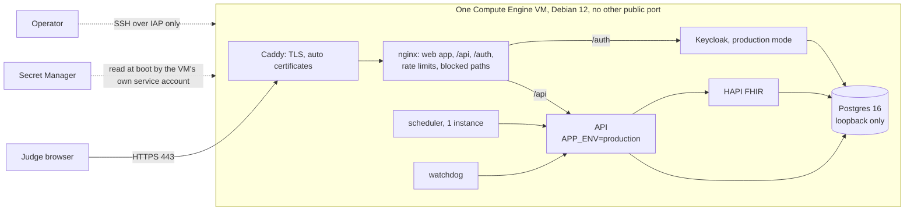

# Hosted judge demo on Google Cloud

**Status: prepared, not deployed.** Nothing in this document has been applied to any Google Cloud project. The scripts under `deploy/gcp/` create resources only when the operator runs `deploy.sh --yes-spend` after approving the cost below. The prices are **estimates from public list prices as known on 4 November 2026; they were not fetched live** (the pricing pages are not machine-readable here). Check them in the [Google Cloud pricing calculator](https://cloud.google.com/products/calculator) for your region before approving.

**Why it exists.** The organisers said judges test the software hands-on through "a demo platform or a link", with test credentials. The user decided the product is hosted on the cloud. This is a demonstration host for **synthetic data only**. It is not a deployment claim: production would run in-country (see "Region and residency").

## What judges get

One public HTTPS URL. Sign-in with four role logins (coordinator, clinician, supervisor, patient) through a real OIDC provider. The seeded synthetic cohort (the same deterministic Synthea cohort, seed 20261017, 300 patients, as `make demo-seed`). An operator-only "reset demo".

## Architecture (recommended: Option A, one VM, Docker Compose)

The files: `deploy/gcp/compose.gcp.yml` (an overlay on the repository's own `docker-compose.yml`, so compose and Helm are untouched), `deploy/gcp/edge/` (Caddyfile, nginx template, web build image), `deploy/gcp/vm/` (what runs on the VM), `deploy/gcp/*.sh` (what the operator runs).

- **One URL.** `https://<host>/` is the web app, `/api/` the API (prefix stripped), `/auth/` Keycloak. The host is `<ip-with-dashes>.sslip.io` (no domain to buy) or your own domain (`SC_DOMAIN`). Caddy gets certificates itself (Let's Encrypt, ZeroSSL as automatic fallback). sslip.io is a shared domain with shared certificate rate limits; for the submission a real domain pointing at the static IP is safer (one A record).
- **Fail-closed production configuration.** The API runs with `APP_ENV=production`, `AUTH_MODE=oidc` with an `https://` issuer, `DEV_LOGIN_ENABLED=false`, 48-character random secrets (the API refuses anything under 32 bytes or default), `CLOCK_MODE=wall`, `FHIR_VERIFY_EVIDENCE=true`, `OUTREACH_DEMO_APPROVAL=0`. `tests/test_gcp_hosting.py` renders the env files and runs the API's own `secure_config_problems()` over them.
- **Judge logins.** Keycloak (production mode, its own database in the same Postgres) imports the committed realm with the public host as the only redirect URI and brute-force protection on. The passwords are generated by `deploy.sh` (`openssl rand`), stored in Secret Manager, and printed by `credentials.sh` for pasting into the submission. They are in no file of the repository.
- **Seeding and the production check.** The seeding scripts (`simulator/*.py`) log in with the dev login, which production refuses by design. So `seed.sh` runs the same stack once in **seed mode** (`APP_ENV=dev`, simulation clock started one hour before now, **no public listener**: Caddy is not started and every port is on 127.0.0.1), loads the cohort, takes the snapshot (`tools/demo/snapshot.sh save`), then switches to production mode and opens the edge. Judges only ever reach production mode.
- **Reset demo.** `demo-reset.sh` runs `tools/demo/snapshot.sh reset` on the VM (Postgres template copy of both databases, fingerprint check; about 25 s plus the HAPI start). It is protected by IAM: only a project member allowed to SSH over IAP can run it. There is deliberately no public reset endpoint. `snapshot.sh` got one opt-in switch, `SNAPSHOT_SKIP_CLOCK_RESET` (production has no clock to move); its default behaviour is unchanged.
- **Scheduler and watchdog.** Both are always-on polling loops (`scheduler/main.py`, interval 10 s; the scheduler renews a lease and every call carries a fencing token, ADR-041). Options compared: (1) Cloud Run service with min-instances=1 and CPU always allocated, (2) a Cloud Run job plus Cloud Scheduler, (3) a container on the VM. Chosen: **(3), the same VM.** Cloud Scheduler's minimum interval is one minute, which breaks the 10 s cadence and the lease TTL (30 s); a job per minute would also lose the lease between runs, defeating the fencing design. Cloud Run min-instance=1 would work (about USD 25-30 per month each at list price for 0.5 vCPU always on) but costs more than the whole VM's marginal cost and needs a private path to the API. On the VM, one scheduler holds the lease trivially and `restart: unless-stopped` plus the systemd startup script bring them back after a stop/start. The follower/failover design is not exercised (one instance, no `scale` profile); that is stated, not claimed.

## Options compared (monthly, USD, estimates, 4 Nov 2026)

730 hours a month. EU = europe-west4. Middle East prices are **not verified** (the region pages were not readable); expect them above EU, roughly 10-30 percent, to be confirmed in the calculator.

| Option | What | Compute | Disk + IP + secrets | Total, always on | Idle (VM stopped) | Verdict |
|---|---|---|---|---|---|---|
| **A. VM, e2-standard-2 (2 vCPU, 8 GB)** | Everything in Compose on one VM | about 49 (US) to 54 (EU) | 40 GB pd-balanced about 4, static IP 3.7, 17 secrets about 1 | **about 58-63** | about 12 (disk 4 + reserved idle IP 7) | **Recommended.** Sized for HAPI (1.5 GB heap) + Keycloak (0.8 GB) + Postgres + API with headroom. |
| A-cheap. VM, e2-medium (1 shared vCPU, 4 GB) | Same, smaller | about 25-27 | about 9 | **about 34-36** | about 12 | Cheapest viable. Tight: the JVMs, Postgres and builds share 4 GB with the 2 GB swap the startup script adds; the first build and the seed (HAPI heap 3 GB) may fail. Use only after one successful seed on the bigger type (stop, resize, start: no data loss). |
| A-spot. Same VM as Spot | Preemptible | about 15-20 | about 9 | about 24-29 | n/a | Not for judging: a preemption in the judging window is a failed demo. |
| B. Cloud Run + Cloud SQL | API and web on Cloud Run, Postgres on Cloud SQL, HAPI and Keycloak as extra Cloud Run services | Cloud Run always-on instances for the scheduler, watchdog, HAPI and Keycloak: about 25-30 each | Cloud SQL smallest shared-core (db-g1-small) about 27-30 plus storage and a private-networking path | **about 150-200** | does not reach near zero (HAPI/Keycloak min-instance 1 to avoid 30-60 s JVM cold starts for judges) | Rejected: the textbook layout, but 3-4 times the cost and worse judge experience, because the stack contains two JVM services and a lease-based loop. |
| C. GKE Autopilot | The Helm chart | pods about 100+ plus the cluster fee | | 130+ | | Rejected: the Helm chart has no FHIR server or identity provider; more to run than a demo needs. |

"Scale to near zero when idle" on Option A means **stop the VM** between judging windows (`gcloud compute instances stop`; start brings the stack back by itself, certificates and data persist): compute stops billing, the disk and the reserved IP remain (about 12 per month). Releasing the IP too would change the sslip.io hostname (and so the issuer URL); with your own domain you can re-point it. Network egress for a demo is a few GB at most (about 0.12 per GB beyond the free tier). Free-tier allowances are ignored. Taxes and support plans are excluded. The monthly budget alert in `deploy.sh` defaults to 60 USD and **is an email alert, not a cap**; Google Cloud has no hard spending cap, so the real guard is that the stack is one fixed-price VM.

## Region and residency

| Region | Where | Fit | Cost | Notes |
|---|---|---|---|---|
| europe-west4 (default) | Netherlands | about 110-140 ms from the UAE | list prices as above | Certain to offer every service used. Chosen as the default for cost certainty. |
| me-central1 | Doha | about 10-20 ms from the UAE | above EU, to be confirmed | Nearest. Switch with `GCP_REGION=me-central1`; `preflight.sh` checks the machine type is offered. |
| me-central2 | Dammam | about 10-25 ms from the UAE | above EU, to be confirmed | Same. Fewer machine families have historically been offered there; verify first. |

Google Cloud has **no UAE region**. The data in this demo is synthetic (Synthea, seeded random), so residency is not a blocker for a demonstration, and nothing real may be entered into it. **Production would run in-country**: Azure UAE North (the Bicep and Helm templates and the capacity plan, [docs/results/scale.md](../results/scale.md), [deployment.md](deployment.md)) or Core42, after the DoH authorisation described in [deployment.md](deployment.md) (ADHICS CM 4.2; ADR-026). This GCP host is a demo environment and not an alternative production target; no health information may be put on it.

## Reply triage in the cloud: decision

The reply-triage model (Qwen2.5-1.5B 4-bit MLX plus a LoRA adapter) runs on Apple silicon only. Compose reaches it on the Mac through `TRIAGE_REMOTE_URL` (`make triage-serve`); on Linux nothing serves it.

| | (a) Merge LoRA, convert to GGUF, serve with llama.cpp on CPU | (b) Keyword gate + "AI unavailable, sent to a person" | (c) Claude remote path |
|---|---|---|---|
| Works | Probably; not tried | Today, no code change | Needs a new classify path (Claude is used for drafting and planning, not triage) |
| Offline from local weights? | Partly. Merge and dequantize is possible with the installed `mlx_lm` (`mlx_lm.fuse --dequantize` on the local 4-bit model and the committed adapter: no download). The GGUF conversion is not: it needs llama.cpp's `convert_hf_to_gguf.py` (a git checkout of llama.cpp), the `gguf` package and `torch` (not in `tools/triage/.venv`; `transformers` and `sentencepiece` are), and `llama-quantize` (`brew install llama.cpp`). Serving needs llama.cpp's server image or `llama-cpp-python` built into an image. | n/a | n/a |
| Cost / risk | The result is a **different model**: dequantize then re-quantize (double quantization), different runtime. The calibration (`calibration.json` temperature and threshold), `docs/results/triage/eval.md`, the fairness check and the model card describe the MLX model and would all have to be redone before the GGUF can carry the same claims. About a day plus review. | None. Every reply except an opt-out is sent to a person: the designed fail-safe | Patient reply text leaves for a third party, contrary to the on-device principle of the product and `ai-boundary.md`; a spend cap and a data-processing position would be needed |
| Honesty in the UI | Must say "CPU model, converted" and not reuse the evaluation numbers | One true sentence | Must say "cloud AI model" |

**Recommendation: (b) for the submission host.** The hosted demo shows the opt-out keyword gate working (type "STOP" or the Arabic equivalent: it is recognised before any model) and the fail-safe (everything else lands with "a person must read it"), and the on-device model is shown where it is true: the demo video and a local `make triage-serve`. (a) is the right post-deadline step if the judges must see live classification in the link; it needs the approvals listed in "What needs your approval". (c) is not recommended.

UI labelling: the web build for this host sets `VITE_HOSTED_DEMO=1` (`deploy/gcp/edge/Dockerfile`), and the reply form's intro then states that the on-device reply model is not running in this hosted demo and that only the opt-out check runs; the local build text ("a small offline model") is unchanged. No "on-device" claim appears in the cloud. The result chip shows the model id `unavailable`.

## Claude drafting

`LLM_CACHE_MODE=replay`, `LLM_NETWORK_ENABLED=false`, `LLM_DAILY_TOKEN_BUDGET=0` (a zero spend cap on top of the network switch), and **no `ANTHROPIC_API_KEY` at all**. Recorded outputs in `api/app/ai/cache/` replay; a prompt with no recording gets the deterministic template with the abstention reason `cache_miss`. The cache is keyed by prompt content; in this wall-clock deployment dates in prompts differ from the recorded run, so expect many drafts to be templates rather than replayed Claude text (they are labelled as such by the product). If live drafting is wanted later: put the key in Secret Manager (`sc-demo-anthropic-key`), grant the VM service account access to that one secret, and set `LLM_NETWORK_ENABLED=true`, `LLM_CACHE_MODE=record` and a small `LLM_DAILY_TOKEN_BUDGET` (for example 100000 tokens a day); the ledger in the API enforces the cap per UTC day. That is a separate approval. The key is never printed by any script here.

## Differences from the local demo (say so to the judges)

- **Outreach policy stays unsigned.** Production forbids the demo placeholder approval, so the automatic outreach path sends nothing; messages are drafted for a person to approve. The clinical lead's signature (H1) is not ours to forge.
- **Wall clock.** Production cannot run the simulation clock, so there is no "advance time" control. Cases are seeded one hour before deployment and age in real time (the watchdog flags idle cases after 7 days). `demo-reset.sh` restores the snapshot, so cases are as old as the seed. For a fresh timeline run `seed.sh --fresh` (20-40 minutes).
- **One scheduler, no failover** (above), single VM, no high availability, no backups beyond the reset snapshot. It is a demo.
- **Reply triage** as above.

## Security

- HTTPS only: Caddy redirects HTTP, HSTS is set; Keycloak refuses non-HTTPS from outside (`sslRequired=external`, proxy headers).
- Network: GCP firewall allows 80/443 from anywhere and SSH **only from the IAP range** (35.235.240.0/20); OS Login on; Shielded VM. Postgres, HAPI and the API ports are bound to 127.0.0.1 (checked by `tools/check/compose_lint.py`: the overlay's only public publish is Caddy, asserted in tests). No public database.
- Least privilege: the VM runs as its own service account with **no project roles**; it holds `secretmanager.secretAccessor` on the 17 `sc-demo-*` secrets only. The scheduler and watchdog get only their own token and no database credentials; Keycloak has its own database role; the API uses the unprivileged `closure_app` role; the migrate job alone holds the owner credentials (existing design, unchanged).
- Secrets: generated in `deploy.sh` with `openssl rand -hex 24`, written straight into Secret Manager (nothing on disk, nothing printed); the VM renders `/etc/sc/*.env` (root, 0600) at boot. No secret in the repository, an image, or instance metadata.
- Rate limiting on the public API: nginx `limit_req` per visitor (10 requests/s with a burst of 40 on `/api/`, 5/s on `/auth/`), 30 concurrent connections, 256 KB request bodies, plus the API's own load shedding (`MAX_INFLIGHT_REQUESTS=40`). Not a DDoS defence (no Cloud Armor; that needs a load balancer, about 18 USD a month more).
- Blocked at the edge: `/api/scheduler`, `/api/watchdog`, `/api/clock`, `/api/hl7`, `/api/metrics`, `/api/auth/dev-login`, Keycloak's admin console and master realm.
- Budget alert: email at 50, 90, 100 percent of `SC_BUDGET_USD` (alert, not a cap).
- Not covered: WAF, DDoS protection, vulnerability scanning of images, log export, MFA for the demo logins, patching beyond Debian's unattended upgrades. Images are built on the VM from the committed tree (no registry), and the pinned Caddy and Keycloak versions are the repository's.

## Step-by-step: what the operator runs

Everything below is run by you in a terminal. The agent that prepared this did not sign in, create a project, enable an API or create any resource.

1. **Install gcloud if missing** (it is installed on this Mac at `/opt/homebrew/share/google-cloud-sdk`; otherwise `brew install --cask gcloud-cli`).
2. **Sign in** (yourself, in the browser): `gcloud auth login`
3. **Project**: create or choose one in the console (billing must be linked there), then `gcloud config set project <PROJECT_ID>`. Optional: `export GCP_REGION=me-central1`, `export SC_DOMAIN=demo.example.org` (point an A record at the IP after step 5), `export SC_MACHINE_TYPE=e2-medium`.
4. **Billing and availability check (read-only):** `deploy/gcp/preflight.sh`
5. **Create everything (spends money; approve the cost first):** `deploy/gcp/deploy.sh --yes-spend` (APIs, service account, secrets, firewall, static IP, VM, budget alert, delivery of the committed tree; 5-10 minutes). Add the printed IP to your domain's DNS now if you use `SC_DOMAIN`.
6. **Seed and go live:** `deploy/gcp/seed.sh` (first run builds the images, generates the cohort and takes the snapshot, 20-40 minutes; it ends in production mode).
7. **Smoke test:** `deploy/gcp/smoke-test.sh` (or `deploy/gcp/smoke-test.sh https://<host>`). Must end `SMOKE TEST PASSED`.
8. **Get the credentials once and paste them into the submission:** `deploy/gcp/credentials.sh`
9. **Reset demo whenever needed:** `deploy/gcp/demo-reset.sh`
10. **Save money between judging windows:** `gcloud compute instances stop sc-demo --zone <zone>`; `gcloud compute instances start sc-demo --zone <zone>` (the stack restarts itself in about 2-3 minutes).
11. **Tear down when judging is over:** `deploy/gcp/teardown.sh` (asks for the project id), or delete the whole project: `gcloud projects delete <PROJECT_ID>`.

To ship a newer commit: commit, then `deploy/gcp/deploy.sh --yes-spend` again (idempotent; it re-delivers the tree and keeps the data volume), then `gcloud compute ssh sc-demo --tunnel-through-iap --command 'sudo /srv/sc/repo/deploy/gcp/vm/sc-up.sh'`.

## What needs your approval

- **Cost**: Option A about USD 58-63 a month always on, about 12 stopped (estimates, region-dependent); or e2-medium about 34-36. A project with billing linked. The budget alert amount.
- **Region**: europe-west4 (default) or me-central1/me-central2 (closer, dearer, unverified).
- **A domain** (optional, recommended for the submission link).
- **Downloads on the VM** (all from the VM, not your Mac): Docker's apt repository, container images (Postgres, HAPI, Keycloak, Caddy, nginx, Node, Python), npm packages for the web build, the Synthea release jar from GitHub (pinned v3.3.0, run inside a container).
- **Not needed for the recommended path**: no new packages on your Mac. For triage option (a): `brew install llama.cpp`, a llama.cpp checkout, `pip install torch gguf` into a scratch venv, a CPU llama.cpp server image, and a re-evaluation and model-card update.
- **Live Claude drafting** (optional): an Anthropic key in Secret Manager and a token budget.

## Not verified yet

Only unit-level checks ran: `tests/test_gcp_hosting.py` (env rendering against the API's production check, overlay structure, edge rules, script syntax) and the compose-merge parse (`docker compose config`). **Not run, because the machine is not free and nothing may be created:** the Docker builds (edge image, web build), the Keycloak production-mode start and its hostname/proxy settings (`KC_HOSTNAME`, `KC_HTTP_RELATIVE_PATH=/auth`, `KC_PROXY_HEADERS`), the certificate issuance, the seed on a 2 vCPU VM (time and memory), and the reset in production mode. `smoke-test.sh` is the first end-to-end check and is expected to need one round of fixes on first contact. The `me-central*` machine availability and prices are unverified.
