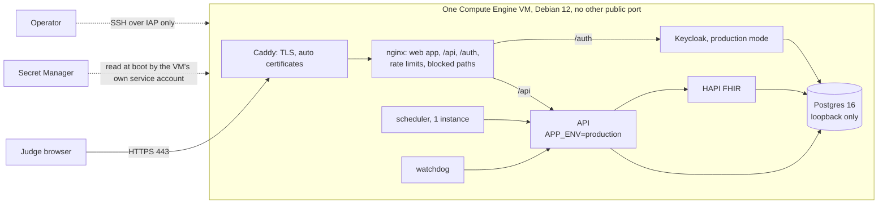

# Hosted judge demo on Google Cloud

**Status: prepared, not deployed.** Nothing in this document has been applied to any Google Cloud project. The scripts under `deploy/gcp/` create resources only when the operator runs `deploy.sh --yes-spend` after approving the cost below. The prices are **estimates**: the compute rate for Doha is from the third-party tracker [Spare Cores](https://sparecores.com/server/gcp/e2-standard-2) (observed 4 November 2026), not from Google's own price sheet; other lines are list prices as known on that date. Confirm them in the [Google Cloud pricing calculator](https://cloud.google.com/products/calculator) before approving. **The deployment itself is deferred: the user will run it later.** What is ready now is the code, the scripts and the gate; the triage model conversion and re-evaluation wait for a free machine (see "Reply triage").

**Why it exists.** The organisers said judges test the software hands-on through "a demo platform or a link", with test credentials. The user decided the product is hosted on the cloud. This is a demonstration host for **synthetic data only**. It is not a deployment claim: production would run in-country (see "Region and residency").

## What judges get

One public HTTPS URL. Sign-in with four role logins (coordinator, clinician, supervisor, patient) through a real OIDC provider. The seeded synthetic cohort (the same deterministic Synthea cohort, seed 20261017, 300 patients, as `make demo-seed`). An operator-only "reset demo".

## Architecture (recommended: Option A, one VM, Docker Compose)

The files: `deploy/gcp/compose.gcp.yml` (an overlay on the repository's own `docker-compose.yml`, so compose and Helm are untouched), `deploy/gcp/edge/` (Caddyfile, nginx template, web build image), `deploy/gcp/vm/` (what runs on the VM), `deploy/gcp/*.sh` (what the operator runs).

- **One URL.** `https://<host>/` is the web app, `/api/` the API (prefix stripped), `/auth/` Keycloak. **The host is `<ip-with-dashes>.sslip.io` for now (decided: no domain).** Caddy gets certificates itself (Let's Encrypt, ZeroSSL as automatic fallback). sslip.io is a shared domain with shared certificate rate limits, so issuance can fail in a busy week. **Custom-domain path, for later:** create an A record `demo.example.org` pointing at the static IP (printed by `deploy.sh`), then `export SC_DOMAIN=demo.example.org` before `deploy.sh`/`up.sh` (the host, the OIDC issuer, the Keycloak redirect URI and the web build all follow from it), or re-run `deploy.sh` with it set and `sc-up.sh` on the VM; nothing else changes.
- **Fail-closed production configuration.** The API runs with `APP_ENV=production`, `AUTH_MODE=oidc` with an `https://` issuer, `DEV_LOGIN_ENABLED=false`, 48-character random secrets (the API refuses anything under 32 bytes or default), `FHIR_VERIFY_EVIDENCE=true`, `OUTREACH_DEMO_APPROVAL=0`, and the one declared exception below for the clock. `tests/test_gcp_hosting.py` renders the env files and runs the API's own `secure_config_problems()` over them.
- **Simulated clock, behind an explicit demo gate (decided).** Production config normally refuses the simulation clock (`CLOCK_MODE` must be `wall`; moving a clinical safety clock is never a production affordance). The judges need to move time to see the pathway end to end, so the API has a narrow setting: `DEMO_SIMULATED_CLOCK=1` **and** `DEMO_DEPLOYMENT=1` together, with `CLOCK_MODE=sim` (`app.auth.demo_clock_problems`). One flag alone, or either with `CLOCK_MODE=wall`, refuses to start with a clear message; every other check (OIDC, https issuer, no dev login, secrets, evidence check, no demo-approval) still applies (`api/tests/test_demo_clock_gate.py` runs each of those under the gate). Under the gate only `POST /clock/advance` is registered, for the supervisor role (no `/clock/reset`; nginx also lets only that one path through), and `GET /health` reports `demo.simulated_clock`, which the web app turns into a header banner **"Demo: simulated time"** with the simulated date (`web/tests/demo_clock_banner.test.tsx`). The header's "Advance" control for the supervisor already existed. Dev behaviour and the default production behaviour are unchanged.
- **Judge logins.** Keycloak (production mode, its own database in the same Postgres) imports the committed realm with the public host as the only redirect URI and brute-force protection on. The passwords are generated by `deploy.sh` (`openssl rand`), stored in Secret Manager, and printed by `credentials.sh` for pasting into the submission. They are in no file of the repository.
- **Seeding and the production check.** The seeding scripts (`simulator/*.py`) log in with the dev login, which production refuses by design. So `seed.sh` runs the same stack once in **seed mode** (`APP_ENV=dev`, **no public listener**: Caddy is not started and every port is on 127.0.0.1), loads the cohort with the repository's default clock start (2026-01-05, as in the local demo), takes the snapshot (`tools/demo/snapshot.sh save`), then switches to production mode and opens the edge. Judges only ever reach production mode.
- **Reset demo.** `demo-reset.sh` runs `tools/demo/snapshot.sh reset` on the VM (Postgres template copy of both databases, fingerprint check; about 25 s plus the HAPI start). It is protected by IAM: only a project member allowed to SSH over IAP can run it. There is deliberately no public reset endpoint. The snapshot carries the simulated clock, so a reset also puts the date back. `snapshot.sh` got one opt-in switch, `SNAPSHOT_SKIP_CLOCK_RESET` (production has no dev login to call `/clock/reset` with, and the restore already did it); its default behaviour is unchanged.
- **Scheduler and watchdog.** Both are always-on polling loops (`scheduler/main.py`, interval 10 s; the scheduler renews a lease and every call carries a fencing token, ADR-041). Options compared: (1) Cloud Run service with min-instances=1 and CPU always allocated, (2) a Cloud Run job plus Cloud Scheduler, (3) a container on the VM. Chosen: **(3), the same VM.** Cloud Scheduler's minimum interval is one minute, which breaks the 10 s cadence and the lease TTL (30 s); a job per minute would also lose the lease between runs, defeating the fencing design. Cloud Run min-instance=1 would work (about USD 25-30 per month each at list price for 0.5 vCPU always on) but costs more than the whole VM's marginal cost and needs a private path to the API. On the VM, one scheduler holds the lease trivially and `restart: unless-stopped` plus the systemd startup script bring them back after a stop/start. The follower/failover design is not exercised (one instance, no `scale` profile); that is stated, not claimed.

## Options compared (monthly, USD, estimates, 4 Nov 2026)

730 hours a month. **Decided: me-central1 (Doha), e2-standard-2 (2 vCPU, 8 GB), budget alert USD 80.**

| Line | Basis | Monthly |
|---|---|---|
| VM e2-standard-2, Doha, on demand | USD 0.0814 per hour x 730. Source: [Spare Cores](https://sparecores.com/server/gcp/e2-standard-2) region table, observed 2026-11-04 (third party; Google's own page was not readable). Same table: europe-west4 0.0738, us-central1 0.067 | **59.4** |
| Boot disk 40 GB pd-balanced | about USD 0.12 per GB-month assumed for Doha (the US/EU list price is 0.10; the Doha rate was **not** found) | about 4.8 |
| One in-use static external IPv4 | USD 0.005 per hour, Google's flat external IP rate (from memory, not re-read) | about 3.7 |
| Secret Manager, 17 secrets | USD 0.06 per active version | about 1.0 |
| Egress | a few GB for a demo, mostly inside the free tier | under 1 |
| **Total, always on** | | **about 69** |
| **Stopped between judging windows** | disk 4.8 + the reserved but unattached IP (USD 0.01 per hour, 7.3) | **about 12** |
| Budget alert | email at 50/90/100 percent of USD 80; an alert, not a cap | |

Free-tier allowances, taxes and support plans are ignored. Google Cloud has no hard spending cap; the real guard is that the whole stack is one fixed-price VM. **Machine availability (checked against Google's [regions and zones](https://docs.cloud.google.com/compute/docs/regions-zones) table on 2026-11-04, not against your project):** E2 is listed in all three Doha zones (`me-central1-a`, `-b`, `-c`); `preflight.sh` confirms the type in the chosen zone with your project once you are signed in. The default zone is `me-central1-a`.

Alternatives considered (estimates, from the earlier comparison): **cheapest viable**, e2-medium (1 shared vCPU, 4 GB), about USD 34-38 in Doha: too tight now that the triage model (about 1.2-1.7 GB) joins HAPI, Keycloak and Postgres, so it is no longer recommended. **Spot** VM about 24-29: a preemption in the judging window is a failed demo. **Cloud Run + Cloud SQL** about 150-200: HAPI and Keycloak are JVM services that need to stay warm and the scheduler is a lease-based loop (always-on Cloud Run instances cost about 25-30 each), so it costs three times as much for a worse judge experience. **GKE** 130+: the Helm chart has no FHIR server or identity provider.

Memory on the 8 GB VM, rough: HAPI (1.5 GB heap, about 2.2 resident), Keycloak 0.9, Postgres 0.4, API 0.3, llama.cpp with Q8_0 about 1.7 (Q5_K_M about 1.2), the rest 0.4: about 6 GB, plus 2 GB swap as a safety net. To be confirmed by the first seed on the real VM.

"Scale to near zero when idle" means **stop the VM** between judging windows (`gcloud compute instances stop`; start brings the stack back by itself, certificates and data persist).

## Region and residency

| Region | Where | Fit | Cost | Notes |
|---|---|---|---|---|
| **me-central1 (chosen)** | Doha | about 10-20 ms from the UAE | USD 0.0814/h (e2-standard-2) | E2 in zones a, b, c. |
| me-central2 | Dammam | about 10-25 ms | USD 0.1072/h per the same tracker | Dearer. |
| europe-west4 | Netherlands | about 110-140 ms | USD 0.0738/h | Cheapest of the three. |

Google Cloud has **no UAE region**. The data in this demo is synthetic (Synthea, seeded random), so residency is not a blocker for a demonstration, and nothing real may be entered into it. **Production would run in-country**: Azure UAE North (the Bicep and Helm templates and the capacity plan, [docs/results/scale.md](../results/scale.md), [deployment.md](deployment.md)) or Core42, after the DoH authorisation described in [deployment.md](deployment.md) (ADHICS CM 4.2; ADR-026). This GCP host is a demo environment and not an alternative production target; no health information may be put on it.

## Reply triage in the cloud: decision (a), the converted model

**Decided by the user: option (a).** The hosted demo runs **the same fine-tuned model** (Qwen2.5-1.5B-Instruct plus the committed LoRA), converted to GGUF and run on the VM's CPU by llama.cpp. No third-party AI is called; patient reply text never leaves our server. Option (b) (keyword gate and "unavailable") remains the automatic fail-safe if the model service is down, and (c) (Claude) was rejected.

How it is built (all scripts exist; **the conversion and the evaluation have not been run yet**, they are CPU-heavy and wait for a free machine):

1. **Merge, offline** (`tools/triage/convert_gguf.sh`): `mlx_lm fuse --dequantize` on the local 4-bit base and the committed adapter writes fp16 weights with the LoRA merged. No download.
2. **Convert and quantize**: llama.cpp's `convert_hf_to_gguf.py` makes an f16 GGUF; `llama-quantize` makes **Q8_0** and **Q5_K_M**. One-time installs on the Mac, approved: `torch` and `gguf` into `tools/triage/.venv` (`pip install torch <llama.cpp>/gguf-py`), `brew install llama.cpp`, and a shallow checkout of llama.cpp for the converter script (all gitignored; the script checks and installs nothing).
3. **Honest caveat**: the local base is already MLX 4-bit; fusing dequantizes it and GGUF quantization quantizes again. The converted model is a different artefact, hence the next step.
4. **Re-evaluate on the same splits with the same scripts** (`tools/triage/evaluate_gguf.py`, `make triage-gguf-eval`): it runs a local llama-server on each GGUF, scores the validation and test splits through the exact scorer the host uses (`LlamaServerScorer`, same prompt, same nine label tokens, next-token log-probabilities), reuses `tools/triage/evaluate.py` unchanged for temperature, threshold, accuracy, macro F1, auto-handled precision and coverage with intervals, ECE, and opt-out leakage, and reuses `tools/rai/fairness.py` for the per-language (ar, en, arabizi, mixed) and per-dialect (MSA, Gulf) results through the deployed path, with the dialect rule (`api/app/triage/dialect.py`) on and off. The report puts three columns side by side: MLX (the committed `eval.json`), the GGUF with the MLX calibration untouched, and the GGUF re-fitted. The plumbing was checked by feeding it the MLX scores themselves, which reproduces the MLX numbers exactly. **Before and after numbers: pending the run.**
5. **Choosing the quantization**: both are scored; promote the one closest to the MLX model (expected: Q8_0; Q5_K_M if the difference is within the intervals and memory matters): `evaluate_gguf.py --quant <X> --reuse-scores --promote` writes `api/app/triage/calibration_gguf.json`.
6. **Re-fitting**: if accuracy or calibration drops materially, the temperature and threshold are re-fitted the documented way (temperature on validation by minimum NLL; the smallest threshold at which what the system handles itself reaches 97 percent precision on validation, target 95 percent on test), and the Arabizi group threshold is re-fitted on this build's validation split with `fairness.py`'s own function; if it differs from the MLX 0.918 it travels in the calibration as `group_thresholds` (supported by `dialect.apply_group_rule(..., thresholds)`; the MLX defaults are unchanged). The report says which happened.

Serving: `triage-llama` (the `ghcr.io/ggml-org/llama.cpp:server` image, the GGUF mounted read-only, 2 threads, no published port) and `triage` (`python -m app.triage.gguf_server`) which speaks the existing triage-server contract (`POST /classify`, `GET /health`, as `make triage-serve`), applies the opt-out gate first, this build's calibration, and the dialect rule. The API calls it through `TRIAGE_REMOTE_URL=http://triage:8765` and re-checks the confidence and group rule itself with the same `TRIAGE_CALIBRATION_PATH`. Unreachable, slow (2 s) or malformed means the existing fail-safe: the reply goes to a person. The image tag `server` should be pinned to a digest after the first pull (set `TRIAGE_LLAMA_IMAGE`).

Labelling: the hosted web build says "On-premises model (runs on our server, no cloud AI)" in the reply form, and every `reply_classified` event carries the model id `qwen2.5-1.5b-<quant>-gguf+lora-<adapter hash>`, so the GGUF build is visible in the case timeline. The model card ([model-cards/reply-triage.md](model-cards/reply-triage.md)) has a section for the hosted build; its numbers are filled from the evaluation report when it has run. Wording used: same fine-tuned model, converted to run on our cloud server, no third-party AI. The Arabic remains developer-written and unreviewed by native speakers; the evaluation is synthetic and split by template.

## Claude drafting

`LLM_CACHE_MODE=replay`, `LLM_NETWORK_ENABLED=false`, `LLM_DAILY_TOKEN_BUDGET=0` (a zero spend cap on top of the network switch), and **no `ANTHROPIC_API_KEY` at all**; the key, if ever wanted, would live in Secret Manager and is never printed by anything here. Recorded outputs in `api/app/ai/cache/` replay; a prompt with no recording gets the deterministic template with the abstention reason `cache_miss`. **Do the recordings hit?** They are keyed by prompt content, and the prompts carry case facts and simulated dates. The hosted demo now seeds the same synthetic cohort (fixed Synthea seed) on the same default simulation clock start as the local demo and keeps a simulated clock, so the prompts for the same actions are the same and the recordings should hit; this follows from the design and the existing replay tests, **but it has not been measured end to end**: after seeding, run the demo scenario against the host (`tools/demo/scenario.py`) and count `cache_miss` abstentions. (With the earlier wall-clock idea, hits were not expected; that is why the clock decision matters.) If live drafting is ever wanted: a key in `sc-demo-anthropic-key`, `LLM_NETWORK_ENABLED=true`, `LLM_CACHE_MODE=record` and a small `LLM_DAILY_TOKEN_BUDGET`; a separate approval.

## Differences from the local demo (say so to the judges)

- **Outreach policy stays unsigned.** Production forbids the demo placeholder approval, so the automatic outreach path sends nothing; messages are drafted for a person to approve. The clinical lead's signature (H1) is not ours to forge.
- **Simulated time** (banner "Demo: simulated time"): all dates are the demo clock's; a supervisor advances it. This is the decided trade-off; production would use real time.
- **One scheduler, no failover** (above), single VM, no high availability, no backups beyond the reset snapshot. It is a demo.
- **Reply triage** is the converted CPU build of the same model, not the MLX build, with its own measured numbers.

## Security

- HTTPS only: Caddy redirects HTTP, HSTS is set; Keycloak refuses non-HTTPS from outside (`sslRequired=external`, proxy headers).
- Network: GCP firewall allows 80/443 from anywhere and SSH **only from the IAP range** (35.235.240.0/20); OS Login on; Shielded VM. Postgres, HAPI, the API and the triage services (no published port at all) are bound to 127.0.0.1 or the private compose network (checked by `tools/check/compose_lint.py`: the overlay's only public publish is Caddy, asserted in tests). No public database.
- Least privilege: the VM runs as its own service account with **no project roles**; it holds `secretmanager.secretAccessor` on the 17 `sc-demo-*` secrets only. The scheduler and watchdog get only their own token and no database credentials; Keycloak has its own database role; the API uses the unprivileged `closure_app` role; the migrate job alone holds the owner credentials (existing design, unchanged).
- Secrets: generated in `deploy.sh` with `openssl rand -hex 24`, written straight into Secret Manager (nothing on disk, nothing printed); the VM renders `/etc/sc/*.env` (root, 0600) at boot. No secret in the repository, an image, or instance metadata.
- Rate limiting on the public API: nginx `limit_req` per visitor (10 requests/s with a burst of 40 on `/api/`, 5/s on `/auth/`), 30 concurrent connections, 256 KB request bodies, plus the API's own load shedding (`MAX_INFLIGHT_REQUESTS=40`). Not a DDoS defence (no Cloud Armor; that needs a load balancer, about 18 USD a month more).
- Blocked at the edge: `/api/scheduler`, `/api/watchdog`, `/api/hl7`, `/api/metrics`, `/api/auth/dev-login`, every `/api/clock` path except `/api/clock/advance`, Keycloak's admin console and master realm.
- Budget alert: email at 50, 90, 100 percent of `SC_BUDGET_USD` (alert, not a cap).
- Not covered: WAF, DDoS protection, vulnerability scanning of images, log export, MFA for the demo logins, patching beyond Debian's unattended upgrades. Images are built on the VM from the committed tree (no registry), and the pinned Caddy and Keycloak versions are the repository's.

## Step-by-step: what the operator runs (later; deployment is deferred)

Everything below is run by you in a terminal. The agent that prepared this did not sign in, create a project, enable an API or create any resource.

**Before that, on the Mac, once the machine is free (the triage model; about 6 GB of disk during conversion):**

1. `tools/triage/.venv/bin/pip install torch` and `brew install llama.cpp`; `git clone --depth 1 https://github.com/ggml-org/llama.cpp tools/triage/llama.cpp`; `tools/triage/.venv/bin/pip install tools/triage/llama.cpp/gguf-py`.
2. `make triage-gguf` (merge, convert, quantize Q8_0 and Q5_K_M into `tools/triage/gguf/`, git-ignored).
3. `make triage-gguf-eval`, read `docs/results/triage/eval-gguf-*.md`, pick the build, then `tools/triage/.venv/bin/python tools/triage/evaluate_gguf.py --quant <Q8_0|Q5_K_M> --reuse-scores --promote`; fill the numbers into the model card; commit `calibration_gguf.json` and the reports.

**Then the deployment:**

1. gcloud is installed at `/opt/homebrew/share/google-cloud-sdk` (otherwise `brew install --cask gcloud-cli`).
2. Sign in, in the browser: `gcloud auth login`
3. Create or choose a project in the console and link billing there, then `gcloud config set project <PROJECT_ID>`. Defaults are already set to me-central1-a, e2-standard-2, a USD 80 alert and sslip.io.
4. Read-only check: `deploy/gcp/preflight.sh`
5. **One command (spends money; approve the cost first):** `make gcp-up` (= `deploy/gcp/up.sh --yes-spend`). It runs preflight, `deploy.sh --model tools/triage/gguf/triage-q8_0.gguf` (APIs, service account with no roles, 17 generated secrets, firewall, static IP, VM, budget alert, delivery of the committed tree and the model), `seed.sh` (builds the images, generates the cohort, takes the snapshot, switches to production mode), `smoke-test.sh`, then prints the judge logins once with `credentials.sh`. Use `SC_QUANT=q5_k_m make gcp-up` for the other build, or `deploy/gcp/up.sh --yes-spend --no-model` to skip triage. About 45-75 minutes the first time; every step is idempotent, so re-running continues.
6. Individual steps if you prefer: `deploy/gcp/deploy.sh --yes-spend --model <file>`, `deploy/gcp/seed.sh`, `deploy/gcp/smoke-test.sh`, `deploy/gcp/credentials.sh` (paste into the submission).
7. Reset demo whenever needed: `make gcp-reset` (IAM-protected over IAP SSH).
8. Between judging windows: `gcloud compute instances stop sc-demo --zone me-central1-a`, and `start` (the stack returns in 2-3 minutes).
9. Tear down when judging is over: `make gcp-down` (asks for the project id), or `gcloud projects delete <PROJECT_ID>`.

To ship a newer commit: commit, run `deploy/gcp/deploy.sh --yes-spend` again (idempotent; keeps the data volume), then `gcloud compute ssh sc-demo --tunnel-through-iap --zone me-central1-a --command 'sudo /srv/sc/repo/deploy/gcp/vm/sc-up.sh'`.

## What needs your approval

- **Cost**: about USD 69 a month always on, about 12 stopped (Doha, e2-standard-2, estimates above); the alert at USD 80. A project with billing linked. To be confirmed with the user before `gcp-up`.
- **Downloads on the Mac for the triage conversion (already approved by the user)**: PyTorch and the `gguf` package into the triage venv, `brew install llama.cpp`, a llama.cpp checkout. Anything else, or well over 2 GB in total, needs a new approval.
- **Downloads on the VM** (not the Mac): Docker's apt repository, container images (Postgres, HAPI, Keycloak, Caddy, nginx, Node, Python, llama.cpp server), npm packages for the web build, the Synthea v3.3.0 jar from GitHub (inside a container).
- **Live Claude drafting** (optional, off): an Anthropic key in Secret Manager and a token budget.

## Not verified yet

Run so far (quick, no cloud, no Docker build): `tests/test_gcp_hosting.py` (env rendering against the API's production check, overlay structure, edge rules, script syntax, honest labels), `api/tests/test_demo_clock_gate.py` (the clock gate, including every other check under it and the route/health surface), `api/tests/test_triage_gguf.py` (the llama-server scorer against a fake server, the service contract, the calibration switch and group thresholds), `web/tests/demo_clock_banner.test.tsx`, `tsc --noEmit`, and the compose-merge parse. **Not run, waiting for a free machine or for the deployment:** the GGUF conversion and its evaluation (so no accuracy numbers yet), the real `llama-server` response shape against `LlamaServerScorer` (written for the current `completion_probabilities` format; the evaluation is its first real test), the Docker builds, the Keycloak production-mode start and its hostname/proxy settings, certificate issuance, the seed on a 2 vCPU VM, the recorded-draft hit rate, and the reset in production mode. `smoke-test.sh` is the first end-to-end check and is expected to need one round of fixes on first contact.
