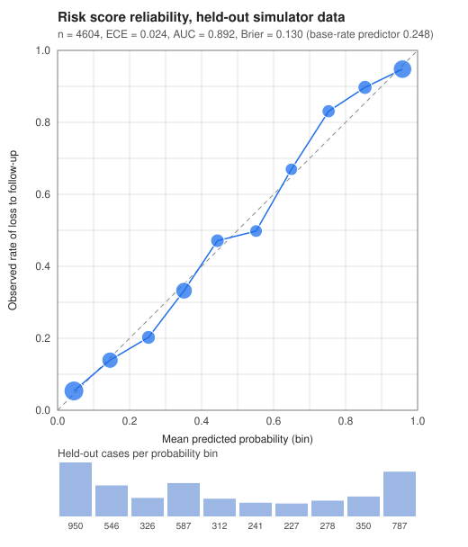

# Risk score card

Loss-to-follow-up risk score for the coordinator worklist (tickets D8, D9, D10). A model card in the sense of "what it is for, what it was trained on, how well it works, where it fails, how it is retrained". Related: [AI boundary](ai-boundary.md) (the language-model side), [decision matrix](decision-matrix.md), [training report](../results/risk/training.md), [regulatory mapping](regulatory-mapping.md).

**Status: a demonstration of the pattern, not a validated model.** It is trained on synthetic data produced by our own behaviour simulator, so it has learned the simulator's assumptions and nothing about real patients. Do not quote its numbers as evidence of clinical or operational performance.

## 1. Intended use

One use: **ordering the coordinator's worklist**. `GET /cases` carries `risk_score`, a number between 0 and 1: the modelled probability that the case ends with no colonoscopy within 180 days of the result. The worklist shows cases past their deadline first (SLA breach), and uses the score to order cases within that. `GET /cases/{id}` carries `risk` with the same score and the three features that moved it most, so a coordinator can see why a case ranks where it does.

The score is read by staff roles only. A patient's worklist rows and case page carry `null`.

## 2. Not for

- **Closing a case.** Closure needs evidence and a human clinician's sign-off, whatever the score says.
- **Escalating a case, raising or lowering an SLA, or starting any automated action.** The sweep and the watchdog do not read the score.
- **Any care decision**: whether, when or how a patient is investigated or treated, or how urgent a clinical need is.
- **Excluding a case from follow-up.** A low score does not make a case safe to leave; every open case has its owner, its timers and its ladder regardless.
- **Patient-facing use**, staff performance measurement, or allocating resources between providers.
- **Use on real patients** before it is retrained and validated on real data under the procedure in section 8.

### How the rule is enforced in code (T-D10)

The score is computed in one place and read nowhere. `app.risk` is imported only by `api/app/routers/cases.py`, and the name `risk_score` appears nowhere else in `api/app` as a read (an AST scan fails the build otherwise, `api/tests/test_risk_boundary.py`). Inside the router it is only assigned to the response. Dynamic proof: the same seeded world is run with the real score, with the model switched off, with a constant score and with a random score, and every case log, every read model and the order of the worklist come out identical (a hypothesis property test). A model that cannot be loaded leaves `risk_score` null and does not break the worklist. The API never sorts by the score: sort order is the web's concern.

## 3. Training data

Everything is synthetic, from the behaviour simulator (`simulator/sim/`, [README](../../simulator/README.md)).

- **Scenario**: the orchestrated arm of the literature-anchored scenario (the one the results quote), 20,000 cases, seed 20261017, each followed for 180 days. 55% of its cases get the full orchestrated process (`programme_reach`) and 45% follow today's process, so the data contain both kinds of case.
- **Rows**: one snapshot per case, at a random day in the first 90 days after the result; what the worklist could have known on that day becomes the features. Cases whose colonoscopy is already done at the snapshot are not at risk and are left out (the score is 0.0 for them at serving time).
- **Label**: no colonoscopy within 180 days of the result.
- **Split**: 70% training, 30% held-out, assigned by a hash of the case key.
- **Parameters**: most simulator parameters are placeholders (88 of 132 are `assumed` at the time of writing; see [results](../results/results.md)). The relationships the model finds, for example that a withdrawn consent is the strongest predictor of loss, are the simulator's own assumptions played back.

The full provenance (parameter hash, row hash, coefficient hash, iterations) is in [`api/app/risk/model.json`](../../api/app/risk/model.json) and the [training report](../results/risk/training.md).

## 4. Features

All are known while the case is open and before a colonoscopy has happened. The same code ([`api/app/risk/features.py`](../../api/app/risk/features.py)) builds them from a simulated event log for training and from a case's read model and events for serving; a parity test feeds the same story in both event vocabularies.

| Feature | What it is | Where it comes from when serving |
|---|---|---|
| `stage` | Pathway stage before the colonoscopy: result received, acknowledged, owner accepted, patient contacted, patient acknowledged, confirmatory booked. A rejected referral counts as patient acknowledged, lost contact as patient contacted, consent withdrawn as the stage it interrupted. | The read model's state. |
| `days_since_result` | Days from the result to now, at most 90 | Genesis event time and the simulation clock. |
| `prior_escalations` | Escalations so far, at most 3 | `escalate` events. |
| `prior_bounces` | Handoffs rejected or timed out so far, at most 3 | `handoff_rejected` events. |
| `consent_withdrawn` | The patient's latest consent update withdraws consent | `consent_updated` events. |
| `provider_changed` | The case was transferred to another provider | A second `handoff_accepted`, or a `reassign`. |
| `contact_valid` | No known contact problem | The `contact_valid` flag on the case at creation. |
| `language`, `channel` | The patient's language (ar, en, other) and preferred channel | No registry feeds these yet: taken from the log when it shows them (`patient_acknowledge.lang`, `contact_patient.channel`), otherwise unknown. |
| `age_band` | 40-49, 50-59, 60-69, 70-75 | Unknown today. |

**Unknown values.** A feature that is unknown for a case is encoded at its training mean, so it adds exactly nothing relative to an average patient. Today the API knows none of age band and little of language and channel, so the served score rests on stage, days, escalations, bounces, consent, provider change and the contact flag. The performance table below includes the held-out result with language, channel and age band unknown, which is what the API serves today.

**Features that the brief or the pathway suggests and the simulator cannot support.** The simulator has no ages, so the age band is drawn by the exporter from its own random stream, independent of every behaviour: it is a null feature by construction. Its coefficients are about zero, which is the check that the pipeline does not invent signal. The simulator has no provider identities and no per-channel consent, so neither is a feature (`provider_changed` stands for the provider). Consent is the single withdrawal flag.

## 5. Performance

Measured on the held-out split of synthetic data. Generated by `python -m simulator.sim.export_training`.

<!-- risk:performance:begin -->
| Measure (held-out split) | Value |
|---|---|
| Held-out cases | 4552 (of 15195 rows from 20000 simulated cases) |
| Prevalence of loss to follow-up | 44.0% (training split 44.7%) |
| AUC | 0.8938 |
| Brier score | 0.1275 |
| Brier score of the base-rate predictor | 0.2464 |
| Brier skill score (1 minus the ratio) | 0.4824 |
| Expected calibration error (ECE, 10 equal-width bins) | 0.0220 |
| ECE of a perfectly calibrated model at this sample size (mean, 95th percentile) | 0.0129, 0.0185 |
| Tolerance: ECE at or below 0.05 | met |
| As served today, with language, channel and age band unknown (AUC, Brier, ECE) | 0.8938, 0.1278, 0.0184 |

The calibration tolerance is met: ECE 0.0220 is at or below 0.05, and the Brier score is better than the base-rate predictor.
<!-- risk:performance:end -->

The tolerance for calibration, ECE at or below 0.05 on the held-out set, was proposed in ticket D10 and confirmed after the first fit. ECE is the count-weighted mean absolute gap between the mean predicted probability and the observed rate over ten equal-width probability bins. The chance level shown is what a perfectly calibrated model would score at this sample size; the observed ECE sits just above it, with the gaps in the 0.5 to 0.8 bins, which is consistent with a linear-logit model that cannot represent the interaction between stage and days. Most of the discrimination comes from stage, days since the result and consent withdrawal: a case that stays early in the pathway for a long time is lost more often.

### Calibration

<!-- risk:calibration:begin -->
| Bin | Predicted range | Cases | Mean predicted | Observed rate | Absolute gap |
|---|---|---|---|---|---|
| 1 | 0.0 to 0.1 | 1018 | 0.0436 | 0.0481 | 0.0045 |
| 2 | 0.1 to 0.2 | 533 | 0.1439 | 0.1482 | 0.0044 |
| 3 | 0.2 to 0.3 | 366 | 0.2536 | 0.2213 | 0.0323 |
| 4 | 0.3 to 0.4 | 590 | 0.3504 | 0.3254 | 0.0250 |
| 5 | 0.4 to 0.5 | 268 | 0.4444 | 0.4627 | 0.0183 |
| 6 | 0.5 to 0.6 | 227 | 0.5493 | 0.4890 | 0.0603 |
| 7 | 0.6 to 0.7 | 218 | 0.6490 | 0.6743 | 0.0253 |
| 8 | 0.7 to 0.8 | 254 | 0.7527 | 0.8504 | 0.0976 |
| 9 | 0.8 to 0.9 | 325 | 0.8539 | 0.8862 | 0.0322 |
| 10 | 0.9 to 1.0 | 753 | 0.9594 | 0.9495 | 0.0098 |

<!-- risk:calibration:end -->

## 6. Fairness check by language and channel

ECE and AUC per group on the held-out split, with the ECE a perfectly calibrated model would show at the same group size ("chance ECE", 95th percentile of 100 simulated draws). Age band is included as the null-feature check.

<!-- risk:fairness:begin -->
| Group | Value | Held-out cases | Prevalence | AUC | ECE | Chance ECE (95th percentile) | Brier |
|---|---|---|---|---|---|---|---|
| Language | ar | 2097 | 45.6% | 0.8972 | 0.0278 | 0.0274 | 0.1258 |
| Language | en | 1543 | 39.6% | 0.8922 | 0.0245 | 0.0325 | 0.1262 |
| Language | other | 912 | 47.7% | 0.8857 | 0.0344 | 0.0426 | 0.1338 |
| Preferred channel | sms | 1809 | 43.9% | 0.8936 | 0.0196 | 0.0278 | 0.1280 |
| Preferred channel | whatsapp | 1335 | 43.9% | 0.8972 | 0.0231 | 0.0334 | 0.1250 |
| Preferred channel | phone | 699 | 45.2% | 0.8991 | 0.0317 | 0.0505 | 0.1231 |
| Preferred channel | letter | 709 | 43.0% | 0.8816 | 0.0408 | 0.0472 | 0.1356 |
| Age band | 40-49 | 1255 | 44.9% | 0.8797 | 0.0272 | 0.0361 | 0.1363 |
| Age band | 50-59 | 1260 | 43.2% | 0.8965 | 0.0248 | 0.0366 | 0.1261 |
| Age band | 60-69 | 1287 | 45.7% | 0.9013 | 0.0294 | 0.0365 | 0.1239 |
| Age band | 70-75 | 750 | 40.8% | 0.8995 | 0.0408 | 0.0431 | 0.1217 |

Largest gap between groups (maximum minus minimum): language AUC 0.012, ECE 0.010; channel AUC 0.018, ECE 0.021; age band AUC 0.022, ECE 0.016.
<!-- risk:fairness:end -->

How to read it. The score ranks cases about equally well in every group (the AUC gaps are the last line of the table), and calibration within each group is close to the chance level for its size, so the score does not systematically under-predict risk for Arabic speakers, for "other" language speakers or for any channel in this synthetic population. This is a check of the pipeline, not of fairness in the world: the simulator makes language and channel matter only through response probabilities, and it contains no other source of inequity. The model does use language and channel, with small coefficients next to stage, days and consent (table below); ordering by the score therefore ranks, other things equal, a patient with a lower assumed response rate slightly higher, which is the intended effect, and any retrain must repeat this table.

## 7. Coefficients

Log-odds per column. Numeric columns are standardised on the training split, so their coefficients are per standard deviation. A positive coefficient raises the score.

<!-- risk:coefficients:begin -->
| Column | Coefficient (log-odds) | Odds ratio | Unit |
|---|---|---|---|
| intercept | 0.3662 | n/a | baseline logit for an all-zero row |
| language=ar | 0.0658 | 1.068 | 1 if true, else 0 |
| language=en | -0.0890 | 0.915 | 1 if true, else 0 |
| language=other | 0.0233 | 1.024 | 1 if true, else 0 |
| channel=sms | 0.0516 | 1.053 | 1 if true, else 0 |
| channel=whatsapp | 0.0280 | 1.028 | 1 if true, else 0 |
| channel=phone | 0.1005 | 1.106 | 1 if true, else 0 |
| channel=letter | -0.1801 | 0.835 | 1 if true, else 0 |
| age_band=40-49 | -0.0249 | 0.975 | 1 if true, else 0 |
| age_band=50-59 | 0.0329 | 1.033 | 1 if true, else 0 |
| age_band=60-69 | -0.0258 | 0.975 | 1 if true, else 0 |
| age_band=70-75 | 0.0179 | 1.018 | 1 if true, else 0 |
| contact_valid | -0.1137 | 0.893 | 1 if true, else 0 |
| stage=result_received | 1.1172 | 3.056 | 1 if true, else 0 |
| stage=acknowledged | 1.2295 | 3.419 | 1 if true, else 0 |
| stage=owner_accepted | 0.6975 | 2.009 | 1 if true, else 0 |
| stage=patient_contacted | 1.4064 | 4.081 | 1 if true, else 0 |
| stage=patient_acknowledged | -0.8843 | 0.413 | 1 if true, else 0 |
| stage=confirmatory_booked | -3.5663 | 0.028 | 1 if true, else 0 |
| days_since_result | 1.3783 | 3.968 | per 1 SD (24.53; mean 37.87) |
| prior_escalations | -0.1030 | 0.902 | per 1 SD (1.09; mean 0.62) |
| prior_bounces | 0.2086 | 1.232 | per 1 SD (0.63; mean 0.22) |
| consent_withdrawn | 2.1424 | 8.520 | 1 if true, else 0 |
| provider_changed | -0.4201 | 0.657 | 1 if true, else 0 |
<!-- risk:coefficients:end -->

## 8. Limits and retraining

### Limits

- **Synthetic, and therefore not validated.** Nothing here says how the score behaves on real patients. A real pilot would measure it against outcomes (section 8).
- **The simulator's assumptions are the model's assumptions.** If a parameter changes, the relationships change; a test fails when the simulator parameters no longer match the ones the committed model was trained on.
- **Linear in the log-odds.** No interactions: the mid-range gaps in the calibration table are the visible cost.
- **Snapshots in the first 90 days only.** Cases older than that are scored with the days feature held at its cap.
- **A prediction of "no colonoscopy by day 180", not of harm.** Delay can harm before day 180, and a colonoscopy at day 179 counts as success.
- **No capacity, no clinical content.** Endoscopy slots, bowel preparation failures and findings are not modelled.
- **Feedback.** If the worklist order improves follow-up, the data that a retrain would see change. Retrain only from data collected under a documented ordering policy.
- **Missing attributes.** Language, channel and age band are unknown in the API today and imputed at the training mean.
- **Per-case explanation is not causal.** `top_factors` are contributions to the log-odds relative to an average training patient, not reasons the patient was lost.

### Retraining procedure

1. Change nothing by hand in `api/app/risk/model.json`. It is generated.
2. Make the change (simulator parameters, the feature set in `api/app/risk/features.py`, or the training settings in `simulator/sim/export_training.py`).
3. Run `make risk-report` (`PYTHONPATH=api:. .venv/bin/python -m simulator.sim.export_training` from the repository root). It reruns the simulator from the seed, refits, validates on the held-out split and rewrites `model.json`, `docs/results/risk/` and the generated blocks of this card. Two runs on the same inputs write identical bytes (T-D11); `make risk-check` (`... --check`) fails if a committed file differs from a fresh run (T-D12) and is a stage of `make check`.
4. Read the generated report. Accept the new model only if the calibration tolerance (ECE at or below 0.05) is met or explicitly waived in this card, the Brier score beats the base-rate predictor, AUC has not fallen without an explanation, the age-band coefficients are still about zero, and the fairness table shows no group with a markedly worse AUC or an ECE well above its chance level.
5. Update the prose in this card that depends on the numbers (the reading of the calibration table and of the coefficients), and add a line to `project/LOG.md`.
6. Run `make check`. The tests that guard the pattern are `api/tests/test_risk_*.py` and `simulator/tests/test_risk_training.py`.
7. Roll back by reverting the commit: the API reads `model.json` at start-up.

**Retraining on real data (not done).** Replace the exporter's input with a registry extract of the same features and the same label, keep the split and the report, and treat it as a new model: a documented ordering policy during data collection, review of the fairness table by the programme, and sign-off by the clinical safety owner before the score is shown to staff. The training data must come from the provider's environment and never from anywhere else (see [regulatory mapping](regulatory-mapping.md)).

**Monitoring in a pilot.** Compare the score at the time a case first appears with its outcome at 180 days, in the same calibration table, per language and channel, every month; any group whose ECE leaves its chance band is a reason to stop using the score for ordering until it is understood.
