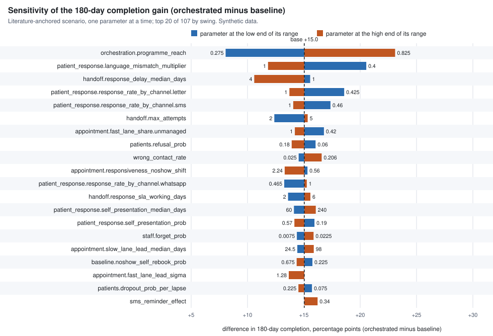

# Parameter sensitivity: how much do the results lean on each assumption?

Generated by `make sensitivity` from [`sensitivity.json`](sensitivity.json); do not edit by hand. Reproduce with `make sensitivity`, verify with `make sensitivity-check`. All data are synthetic.

- Design: one at a time: each parameter with a range moved to its low end and to its high end, all others held at the base case. Base case: the literature anchored scenario (`params.yaml`, `params.conservative.yaml`), parameter-and-range hash `5037c25ac14cf7aa`.
- Seed 20261017; 5 replications x 1,000 cases x 360 days of follow-up at every point; 103 parameters, 207 points (base plus low and high for each). The same patients and random numbers are used at every point, so differences between points come from the parameter, not from sampling.
- Base case: baseline 52.9% and orchestrated 66.3% complete within 180 days (difference +13.4 points); 61.7% against 47.2% still open at 90 days; silent loss 43.6% against 22.4%. These come from 5 x 1,000 cases, so they differ slightly from the 20 x 2,000 figures in [`results.md`](results.md).

## Reading

The headline is the gain in 180-day colonoscopy completion from the orchestrated process over today's process, in the literature-anchored scenario: **+13.4 percentage points** in the base case. Each of the 103 parameters with a plausible range was moved to the low and to the high end of it, one at a time, with every other parameter held at the base case.

**Which five parameters dominate.** In order of swing in the 180-day completion difference:

1. `orchestration.programme_reach` (share of orchestrated-arm cases that actually get the orchestrated process): swing 13.4 points, from +7.4 at its low end (0.25) to +20.8 at its high end (0.75); base value 0.5.
2. `patient_response.language_mismatch_multiplier` (response penalty when the message is not in the patient's language): swing 8.1 points, from +18.5 at its low end (0.4) to +10.5 at its high end (1); base value 0.8.
3. `handoff.response_delay_median_days` (median days the receiving service takes to answer a referral): swing 7.0 points, from +14.1 at its low end (1) to +7.1 at its high end (4); base value 2.
4. `patient_response.response_rate_by_channel.letter` (chance a patient acts on one letter): swing 4.9 points, from +16.9 at its low end (0.425) to +12.0 at its high end (1); base value 0.85.
5. `patient_response.response_rate_by_channel.sms` (chance a patient acts on one SMS): swing 4.2 points, from +16.7 at its low end (0.46) to +12.5 at its high end (1); base value 0.92.

`orchestration.programme_reach` is the parameter that was fitted so the literature-anchored scenario reproduces the published navigation effect (ratio 1.27), so its place at or near the top is built in: the headline scales with how many cases the programme reaches, and the published average effect alone cannot separate that share from the size of the effect on the cases that are reached.

**Does the direction ever flip? No.** In all 206 one-at-a-time runs the orchestrated arm completes more colonoscopies within 180 days than baseline. The smallest gain is +7.1 points (`handoff.response_delay_median_days` at its high end). The other two outcomes agree on direction: the share of cases still open at 90 days: never worse than baseline in any run; silent loss (programme level): never worse than baseline in any run.

**Range of the headline difference.** Across all sweeps the 180-day completion difference runs from +7.1 points (`handoff.response_delay_median_days`, high end) to +20.8 points (`orchestration.programme_reach`, high end), against +13.4 in the base case. Between replications the base case itself varies by a standard deviation of 1.4 points (standard error 0.6), so swings much smaller than that are noise.

**How far to trust this.** It is one-at-a-time: interactions between parameters are not explored. Where no published range exists the range is a mechanical rule (plus or minus 50 percent for rates, halved and doubled for durations; see Method), not evidence, so a parameter that tops the chart because its rule-made range is wide has not been shown to matter in the world. Calibrated parameters are moved without recalibrating the baseline, so their swings include moving the baseline away from the published completion curve. The ranking says which assumptions the result leans on and so where evidence is worth buying first; it is not a forecast.

## Tornado

The chart shows the top 20 of 103. Each bar runs from the headline difference with the parameter at its low end to the difference with it at its high end, through the base case (dashed line).

Sorted by the swing in the 180-day completion difference (orchestrated minus baseline, percentage points). Swing = max minus min of the orchestrated-minus-baseline difference over the parameter's low end, the base case and its high end. The silent-loss and open-at-90 columns are the same swing computed on those outcomes (silent loss at programme level, all cases).

| # | Parameter | Status | Base | Low to high | Difference at low (pp) | Difference at high (pp) | Swing, 180-day completion (pp) | Swing, silent loss (pp) | Swing, open at 90 days (pp) |
|---|---|---|---|---|---|---|---|---|---|
| 1 | `orchestration.programme_reach` | calibrated | 0.5 | 0.25 to 0.75 | +7.4 | +20.8 | 13.4 | 21.8 | 14.5 |
| 2 | `patient_response.language_mismatch_multiplier` | calibrated | 0.8 | 0.4 to 1 | +18.5 | +10.5 | 8.1 | 6.8 | 7.8 |
| 3 | `handoff.response_delay_median_days` | assumed | 2 | 1 to 4 | +14.1 | +7.1 | 7.0 | 0.1 | 6.6 |
| 4 | `patient_response.response_rate_by_channel.letter` | calibrated | 0.85 | 0.425 to 1 | +16.9 | +12.0 | 4.9 | 4.8 | 4.4 |
| 5 | `patient_response.response_rate_by_channel.sms` | calibrated | 0.92 | 0.46 to 1 | +16.7 | +12.5 | 4.2 | 4.6 | 3.1 |
| 6 | `handoff.max_attempts` | assumed | 4 | 2 to 5 | +10.3 | +14.0 | 3.7 | 0.0 | 2.7 |
| 7 | `staff.delay_sigma` | assumed | 0.8 | 0.4 to 1.6 | +13.5 | +16.1 | 2.7 | 0.7 | 6.5 |
| 8 | `wrong_contact_rate` | sourced-adjacent | 0.08 | 0.025 to 0.206 | +12.8 | +15.0 | 2.2 | 3.5 | 1.2 |
| 9 | `patient_response.self_presentation_median_days` | calibrated | 120 | 60 to 240 | +12.4 | +14.4 | 2.0 | 1.2 | 0.8 |
| 10 | `handoff.response_sla_working_days` | assumed | 3 | 2 to 6 | +12.0 | +14.1 | 2.0 | 0.0 | 2.0 |
| 11 | `patients.refusal_prob` | calibrated | 0.12 | 0.06 to 0.18 | +14.3 | +12.4 | 2.0 | 3.5 | 2.1 |
| 12 | `patient_response.self_presentation_prob` | calibrated | 0.38 | 0.19 to 0.57 | +14.2 | +12.5 | 1.7 | 3.6 | 0.3 |
| 13 | `staff.forget_prob` | calibrated | 0.015 | 0.0075 to 0.0225 | +12.8 | +14.3 | 1.5 | 1.6 | 1.4 |
| 14 | `baseline.noshow_self_rebook_prob` | calibrated | 0.45 | 0.225 to 0.675 | +14.0 | +12.8 | 1.1 | 1.4 | 0.3 |
| 15 | `patient_response.response_rate_by_channel.whatsapp` | calibrated | 0.93 | 0.465 to 1 | +12.4 | +13.6 | 1.1 | 0.0 | 1.7 |
| 16 | `patient_response.response_delay_sigma` | assumed | 0.9 | 0.45 to 1.8 | +13.2 | +14.2 | 1.0 | 1.6 | 0.4 |
| 17 | `patients.dropout_prob_per_lapse` | assumed | 0.15 | 0.075 to 0.225 | +13.9 | +12.9 | 1.0 | 0.0 | 1.0 |
| 18 | `patients.language_share.ar` | assumed | 0.45 | 0.225 to 0.675 | +12.8 | +13.7 | 0.9 | 0.9 | 1.0 |
| 19 | `handoff.response_delay_sigma` | assumed | 0.7 | 0.35 to 1.4 | +13.9 | +13.0 | 0.9 | 0.1 | 0.8 |
| 20 | `handoff.no_response_prob` | assumed | 0.04 | 0.02 to 0.06 | +12.9 | +13.7 | 0.8 | 1.1 | 0.5 |
| 21 | `handoff.baseline_rejection_noticed_prob` | calibrated | 0.55 | 0.275 to 0.825 | +13.7 | +12.9 | 0.8 | 0.8 | 0.3 |
| 22 | `orchestration.contact_recovery_prob.on_failure` | assumed | 0.4 | 0.2 to 0.6 | +12.9 | +13.7 | 0.8 | 0.0 | 0.9 |
| 23 | `patient_response.coordinator_route_response_rate` | assumed | 0.7 | 0.35 to 1 | +13.0 | +13.7 | 0.7 | 0.0 | 0.3 |
| 24 | `patients.language_share.en` | assumed | 0.35 | 0.175 to 0.525 | +13.8 | +13.2 | 0.7 | 0.6 | 0.7 |
| 25 | `messy.baseline_switch_loss_prob` | assumed | 0.7 | 0.35 to 1 | +13.0 | +13.6 | 0.6 | 0.6 | 0.2 |
| 26 | `sms_reminder_effect` | sourced-adjacent | 0 | 0 to 0.34 | +13.4 | +14.0 | 0.6 | 0.0 | 0.7 |
| 27 | `patients.provider_switch_prob` | assumed | 0.05 | 0.025 to 0.075 | +13.1 | +13.7 | 0.6 | 0.6 | 0.4 |
| 28 | `patient_response.response_rate_by_channel.phone` | calibrated | 0.95 | 0.475 to 1 | +12.9 | +13.4 | 0.6 | 0.0 | 1.1 |
| 29 | `baseline.channel_share.letter` | assumed | 0.5 | 0.25 to 0.75 | +13.0 | +13.5 | 0.5 | 0.5 | 0.8 |
| 30 | `appointment.booking_lead_sigma` | calibrated | 0.6 | 0.3 to 1.2 | +13.2 | +12.8 | 0.5 | 0.6 | 4.4 |
| 31 | `messy.switch_window_days` | assumed | 60 | 30 to 120 | +13.7 | +13.1 | 0.5 | 0.6 | 0.5 |
| 32 | `baseline.channel_share.sms` | assumed | 0.5 | 0.25 to 0.75 | +13.6 | +13.1 | 0.5 | 0.5 | 0.9 |
| 33 | `staff.delay_median_days.contact_patient` | calibrated | 5 | 2.5 to 10 | +13.3 | +13.8 | 0.5 | 0.3 | 1.2 |
| 34 | `orchestration.watchdog_effect_prob` | assumed | 0.9 | 0.45 to 1 | +13.1 | +13.5 | 0.4 | 0.0 | 0.3 |
| 35 | `appointment.booking_lead_median_days` | calibrated | 24 | 12 to 48 | +13.1 | +13.5 | 0.4 | 0.3 | 6.3 |
| 36 | `patient_response.human_dropout_residual_multiplier` | assumed | 0.25 | 0.125 to 0.375 | +13.2 | +13.6 | 0.4 | 0.0 | 0.2 |
| 37 | `referral_rejection_rate` | sourced-adjacent | 0.05 | 0.012 to 0.085 | +13.1 | +13.5 | 0.4 | 1.1 | 0.3 |
| 38 | `baseline.noshow_self_rebook_median_days` | assumed | 30 | 15 to 60 | +13.3 | +13.6 | 0.4 | 0.1 | 0.3 |
| 39 | `patients.responsiveness_sd` | assumed | 0.8 | 0.4 to 1.6 | +13.3 | +13.0 | 0.4 | 0.8 | 0.4 |
| 40 | `appointment.max_attempts` | assumed | 3 | 2 to 4 | +13.1 | +13.5 | 0.3 | 0.2 | 0.2 |
| 41 | `handoff.reroute_delay_median_days` | assumed | 2 | 1 to 4 | +13.7 | +13.5 | 0.3 | 0.0 | 0.8 |
| 42 | `messy.rate_multiplier` | assumed | 1 | 0.5 to 2 | +13.5 | +13.2 | 0.3 | 0.3 | 0.0 |
| 43 | `patient_response.staff_call_response_rate` | assumed | 0.65 | 0.325 to 0.975 | +13.3 | +13.6 | 0.3 | 0.0 | 0.4 |
| 44 | `patient_response.dropout_residual_multiplier` | assumed | 0.25 | 0.125 to 0.375 | +13.2 | +13.5 | 0.2 | 0.0 | 0.3 |
| 45 | `patients.language_share.other` | assumed | 0.2 | 0.1 to 0.3 | +13.3 | +13.5 | 0.2 | 0.1 | 0.1 |
| 46 | `orchestration.watchdog_idle_days` | assumed | 14 | 7 to 28 | +13.3 | +13.5 | 0.2 | 0.0 | 1.0 |
| 47 | `patients.consent_withdrawal_window_days` | assumed | 90 | 45 to 180 | +13.3 | +13.5 | 0.2 | 0.1 | 0.2 |
| 48 | `simulation.intake_window_days` | assumed | 30 | 15 to 60 | +13.5 | +13.3 | 0.2 | 0.0 | 0.2 |
| 49 | `messy.consent_after_booking_rate` | assumed | 0.02 | 0.01 to 0.03 | +13.5 | +13.3 | 0.2 | 0.2 | 0.1 |
| 50 | `orchestration.contact_recovery_prob.programme_coordinator` | assumed | 0.25 | 0.125 to 0.375 | +13.3 | +13.5 | 0.2 | 0.0 | 0.1 |
| 51 | `patients.channel_share.letter` | assumed | 0.15 | 0.075 to 0.225 | +13.5 | +13.4 | 0.2 | 0.0 | 0.4 |
| 52 | `appointment.responsiveness_noshow_shift` | assumed | 0.5 | 0.25 to 1 | +13.5 | +13.3 | 0.2 | 0.6 | 0.4 |
| 53 | `acknowledgement_delay_days` | assumed | 2 | 1 to 4 | +13.5 | +13.4 | 0.1 | 0.1 | 0.3 |
| 54 | `orchestration.escalation_effect_prob.owner` | assumed | 0.5 | 0.25 to 0.75 | +13.4 | +13.5 | 0.1 | 0.0 | 0.9 |
| 55 | `orchestration.reaction_delay_sigma` | assumed | 0.6 | 0.3 to 1.2 | +13.4 | +13.5 | 0.1 | 0.0 | 0.5 |
| 56 | `patient_response.response_delay_median_days.letter` | assumed | 6 | 3 to 12 | +13.3 | +13.5 | 0.1 | 0.2 | 1.1 |
| 57 | `patients.channel_share.phone` | assumed | 0.15 | 0.075 to 0.225 | +13.4 | +13.5 | 0.1 | 0.0 | 0.2 |
| 58 | `orchestration.reaction_delay_median_days` | assumed | 1 | 0.5 to 2 | +13.4 | +13.5 | 0.1 | 0.0 | 0.2 |
| 59 | `handoff.rejection_reason_share.patient_declined` | assumed | 0.2 | 0.1 to 0.3 | +13.4 | +13.3 | 0.1 | 0.0 | 0.0 |
| 60 | `orchestration.contact_recovery_prob.owner_supervisor` | assumed | 0.25 | 0.125 to 0.375 | +13.3 | +13.4 | 0.1 | 0.0 | 0.0 |
| 61 | `patients.channel_share.whatsapp` | assumed | 0.3 | 0.15 to 0.45 | +13.5 | +13.4 | 0.1 | 0.0 | 0.1 |
| 62 | `orchestration.watchdog_reaction_delay_days` | assumed | 2 | 1 to 4 | +13.4 | +13.3 | 0.1 | 0.0 | 0.2 |
| 63 | `patient_response.response_delay_median_days.whatsapp` | assumed | 1 | 0.5 to 2 | +13.5 | +13.4 | 0.1 | 0.0 | 0.2 |
| 64 | `patients.consent_withdrawal_declines_care_prob` | assumed | 0.3 | 0.15 to 0.45 | +13.5 | +13.4 | 0.1 | 0.3 | 0.1 |
| 65 | `appointment.rebook_lead_median_days` | assumed | 7 | 3.5 to 14 | +13.4 | +13.4 | 0.1 | 0.0 | 0.5 |
| 66 | `handoff.declined_reengage_prob` | assumed | 0.5 | 0.25 to 0.75 | +13.3 | +13.4 | 0.1 | 0.0 | 0.0 |
| 67 | `handoff.rejection_reason_share.missing_info` | assumed | 0.3 | 0.15 to 0.45 | +13.3 | +13.4 | 0.1 | 0.0 | 0.0 |
| 68 | `handoff.rejection_reason_share.capacity` | assumed | 0.35 | 0.175 to 0.525 | +13.3 | +13.4 | 0.1 | 0.0 | 0.0 |
| 69 | `patient_response.response_delay_median_days.sms` | assumed | 1.5 | 0.75 to 3 | +13.4 | +13.4 | 0.1 | 0.1 | 0.1 |
| 70 | `patients.channel_share.sms` | assumed | 0.4 | 0.2 to 0.6 | +13.4 | +13.4 | 0.1 | 0.0 | 0.1 |
| 71 | `patients.consent_withdrawal_prob` | assumed | 0.02 | 0.01 to 0.03 | +13.4 | +13.4 | 0.1 | 0.1 | 0.0 |
| 72 | `staff.delay_median_days.accept_ownership` | calibrated | 2 | 1 to 4 | +13.4 | +13.4 | 0.1 | 0.1 | 0.2 |
| 73 | `staff.delay_median_days.book_confirmatory` | calibrated | 6 | 3 to 12 | +13.4 | +13.4 | 0.0 | 0.2 | 1.0 |
| 74 | `handoff.rejection_reason_share.wrong_service` | assumed | 0.15 | 0.075 to 0.225 | +13.3 | +13.3 | 0.0 | 0.0 | 0.1 |
| 75 | `messy.baseline_conflict_delay_days` | assumed | 10 | 5 to 20 | +13.4 | +13.4 | 0.0 | 0.0 | 0.2 |
| 76 | `orchestration.escalation_effect_prob.programme_coordinator` | assumed | 0.5 | 0.25 to 0.75 | +13.4 | +13.4 | 0.0 | 0.0 | 0.2 |
| 77 | `orchestration.transfer_reestablish_days` | assumed | 5 | 2.5 to 10 | +13.4 | +13.3 | 0.0 | 0.0 | 0.1 |
| 78 | `orchestration.escalation_effect_prob.owner_supervisor` | assumed | 0.5 | 0.25 to 0.75 | +13.3 | +13.4 | 0.0 | 0.0 | 0.4 |
| 79 | `handoff.baseline_rejection_notice_median_days` | assumed | 21 | 10.5 to 42 | +13.4 | +13.4 | 0.0 | 0.0 | 0.3 |
| 80 | `messy.baseline_switch_delay_days` | assumed | 30 | 15 to 60 | +13.4 | +13.4 | 0.0 | 0.0 | 0.0 |
| 81 | `orchestration.contact_recovery_delay_median_days` | assumed | 2 | 1 to 4 | +13.4 | +13.4 | 0.0 | 0.0 | 0.1 |
| 82 | `orchestration.delivery_failure_detect_days.letter` | assumed | 7 | 3.5 to 14 | +13.4 | +13.4 | 0.0 | 0.0 | 0.1 |
| 83 | `patient_response.response_delay_median_days.phone` | assumed | 0.5 | 0.25 to 1 | +13.4 | +13.4 | 0.0 | 0.0 | 0.1 |
| 84 | `appointment.reminder_days_before` | assumed | [7, 1] | [3.5, 0.5] to [14, 2] | +13.4 | +13.4 | 0.0 | 0.0 | 0.0 |
| 85 | `messy.conflicting_ack_rate` | assumed | 0.04 | 0.02 to 0.06 | +13.4 | +13.4 | 0.0 | 0.0 | 0.2 |
| 86 | `messy.duplicate_delay_max_days` | assumed | 10 | 5 to 20 | +13.4 | +13.4 | 0.0 | 0.0 | 0.0 |
| 87 | `messy.duplicate_result_rate` | assumed | 0.06 | 0.03 to 0.09 | +13.4 | +13.4 | 0.0 | 0.0 | 0.0 |
| 88 | `metrics.escalation_precision_window_working_days` | assumed | 5 | 3 to 10 | +13.4 | +13.4 | 0.0 | 0.0 | 0.0 |
| 89 | `metrics.ltfu_idle_days` | assumed | 30 | 15 to 60 | +13.4 | +13.4 | 0.0 | 0.1 | 0.0 |
| 90 | `metrics.min_group_size` | assumed | 30 | 15 to 60 | +13.4 | +13.4 | 0.0 | 0.0 | 0.0 |
| 91 | `orchestration.consent_review_delay_median_days` | assumed | 2 | 1 to 4 | +13.4 | +13.4 | 0.0 | 0.0 | 0.0 |
| 92 | `orchestration.contact_recovery_prob.owner` | assumed | 0.25 | 0.125 to 0.375 | +13.4 | +13.4 | 0.0 | 0.0 | 0.0 |
| 93 | `orchestration.delivery_failure_detect_days.phone` | assumed | 0.1 | 0.05 to 0.2 | +13.4 | +13.4 | 0.0 | 0.0 | 0.0 |
| 94 | `orchestration.delivery_failure_detect_days.sms` | assumed | 0.25 | 0.125 to 0.5 | +13.4 | +13.4 | 0.0 | 0.0 | 0.0 |
| 95 | `orchestration.delivery_failure_detect_days.whatsapp` | assumed | 0.25 | 0.125 to 0.5 | +13.4 | +13.4 | 0.0 | 0.0 | 0.0 |
| 96 | `orchestration.ladder_exhausted_wait_working_days` | assumed | 5 | 3 to 10 | +13.4 | +13.4 | 0.0 | 0.0 | 0.0 |
| 97 | `orchestration.signoff_sla_working_days` | assumed | 3 | 2 to 6 | +13.4 | +13.4 | 0.0 | 0.0 | 0.0 |
| 98 | `orchestration.timer_miss_prob` | assumed | 0.02 | 0.01 to 0.03 | +13.4 | +13.4 | 0.0 | 0.0 | 0.0 |
| 99 | `reopen.after_closure_prob` | assumed | 0.03 | 0.015 to 0.045 | +13.4 | +13.4 | 0.0 | 0.0 | 0.1 |
| 100 | `reopen.lag_median_days` | assumed | 30 | 15 to 60 | +13.4 | +13.4 | 0.0 | 0.0 | 0.1 |
| 101 | `reopen.lag_sigma` | assumed | 0.6 | 0.3 to 1.2 | +13.4 | +13.4 | 0.0 | 0.0 | 0.0 |
| 102 | `staff.delay_median_days.clinician_review` | assumed | 4 | 2 to 8 | +13.4 | +13.4 | 0.0 | 0.0 | 0.7 |
| 103 | `staff.delay_median_days.close` | assumed | 2 | 1 to 4 | +13.4 | +13.4 | 0.0 | 0.0 | 0.1 |

## Method

- **Which parameters.** Every parameter with status `assumed` or `calibrated`, and every sourced parameter whose source states a range, carries `range: [low, high]` and a `range_basis` in `simulator/params.yaml` (or in `simulator/params.conservative.yaml` for the keys that overlay overrides, so the range sits around the literature-anchored value). Other parameters are listed under Not swept.
- **Where a range comes from.** A `range_basis` starting with "stated range:" is quoted from the parameter's source. Otherwise it is one of these default rules, applied to the base value:
  - count: count, value x0.5 and x2, rounded half up, at least 1, at most the engine limit.
  - duration: duration, value x0.5 and x2.
  - rate: rate, value x0.5 and x1.5, clipped to [0, 1].
  - scale: scale, value x0.5 and x2.
  - share: category weight, value x0.5 and x1.5, mix renormalised when read.
- **Swing.** max minus min of the orchestrated-minus-baseline difference over the parameter's low end, the base case and its high end. The tornado is sorted by this swing for `completion_180d`.
- **Not an estimate of uncertainty.** The swings say how much the headline moves when one input moves across a range; they are not confidence intervals. The headline's own sampling uncertainty is in the replication spread quoted above and in `results.md`.

## Not swept

Parameters that carry no range, with the reason. Sourced parameters without a stated range are not swept because inventing a range for a sourced value would pass a rule of thumb off as evidence; several are benchmarks that the simulator does not read (completion targets, reference curves, age limits).

| Parameter | Status | Reason |
|---|---|---|
| `baseline.default_language` | assumed | a category (the language of the baseline's single letter), not a quantity |
| `calendar.holidays` | assumed | a list of dates, empty in the base case |
| `colonoscopy_completion_12m` | sourced | sourced; its source states no plausible range |
| `colonoscopy_completion_12m_integrated_ref` | sourced | sourced; its source states no plausible range |
| `colonoscopy_completion_3m` | sourced | sourced; its source states no plausible range |
| `colonoscopy_completion_3m_integrated_ref` | sourced | sourced; its source states no plausible range |
| `colonoscopy_completion_6m` | sourced | sourced; its source states no plausible range |
| `colonoscopy_completion_6m_integrated_ref` | sourced | sourced; its source states no plausible range |
| `colonoscopy_never_completes_12m` | sourced-adjacent | sourced; its source states no plausible range |
| `delay_harm_threshold_days` | sourced-adjacent | sourced; its source states no plausible range |
| `dna_rate` | sourced-adjacent | sourced; its source states no plausible range |
| `eligible_age_max` | sourced | sourced; its source states no plausible range |
| `eligible_age_min` | sourced | sourced; its source states no plausible range |
| `fit_interval_months` | sourced | sourced; its source states no plausible range |
| `fit_positivity_rate` | sourced-adjacent | sourced; its source states no plausible range |
| `followup_target_working_days` | sourced | sourced; its source states no plausible range |
| `gi_referral_made_rate` | sourced-adjacent | sourced; its source states no plausible range |
| `gi_referral_non_attendance_abu_dhabi` | sourced-adjacent | sourced; its source states no plausible range |
| `malaffi_integration_assumption` | sourced | sourced; its source states no plausible range |
| `navigation_effect` | sourced | sourced; its source states no plausible range |
| `navigation_time_reduction_days` | sourced-adjacent | sourced; its source states no plausible range |
| `no_show_rate_by_channel.letter` | sourced-adjacent | sourced; its source states no plausible range |
| `no_show_rate_by_channel.phone_call` | sourced-adjacent | sourced; its source states no plausible range |
| `no_show_rate_by_channel.sms` | sourced-adjacent | sourced; its source states no plausible range |
| `reopen.resume_state` | assumed | a pathway state name, not a quantity |
| `simulation.start_date` | assumed | a calendar date (it must be a working day), not a quantity |
| `time_to_colonoscopy_iqr_days` | sourced-adjacent | sourced; its source states no plausible range |
| `time_to_colonoscopy_median_days` | sourced-adjacent | sourced; its source states no plausible range |
| `working_week` | sourced | sourced; its source states no plausible range |
