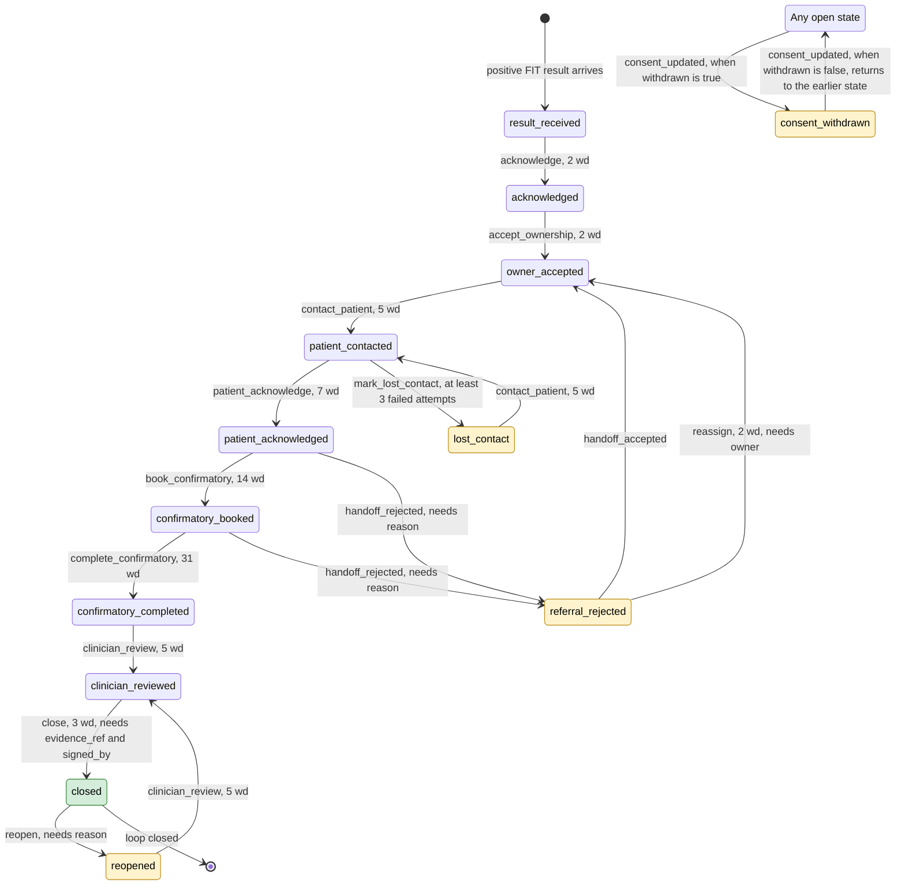

# Clinician review pack (H1)

> Generated file. Do not edit by hand. Regenerate with `make review-packs` (tools/review/build_packs.py).
> Built from pathway `colorectal_fit` v0.2, template set v1, forbidden-phrase list v1.
> For: a GP or public-health doctor, 30 minutes
> All data in this project is synthetic. Nothing here is clinical advice or a claim of real-world performance.

## 0. How to use this pack in 30 minutes

| Minutes | Section | What to do |
|---|---|---|
| 3 | 1 Purpose | Read the one-page summary. |
| 5 | 2 to 4 Pathway, states, events | Check the picture and the plain-language table: is anything wrong or missing? |
| 7 | 5 to 8 Time limits, escalation, handoff, two flagged rules | Say whether the numbers are realistic. |
| 5 | 9 and 10 What the patient reads, words that are never allowed | Read the English wording as a patient would. |
| 10 | 11 and 12 Ten questions, feedback table | Answer the questions. Fill the last table: keep or change, with a comment. |

Anything you cannot judge, mark "cannot say" in the comment. A short answer is more useful than none.

## 1. Purpose (one page)

**The problem.** A positive FIT (faecal immunochemical test) result is only the start of screening. In a review of 2015 to 2016 data for Emirati nationals in Abu Dhabi Health Services clinics, 436 of 1,429 positive results (30.5%) were followed by a colonoscopy, at a median of 72 days (Almansoori et al., BMC Cancer 2021; source row in `docs/evidence.md` section 8b). Results get lost between the laboratory, the primary care clinic, the specialist and the patient, because no one is named as responsible and nothing notices a delay.

**What this prototype does.** It tracks every positive FIT result from arrival to a documented outcome:

- one named owner at every step, and a time limit (in working days) for every step;
- a late step is flagged and climbs a fixed escalation ladder to a person, who must accept it;
- handing a case to another provider changes the owner only when the receiving provider accepts;
- a case can be closed only with an evidence reference and a named clinician's signature. No automated part of the system can close a case;
- the patient sees a short page, and receives messages, in Arabic or English, with an "I don't understand this" button that asks a person to call.

**What it does not do.** It does not diagnose, give advice, decide care or contact anyone without a person approving. A language model may draft a message for a person to approve, nothing else. A rejected model draft is replaced by the fixed template. All data is synthetic; this is a demonstration, not a medical device and not connected to any real record.

**What we need from you.** Tell us where the pathway, the time limits or the wording would not work in a real clinic. The ten questions in section 11 are the ones we cannot answer ourselves. Everything else in this pack is generated from the files the prototype actually uses, so what you read is what the system does.

Working days: Monday, Tuesday, Wednesday, Thursday, Friday count; Saturday and Sunday are the weekend; public holidays: none are configured. Friday counts as a full day (in government it is a half day). Time zone Asia/Dubai.

## 2. The pathway as a picture

Generated from `config/pathways/colorectal_fit.yaml`. Boxes are states. Yellow boxes are side states that change who may act next. Green is the end. "wd" means working days allowed for that step. "Any open state" means any state except closed.

Overdue and escalated are not states. A case can be overdue and in any state, so they are flags shown beside the state.

**Closure rule (verbatim from the configuration):** A case may only enter `closed` via the `close` event carrying evidence_ref and signed_by. No automated actor may emit `close`.

## 3. States in plain language

| State | Type | Meaning | How the case leaves it, and who may do that | Time limit in this state |
|---|---|---|---|---|
| `result_received` | main path | A positive FIT (stool blood test) result has arrived from the laboratory. Nobody has taken responsibility yet. | `acknowledge` (Laboratory, coordinator, supervisor) `consent_updated` with withdrawal (patient or coordinator) moves the case to `consent_withdrawn` | 2 working days to `acknowledge` |
| `acknowledged` | main path | The laboratory, coordinator or supervisor has confirmed the result is logged and is being routed. Still no named owner. | `accept_ownership` (Primary care owner, specialist owner, supervisor) `consent_updated` with withdrawal (patient or coordinator) moves the case to `consent_withdrawn` | 2 working days to `accept_ownership` |
| `owner_accepted` | main path | A named clinician or service has accepted responsibility (the care owner). From here one named person owns the next step. | `contact_patient` (Care owner, coordinator, supervisor) `consent_updated` with withdrawal (patient or coordinator) moves the case to `consent_withdrawn` | 5 working days to `contact_patient` |
| `patient_contacted` | main path | The care owner or coordinator has contacted the patient (call, message or letter) with the result and the next step. | `patient_acknowledge` (Patient, coordinator) `mark_lost_contact` (Care owner, coordinator, supervisor) `consent_updated` with withdrawal (patient or coordinator) moves the case to `consent_withdrawn` | 7 working days to `patient_acknowledge` |
| `patient_acknowledged` | main path | The patient has confirmed they understood (tapped "I understand" or told the coordinator). The colonoscopy can now be booked. | `book_confirmatory` (Care owner, coordinator) `handoff_rejected` (Receiving clinician; scheduler (timeout only)) `consent_updated` with withdrawal (patient or coordinator) moves the case to `consent_withdrawn` | 14 working days to `book_confirmatory` |
| `confirmatory_booked` | main path | A confirmatory colonoscopy appointment is booked. If the booking went through a referral to another provider, that provider has accepted it. | `complete_confirmatory` (Specialist owner) `handoff_rejected` (Receiving clinician; scheduler (timeout only)) `consent_updated` with withdrawal (patient or coordinator) moves the case to `consent_withdrawn` | 31 working days to `complete_confirmatory` |
| `confirmatory_completed` | main path | The specialist has recorded that the colonoscopy was done. Findings are not yet reviewed. | `clinician_review` (Primary care owner, specialist owner) `consent_updated` with withdrawal (patient or coordinator) moves the case to `consent_withdrawn` | 5 working days to `clinician_review` |
| `clinician_reviewed` | main path | A clinician has reviewed the colonoscopy outcome. The case can now be closed, but only with evidence and a signature. | `close` (Primary care owner, specialist owner (never automated)) `consent_updated` with withdrawal (patient or coordinator) moves the case to `consent_withdrawn` | 3 working days to `close` |
| `closed` | main path | The loop is closed. Only possible with an evidence reference and a named clinician's sign-off. No automated actor can do this. | `reopen` (Primary care owner, specialist owner (human only)) | no time limit |
| `referral_rejected` | side state | The receiving provider turned the referral down, or did not answer in time. The reason is recorded and the case must be re-routed. | `handoff_accepted` (Receiving clinician (human only)) `reassign` (Coordinator, supervisor) `consent_updated` with withdrawal (patient or coordinator) moves the case to `consent_withdrawn` | 2 working days to `reassign` |
| `consent_withdrawn` | side state | The patient withdrew consent. Outreach stops, the case is flagged for a person to review, and the earlier state is remembered so it can be restored. | `consent_updated` restoring consent (patient or coordinator) returns the case to the state it was in | no time limit |
| `lost_contact` | side state | After repeated failed attempts the patient could not be reached. The case stays open and a person decides what to do next. It never closes by itself. | `contact_patient` (Care owner, coordinator, supervisor) `consent_updated` with withdrawal (patient or coordinator) moves the case to `consent_withdrawn` | no time limit |
| `reopened` | side state | A clinician reopened a closed case, giving a reason. It returns for clinician review and can close again only with fresh evidence and a sign-off. | `clinician_review` (Primary care owner, specialist owner) `consent_updated` with withdrawal (patient or coordinator) moves the case to `consent_withdrawn` | no time limit |

## 4. Events: what can happen and who may do it

Events are the facts the system records. The "who" column follows the authorisation table in the code (`api/app/policy.py`) and `docs/governance/decision-matrix.md`. "Human only" means the state machine itself refuses any automated actor (scheduler, watchdog, model, system).

| Event | Meaning | Who may do it | Kind | Human only |
|---|---|---|---|---|
| `acknowledge` | Confirm the positive result is received and logged. | Laboratory, coordinator, supervisor | changes state |  |
| `accept_ownership` | A clinician or service accepts responsibility for the case. | Primary care owner, specialist owner, supervisor | changes state |  |
| `contact_patient` | Contact the patient with the result and next step. | Care owner, coordinator, supervisor | changes state |  |
| `patient_acknowledge` | The patient confirms they understood. | Patient, coordinator | changes state |  |
| `book_confirmatory` | Book the confirmatory colonoscopy. | Care owner, coordinator | changes state |  |
| `complete_confirmatory` | Record that the colonoscopy was done. | Specialist owner | changes state |  |
| `clinician_review` | Review the colonoscopy outcome. | Primary care owner, specialist owner | changes state |  |
| `close` | Close the case. Needs an evidence reference and a signature. | Primary care owner, specialist owner (never automated) | changes state |  |
| `handoff_rejected` | The receiving provider refuses, with a reason from the fixed list. The scheduler may also bounce a request that got no answer. | Receiving clinician; scheduler (timeout only) | changes state or annotates |  |
| `handoff_accepted` | The receiving provider accepts. Ownership moves only now. | Receiving clinician (human only) | changes state or annotates | yes |
| `reassign` | Give a rejected case a new owner. | Coordinator, supervisor | changes state |  |
| `consent_updated` | Record the patient's choice of channels, sharing, or withdrawal. | Patient, coordinator recording the patient's instruction (human only) | changes state or annotates | yes |
| `mark_lost_contact` | Record that the patient could not be reached after repeated attempts. | Care owner, coordinator, supervisor | changes state |  |
| `reopen` | Reopen a closed case, with a reason. | Primary care owner, specialist owner (human only) | changes state | yes |
| `mark_overdue` | Flag that the time limit for the current step has passed. | Scheduler only | annotation |  |
| `escalate` | Send the late case up one rung of the ladder. | Scheduler, coordinator, supervisor | annotation |  |
| `escalation_accepted` | A person accepts an escalation, which stops further rungs for that delay. | A human in the rung's target role (human only) | annotation | yes |
| `handoff_requested` | Ask another provider to take over the case (an annotation; ownership has not moved). | Care owner, supervisor | annotation |  |
| `review_requested` | Flag the case for human review (used when consent is withdrawn). | The system itself; nobody can post it | annotation |  |
| `message_drafted` | A message draft is prepared (by a template or a language model) for a person to approve. | Care owner, coordinator, model drafting provider | annotation |  |
| `message_approved` | A person approves a draft. Nothing is sent without this. | Care owner (human only) | annotation | yes |
| `message_rejected` | A person rejects a draft, giving a reason from a fixed list. Nothing is sent. | Care owner (human only) | annotation | yes |
| `message_sent` | The message is sent through the notification mock. | The approval-gated send path only; nobody can post it | annotation |  |
| `callback_requested` | The patient asks for a person to call because they do not understand. | Patient, coordinator (human only) | annotation | yes |
| `watchdog_flagged` | The watchdog flags a case that has been idle too long. | Watchdog / scheduler | annotation |  |

Events listed as human only in the configuration: `escalation_accepted`, `handoff_accepted`, `consent_updated`, `message_approved`, `message_rejected`, `callback_requested`, `reopen`. Also: no automated actor may emit `close` (checked separately by the state machine).

## 5. Time limits (SLAs)

Each step has a limit in working days. The clock starts when the case enters the state (one step starts at referral acceptance, see the table), and a case is late when time is strictly after the due date. Counting uses the working week above. Time limits are design choices unless stated: only the 31 working days for the colonoscopy has a public anchor.

| Step (event) | What must happen | State where the clock runs | Clock starts when | Working days allowed | Latest, counted from the result if every step uses its full allowance |
|---|---|---|---|---|---|
| `acknowledge` | Lab or coordinator confirms the result is received and logged. | `result_received` | the case enters `result_received` (result received from the laboratory) | 2 | 2 |
| `accept_ownership` | A clinician or service accepts the case. | `acknowledged` | the case enters `acknowledged` (after `acknowledge`) | 2 | 4 |
| `contact_patient` | The patient is contacted with the result. | `owner_accepted` | the case enters `owner_accepted` (after `accept_ownership`, `handoff_accepted`, `reassign`) | 5 | 9 |
| `patient_acknowledge` | The patient confirms they understood. | `patient_contacted` | the case enters `patient_contacted` (after `contact_patient`) | 7 | 16 |
| `book_confirmatory` | The colonoscopy is booked. | `patient_acknowledged` | the case enters `patient_acknowledged` (after `patient_acknowledge`) | 14 | 30 |
| `complete_confirmatory` | The colonoscopy is done. | `confirmatory_booked` | the latest referral acceptance (`handoff_accepted`) on the case, or, if no referral was accepted, when the case enters `confirmatory_booked` | 31 | 61 |
| `clinician_review` | A clinician reviews the outcome. | `confirmatory_completed` | the case enters `confirmatory_completed` (after `complete_confirmatory`) | 5 | 66 |
| `close` | A clinician signs off the closure with evidence (a report or procedure on file). | `clinician_reviewed` | the case enters `clinician_reviewed` (after `clinician_review`) | 3 | 69 |
| `reassign` | A rejected or bounced referral is given a new owner. | `referral_rejected` | the case enters `referral_rejected` (after `handoff_rejected`) | 2 | not on the main path |

**DoH 31-working-day KPI.** The UAE National Guideline for Colorectal Cancer Screening and Diagnosis (3rd edition, 2022, prepared by a task force that included DoH Abu Dhabi; Appendix 2) sets, for follow-up colonoscopy after a positive FIT, a target of **within 31 working days of referral**, in more than 90% of cases (acceptable) and more than 95% (desirable). The same guideline is inconsistent: clause 12.5.2 says 15 working days, Appendix 3 says 31 days. The IFHAS standard (DoH, V10, July 2025) requires referral to secondary care within 15 working days of releasing results. Sources are listed in `docs/evidence.md` section 8; the register marks them as read from the primary source (check marker P).

Our `complete_confirmatory` limit is **31 working days**, the same figure as the KPI. Three differences matter (question 4): (1) the KPI is a share of cases, ours is a limit on each case; (2) our clock starts at the latest referral acceptance, the closest event we record to the KPI's referral date, and falls back to state entry when no referral was accepted; (3) adding every full allowance, the colonoscopy can be as late as 61 working days after the result and still meet every one of our limits. `close` has its own limit of 3 working days after clinician review, so a reviewed case can go overdue.

The same working-day arithmetic applies to the referral response time and the escalation offsets below.

## 6. Escalation ladder

When a step passes its due date, the scheduler flags it (`mark_overdue`, once) and then climbs the ladder. A rung is written only after the previous one, never skipped. A person in the rung's accepting role must accept it (`escalation_accepted`); that stops further rungs for that delay. The scheduler can notify but cannot accept, reassign or close. A regulator rung is not built.

| Rung | What it does | When | Who is told | Who must accept |
|---|---|---|---|---|
| `reminder` | A reminder to the case owner. | 0 working days after the due date | owner | primary care owner, specialist owner |
| `supervisor` | The owner's supervisor is told and asked to act. | 3 working days after the due date | owner supervisor | supervisor |
| `coordinator` | The programme coordinator is told and asked to act. | 7 working days after the due date | programme coordinator | coordinator |

## 7. Handoff and rejection reasons

A case is handed to another provider with `handoff_requested`. Ownership moves only when the receiving clinician accepts (`handoff_accepted`). If the receiving provider rejects, the case goes to `referral_rejected` and must be given a new owner within 2 working days (`reassign`), or accepted by another provider. A request that gets no answer for 3 working days is bounced back by the scheduler.

| Reason | Meaning | Who may write it |
|---|---|---|
| `capacity` | The receiving provider has no capacity. | Receiving clinician |
| `wrong_service` | The receiving provider does not offer the service needed. | Receiving clinician |
| `missing_info` | The referral lacks information the receiving provider needs. | Receiving clinician |
| `patient_declined` | The patient declined this referral. | Receiving clinician |
| `timeout` | No answer within the response time. Written only by the scheduler (a bounce), never by a person. | Scheduler only |

## 8. Two rules we want you to challenge

### 8.1 "Lost contact after 3 failed attempts" (question 7)

- What the system does: from `patient_contacted`, a person can record `mark_lost_contact`; the case moves to `lost_contact` and stays open. The engine accepts it only if the number of failed attempts supplied is at least 3. It does not count attempts itself yet.
- Why 3: it is an assumption (decision record ADR-011; row L14 in `docs/assumptions-limitations.md`), not taken from a guideline.
- What we do not know: what counts as an attempt, how long to wait between them, and what a clinic must try before giving up.

### 8.2 "Opt-out consent default" (question 8)

- What the system does: before the patient says anything, these are treated as allowed: SMS, WhatsApp, phone calls, letters, sharing the result with the specialist. The patient can switch channels off, stop sharing, or withdraw. Withdrawal freezes contacting, drafting, approving, sending and handing off, and flags the case for a person (decision record ADR-017).
- Why: with opt-in, the notification mock would refuse every message for the whole demo cohort. It is an assumption for you to judge, not a legal position.
- A visible inconsistency: the patient page shows the sharing box unticked and the channel set to phone until the patient chooses, while the engine treats all channels and sharing as allowed.

## 9. What the patient reads (English)

65 English strings in three places. The reading-level target is grade 6. Arabic versions are reviewed separately (H2); the IDs below match the Arabic pack. Placeholders in braces are filled in: {owner_name} (the care owner), {next_step} (default "a colonoscopy"), {appointment_date} (for example "Tuesday 3 November 2026"), {name} and {role} on the patient page.

### 9.1 The patient page (web)

Shown in the installed app or browser at `/patient`. Source: `web/src/i18n/strings.ts`.

**Page frame and language.** Title, language switch and start page.

| ID | English text | Where it appears |
|---|---|---|
| W01 | Your screening result | Main heading (h1) at the top of the patient page. |
| W02 | Language | Not shown. Used in the accessible label of the language button, as "Language: <other language>". |
| W03 | العربية | Language button, top of the page. It names the other language in that language: the English column is the button on the English page, the Arabic column the button on the Arabic page. |
| W04 | Your screening result | Heading of the app start page (/patient) when no case has been opened on this device. |
| W05 | Open the link your care team sent you to see your result. You can add this page to your home screen. | Text under that heading: how to open the result and add the page to the home screen. |

**What the result means.** The first thing the patient reads.

| ID | English text | Where it appears |
|---|---|---|
| W06 | What your result means | Heading of the first section. |
| W07 | Your screening test found blood. This does not mean you have cancer. The next step is a camera test called a colonoscopy. | Large paragraph under the heading. The only statement about the result. |
| W08 | This page is not a diagnosis. Your doctor will explain your result. | Small grey line under the result. |

**Where you are now.** Four-step tracker.

| ID | English text | Where it appears |
|---|---|---|
| W09 | Where you are now | Heading of the progress section. |
| W10 | Result received | Step 1 of the tracker. Current while the case is waiting to be acknowledged. |
| W11 | Care team ready | Step 2. Current from acknowledgement until the colonoscopy is booked. |
| W12 | Camera test | Step 3. Current once the colonoscopy has been done. |
| W13 | Doctor review | Step 4. Current at clinician review and after. |

**What happens next.** Three numbered steps.

| ID | English text | Where it appears |
|---|---|---|
| W14 | What happens next | Heading of the next-steps section. |
| W15 | A care coordinator will call you to book the camera test. | Numbered step 1. |
| W16 | You will get a date and easy steps to get ready. | Numbered step 2. |
| W17 | A doctor will check the test and tell you what it means. | Numbered step 3. |

**Who is looking after you.** The named care owner.

| ID | English text | Where it appears |
|---|---|---|
| W18 | Who is looking after you | Heading of the care-owner section. |
| W19 | {name} ({role}) is looking after your care. You can ask them any question. | Large text under that heading. {name} is the owner's name (Latin or Arabic script), {role} the role from the role labels below. In Arabic the sentence is split over three lines so a Latin name does not scramble the line. |
| W20 | A care coordinator will be chosen for you soon. | Shown instead of the line above while nobody has accepted the case. |
| W21 | Primary care physician | Role shown in brackets after the owner's name in the line "Who is looking after you". The English role is the value stored in the case; unknown roles are shown as stored. |
| W22 | Care coordinator | Role shown in brackets after the owner's name in the line "Who is looking after you". The English role is the value stored in the case; unknown roles are shown as stored. |

**I understand / I don't understand.** The two buttons and their confirmations.

| ID | English text | Where it appears |
|---|---|---|
| W23 | I understand | Primary button. Disabled until the patient has been contacted. |
| W24 | Thank you. We saved that you understand. | Green confirmation that replaces the button once the patient has acknowledged. |
| W25 | You can tap this button after your care team has contacted you. | Hint under the disabled button. |
| W26 | I don't understand this | Second button. Asks a person from the care team to call. |
| W27 | Thank you. A person from your care team will call you. | Green confirmation after that button is pressed, or while a callback is pending. |
| W28 | That did not work. Please try again or call your care team. | Red banner if either button fails. |

**Your choices (contact and sharing).** Channel, sharing and their save status.

| ID | English text | Where it appears |
|---|---|---|
| W29 | Your choices | Heading of the choices section. |
| W30 | How may we contact you? | Legend of the group of contact-channel check boxes. Each box is on unless the patient turned it off (an opt-out default); changing one saves at once. |
| W31 | Phone call | Label of the check box for phone calls. |
| W32 | Text message | Label of the check box for text messages. |
| W33 | WhatsApp | Label of the check box for WhatsApp messages. |
| W34 | Letter | Label of the check box for letters. |
| W35 | My care team may share my result with the specialist who will do my test. | Label of the check box that lets the care team share the result with the specialist. |
| W36 | Stop all contact | Button under the choices. Withdraws all consent to contact at once: the case is frozen for outreach and a person is asked to review it. Hidden after withdrawal. |
| W37 | If you stop contact, your care team will not message or call you. A person will check your case. | Small grey text above that button. It says what stopping contact means and that a person will check the case. |
| W38 | You asked us to stop contact. We will not message or call you. A person on your care team will check your case. | Yellow banner at the top of the choices section after the patient has stopped all contact. |
| W39 | You may contact me again | Replaces the stop button after withdrawal. Pressing it records that the patient may be contacted again. |
| W40 | Saved | Status line under the choices after a successful save. |
| W41 | We could not save this. Please try again. | Status line if saving the choices fails. |

**Loading, offline and errors.** System messages.

| ID | English text | Where it appears |
|---|---|---|
| W42 | Loading... | Shown instead of the page while the case loads. |
| W43 | We could not load your information. Please try again. | Shown if the case cannot be loaded and nothing is saved on the device. |
| W44 | You are offline. This is the last information we saved. | Banner above the result when the device is offline. The last saved information is shown. |

Not in the catalogue (hard-coded in `web/src/pages/PatientPage.tsx`): a "Demo case" link on the start page and the accessible label "Actions". They are demo scaffolding and not part of this review.

### 9.2 Messages (SMS, WhatsApp, letter)

Source: `api/app/ai/templates/en.yaml`. These are the default drafts and the fallback if a model draft is rejected. A person approves a message before it is sent. Limits: SMS 320, WhatsApp 600, letter 1200 characters. "Chars" is the length with the sample values.

**result_notification.** First message to the patient once a positive result has an accepted care owner.

| ID | Channel | English text | Chars / limit |
|---|---|---|---|
| T01 | SMS | Your screening test found blood. The next step is {next_step}. Your care team will contact you. Your care owner is {owner_name}. | 130 / 320 |
| T02 | WhatsApp | Hello. This is a message from your care team.  Your screening test found blood.  The next step is {next_step}. Your care team will contact you to talk about it and to arrange it.  Your care owner is {owner_name}. | 214 / 600 |
| T03 | Letter | Hello,  We are writing about the screening test you did recently. The test found blood.  The next step is {next_step}. Your care team will contact you to talk about it and to arrange it.  Your care owner is {owner_name}. This is the person in your care team who is responsible for your next step.  Kind regards, Your care team | 328 / 1200 |

**reminder.** Reminder when the patient has not yet taken the next step. The dated variant is used once an appointment date exists.

| ID | Channel | English text | Chars / limit |
|---|---|---|---|
| T04 | SMS | Reminder from your care team. The next step after your screening test is {next_step}. Your care team will contact you. Your care owner is {owner_name}. | 153 / 320 |
| T05 | SMS with date | Reminder from your care team. Your appointment is on {appointment_date}. The next step is {next_step}. Your care owner is {owner_name}. | 142 / 320 |
| T06 | WhatsApp | Hello. This is a reminder from your care team.  The next step after your screening test is {next_step}. Your care team will contact you to arrange it.  Your care owner is {owner_name}. | 186 / 600 |
| T07 | WhatsApp with date | Hello. This is a reminder from your care team.  Your appointment is on {appointment_date}. The next step is {next_step}.  Your care owner is {owner_name}. | 161 / 600 |
| T08 | Letter | Hello,  This is a reminder from your care team. After your screening test, the next step is {next_step}.  Your care team will contact you to arrange it. Your care owner is {owner_name}.  Kind regards, Your care team | 217 / 1200 |
| T09 | Letter with date | Hello,  This is a reminder from your care team. Your appointment is on {appointment_date}.  The next step is {next_step}. Your care owner is {owner_name}.  Kind regards, Your care team | 191 / 1200 |

**appointment_confirmation.** Confirms a booked colonoscopy. Always carries the date.

| ID | Channel | English text | Chars / limit |
|---|---|---|---|
| T10 | SMS | Your appointment is on {appointment_date}. The next step is {next_step}. Your care team will contact you with the details. Your care owner is {owner_name}. | 162 / 320 |
| T11 | WhatsApp | Hello. This is a message from your care team.  Your appointment is on {appointment_date}. The next step is {next_step}.  Your care team will contact you with the details. Your care owner is {owner_name}. | 210 / 600 |
| T12 | Letter | Hello,  We are writing to confirm your appointment. It is on {appointment_date}.  The next step is {next_step}. Your care team will contact you with the details.  Your care owner is {owner_name}.  Kind regards, Your care team | 232 / 1200 |

**escalation_notice.** Tells the patient a more senior member of the care team has been told, so the next step is not delayed.

| ID | Channel | English text | Chars / limit |
|---|---|---|---|
| T13 | SMS | We want to make sure your next step is not delayed. A senior member of your care team has been told. The next step is {next_step}. Your care owner is {owner_name}. Your care team will contact you. | 198 / 320 |
| T14 | WhatsApp | Hello. This is a message from your care team.  We want to make sure your next step is not delayed. A senior member of your care team has been told.  The next step is {next_step}. Your care team will contact you. Your care owner is {owner_name}. | 246 / 600 |
| T15 | Letter | Hello,  We want to make sure your next step is not delayed. A senior member of your care team has been told.  The next step is {next_step}. Your care team will contact you. Your care owner is {owner_name}.  Kind regards, Your care team | 237 / 1200 |

**callback_ack.** Reply when the patient pressed "I don't understand this". A person will call.

| ID | Channel | English text | Chars / limit |
|---|---|---|---|
| T16 | SMS | Thank you for telling us you need help to understand. A person from your care team will call you. The next step is {next_step}. Your care owner is {owner_name}. | 162 / 320 |
| T17 | WhatsApp | Hello. Thank you for telling us you need help to understand.  A person from your care team will call you to explain. The next step is {next_step}.  Your care owner is {owner_name}. | 182 / 600 |
| T18 | Letter | Hello,  Thank you for telling us you need help to understand our message.  A person from your care team will call you to explain. The next step is {next_step}.  Your care owner is {owner_name}.  Kind regards, Your care team | 225 / 1200 |

### 9.3 Demo draft texts (coordinator app)

Two draft texts in the demo data of the coordinator app. They stand in for a model or template draft and are shown to the coordinator, who approves them.

| ID | English text | Where it appears |
|---|---|---|
| D01 | Hello. Your screening test needs a follow-up camera test called a colonoscopy. This is not a diagnosis. Please call us to book a time. | Draft text offered to the coordinator in the demo (mock) app, shown in both languages and stored in the `message_drafted` event. It stands in for a model or template draft. A person approves it before anything is "sent". |
| D02 | Hello. This is a reminder to call us about your screening follow-up. This is not a diagnosis. We are here to help. | Draft text offered to the coordinator in the demo (mock) app, shown in both languages and stored in the `message_drafted` event. It stands in for a model or template draft. A person approves it before anything is "sent". |
| D03 | Hello. Your follow-up appointment is booked. Please arrive on time and call us if you cannot come. | Draft text offered to the coordinator in the demo (mock) app, shown in both languages and stored in the `message_drafted` event. It stands in for a model or template draft. A person approves it before anything is "sent". |

### 9.4 A check we ran on our own wording

The forbidden-phrase list in section 10 applies to model drafts. We ran it over every string above as a self-check. These strings would be rejected if a model had written them. The patient page is fixed text, not a model draft, so they are allowed today. Please say whether each is acceptable (question 3).

| ID | English text | Matching list entries |
|---|---|---|
| W07 | Your screening test found blood. This does not mean you have cancer. The next step is a camera test called a colonoscopy. | `you_have`, `cancer` |
| W08 | This page is not a diagnosis. Your doctor will explain your result. | `diagnos` |
| D01 | Hello. Your screening test needs a follow-up camera test called a colonoscopy. This is not a diagnosis. Please call us to book a time. | `diagnos` |
| D02 | Hello. This is a reminder to call us about your screening follow-up. This is not a diagnosis. We are here to help. | `diagnos` |

## 10. Words the system never lets a model write

A model draft containing any of these is rejected and replaced by the template (and counted as an abstention). Matching ignores case and, for phrases, whole words only; a regular expression is shown where one word stem stands for several forms. The Arabic list has the same seven categories and is in the Arabic pack. Please say what is missing and what blocks a perfectly good sentence.

| Category | What it prevents |
|---|---|
| `diagnosis_statement` | Saying or implying the patient has a condition. |
| `disease_term` | Naming a disease or a finding the screening test cannot show. |
| `positive_result_jargon` | Calling the result "positive". |
| `false_reassurance` | Telling the patient not to worry or that all is well. |
| `clinical_judgement` | Judging urgency or severity. |
| `medication_or_treatment` | Mentioning medicines, doses, treatment or surgery. |
| `advice` | Telling the patient what they should do beyond the next step. |

| Id | Category | Phrase or pattern | Why | Example it catches |
|---|---|---|---|---|
| `you_have` | diagnosis_statement | `you have` | "You have ..." is the grammar of a diagnosis. The only statement the message may make about the result is that the screening test found blood. | You have a problem that we need to look at. |
| `you_have_got` | diagnosis_statement | `you(?:'\|’)?ve got\|you have got` | Same as "you have"; informal form. | You've got something that needs a test. |
| `you_are_ill` | diagnosis_statement | `you are (?:ill\|sick\|unwell\|affected\|positive)\|you(?:'\|’)re (?:ill\|sick\|unwell\|affected\|positive)` | States a condition of the patient, which only a clinician may do. | You are unwell and need a test. |
| `diagnos` | diagnosis_statement | `diagnos\w*` | The system diagnoses nothing; any use of the word implies that it did or will. | This is not a diagnosis. |
| `cancer` | disease_term | `cancer\w*` | Naming the disease in an automated message is a diagnosis statement and can frighten a patient before a clinician has spoken to them. A screening result is not a cancer finding. | This could be cancer. |
| `tumour` | disease_term | `tumou?rs?` | Names a pathological finding. Not for an automated message. | We found a tumour. |
| `malignant` | disease_term | `malignan\w*` | Names a pathological finding. Not for an automated message. | The test shows it is malignant. |
| `carcinoma_neoplasm` | disease_term | `carcinoma\w*\|neoplas\w*\|adenoma\w*\|oncolog\w*` | Clinical terminology for disease; not allowed in patient messages from the model. | You will see the oncology team. |
| `polyp_lesion` | disease_term | `polyps?\|lesions?\|growths?` | Describes a finding the screening test cannot show. | It may be a polyp. |
| `positive_for` | positive_result_jargon | `positive for\|tested positive\|test is positive\|positive result` | "Positive" is read by many patients as "I have the disease". The message says only that the test found blood. | A positive result came back. |
| `do_not_worry` | false_reassurance | `(?:do not\|don(?:'\|’)t) (?:worry\|be worried\|be alarmed\|panic)\|no need to (?:worry\|panic)\|nothing to (?:worry\|be worried)` | Reassurance is a clinical judgement and may be false. It also makes patients less likely to act on the next step. | Do not worry about this. |
| `probably_nothing` | false_reassurance | `(?:probably\|likely\|just\|only) nothing\|not serious\|nothing serious\|not a big deal\|no cause for concern\|nothing to be concerned\|rest assured` | Minimises a result that has not been investigated yet. | It is probably nothing. |
| `be_fine` | false_reassurance | `(?:will\|should) be (?:fine\|ok\|okay\|alright\|all right)\|everything is (?:fine\|ok\|okay)\|all clear\|(?:is\|are) normal` | Predicts an outcome the system cannot know. | You will be fine. |
| `clinical_judgement` | clinical_judgement | `urgent\w*\|serious\w*\|dangerous\|life[- ]threatening\|emergency\|critical` | Urgency and severity are clinical judgements. Timing is set by the pathway SLAs and the care team, not by the model. | This is urgent. |
| `medication` | medication_or_treatment | `medicat\w*\|medicine\w*\|prescri\w*\|dose\w*\|dosage\|tablets?\|pills?\|aspirin\|ibuprofen\|antibiotic\w*\|laxative\w*\|supplement\w*` | Medication advice is outside the model's remit and can cause harm (for example before a colonoscopy). | Take aspirin until then. |
| `treatment` | medication_or_treatment | `treatment\w*\|therapy\|surgery\|surgical\|chemo\w*\|radiotherapy\|cure\w*` | Implies a treatment decision that has not been made. | Treatment will start soon. |
| `advice_verbs` | advice | `you should\|you must\|you need to\|you have to\|we advise\|we recommend\|i recommend\|it is recommended\|recommended that\|make sure you\|be sure to\|avoid eating\|stop taking\|fasting\|diet\b` | The only instruction allowed is "the next step is ...; your care team will contact you". Everything else (preparation, diet, behaviour) is for the care team. | You should stop eating red meat. |

The Arabic list has 39 entries (see `arabic-pack.md`). The validator also rejects: empty text, text over the channel limit, text in the wrong language, a missing owner name or next step, leftover placeholders, runs of 7 or more digits, email addresses, links, and identifier words (Emirates ID, passport, file number).

## 11. Ten questions we need answered

1. **Acknowledge and accept in 2 working days.** The pathway gives the laboratory or coordinator 2 working days to acknowledge a positive result, and a clinician 2 more to accept ownership. *Question:* Is 2 working days realistic for each of these two steps in your setting? If not, what would you set, and who in practice does each step?

2. **The other time limits.** Contact the patient in 5 working days, patient confirms in 7, book the colonoscopy in 14, clinician review in 5 after the colonoscopy. *Question:* Which of these are too tight or too loose? The patient-confirms limit runs against the team although the patient controls it: should that clock exist, and who should be chased when it passes?

3. **The first message and the word "blood".** The only clinical fact any message states is "Your screening test found blood. The next step is a colonoscopy." The patient page adds "This does not mean you have cancer" (W07), although messages never name cancer, and says "This page is not a diagnosis" (W08). *Question:* Is "found blood" the right first sentence, or would you say "needs a follow-up test"? Should the page name cancer at all, even to say the result is not a diagnosis? Is anything in section 9 alarming, wrong, or missing?

4. **What the 31 working days are measured from.** The national KPI is a colonoscopy within 31 working days of referral. Our clock starts when the booking is recorded (`confirmatory_booked`), not at the result, not at the care owner's acceptance, and not at the referral. Adding up every step's full allowance, a colonoscopy could happen up to 61 working days after the result and still meet every one of our limits. *Question:* From which event should the 31 working days be counted: result received, ownership accepted, referral, or booking? Should we also report the programme-level share (the KPI is a percentage, above 90%), not only a per-case limit?

5. **What counts as evidence to close a case.** A case can close only with an evidence reference and a named clinician's signature after clinician review. What the evidence reference may point to is not restricted today. *Question:* What is acceptable: the colonoscopy report alone, report plus histology, a documented refusal, a letter to the GP? What must be in the sign-off? Who may sign, and is clinician review by itself ever enough?

6. **Informed refusal.** There is no state for a patient who, after a proper discussion, declines the colonoscopy. Today the nearest things are the handoff reason `patient_declined` (declined a referral) and keeping the case open. *Question:* What should happen: close with documented informed refusal (signed by a clinician), keep open with a recall date, offer FIT again next year, or something else? What must be recorded so that the closure is defensible?

7. **Lost contact after 3 failed attempts.** A case can be marked lost after 3 failed attempts (the engine checks only that the number given is at least 3). The case stays open. *Question:* Is 3 the right number? What counts as an attempt (call, SMS, WhatsApp, letter), how far apart, and what else must be tried before marking lost (the patient's GP, a registered letter, an emergency contact)?

8. **Contact allowed unless the patient says no.** Until the patient says otherwise, every channel (SMS, WhatsApp, phone, letter) and sharing the result with the specialist are treated as allowed (opt-out). The patient page, by contrast, shows sharing unticked and the channel set to phone until the patient chooses. *Question:* Is opt-out acceptable for contacting a patient about a positive result and for sharing with the specialist, or must any channel (especially WhatsApp and SMS) be opt-in? Which of the two defaults should the patient page follow?

9. **Escalation and handoff.** A late step gets a reminder to the owner on the due date, the supervisor 3 working days after the due date and the programme coordinator 7 working days after the due date. A referral unanswered for 3 working days bounces back. Rejection reasons are: capacity, wrong service, missing info, patient declined. *Question:* Are these offsets and the 3-day response time realistic? Should any delay (for example before the colonoscopy) climb faster? Are the rejection reasons complete, and is `patient_declined` a rejection at all or a separate outcome?

10. **Missing exits.** The pathway has one way forward and a few side states. It has no state for: patient moved abroad or out of the emirate, died, already had a colonoscopy elsewhere, unfit for colonoscopy, an incomplete colonoscopy or poor bowel preparation needing a repeat, or a symptomatic patient who should skip the pathway. *Question:* Which of these (or others) happen often enough to need their own state or exit, and how should each close? Who may reopen a closed case, and for what reasons?

## 12. Feedback table

For each row write keep or change and, if you change it, say what you would do. Leave a row empty if you did not look at it.

| Item | What | Keep / change | Comment |
|---|---|---|---|
| P1 | Purpose and scope (section 1) |  |  |
| P2 | Pathway picture and closure rule (section 2) |  |  |
| S:result_received | State `result_received`: A positive FIT (stool blood test) result has arrived from the laboratory |  |  |
| S:acknowledged | State `acknowledged`: The laboratory, coordinator or supervisor has confirmed the result is logged and is being routed |  |  |
| S:owner_accepted | State `owner_accepted`: A named clinician or service has accepted responsibility (the care owner) |  |  |
| S:patient_contacted | State `patient_contacted`: The care owner or coordinator has contacted the patient (call, message or letter) with the result and the next step |  |  |
| S:patient_acknowledged | State `patient_acknowledged`: The patient has confirmed they understood (tapped "I understand" or told the coordinator) |  |  |
| S:confirmatory_booked | State `confirmatory_booked`: A confirmatory colonoscopy appointment is booked |  |  |
| S:confirmatory_completed | State `confirmatory_completed`: The specialist has recorded that the colonoscopy was done |  |  |
| S:clinician_reviewed | State `clinician_reviewed`: A clinician has reviewed the colonoscopy outcome |  |  |
| S:closed | State `closed`: The loop is closed |  |  |
| S:referral_rejected | State `referral_rejected`: The receiving provider turned the referral down, or did not answer in time |  |  |
| S:consent_withdrawn | State `consent_withdrawn`: The patient withdrew consent |  |  |
| S:lost_contact | State `lost_contact`: After repeated failed attempts the patient could not be reached |  |  |
| S:reopened | State `reopened`: A clinician reopened a closed case, giving a reason |  |  |
| SLA:acknowledge | Time limit `acknowledge`: 2 working days, clock starts when the case enters `result_received` |  |  |
| SLA:accept_ownership | Time limit `accept_ownership`: 2 working days, clock starts when the case enters `acknowledged` |  |  |
| SLA:contact_patient | Time limit `contact_patient`: 5 working days, clock starts when the case enters `owner_accepted` |  |  |
| SLA:patient_acknowledge | Time limit `patient_acknowledge`: 7 working days, clock starts when the case enters `patient_contacted` |  |  |
| SLA:book_confirmatory | Time limit `book_confirmatory`: 14 working days, clock starts when the case enters `patient_acknowledged` |  |  |
| SLA:complete_confirmatory | Time limit `complete_confirmatory`: 31 working days, clock starts when the latest referral acceptance |  |  |
| SLA:clinician_review | Time limit `clinician_review`: 5 working days, clock starts when the case enters `confirmatory_completed` |  |  |
| SLA:close | Time limit `close`: 3 working days, clock starts when the case enters `clinician_reviewed` |  |  |
| SLA:reassign | Time limit `reassign`: 2 working days, clock starts when the case enters `referral_rejected` |  |  |
| L:reminder | Rung `reminder` at 0 working days after the due date |  |  |
| L:supervisor | Rung `supervisor` at 3 working days after the due date |  |  |
| L:coordinator | Rung `coordinator` at 7 working days after the due date |  |  |
| H:capacity | Handoff reason `capacity` |  |  |
| H:wrong_service | Handoff reason `wrong_service` |  |  |
| H:missing_info | Handoff reason `missing_info` |  |  |
| H:patient_declined | Handoff reason `patient_declined` |  |  |
| H:timeout | Handoff reason `timeout` |  |  |
| R1 | Lost contact after 3 failed attempts (8.1) |  |  |
| R2 | Opt-out consent default (8.2) |  |  |
| W:frame | Patient page: Page frame and language (W01 to W05) |  |  |
| W:result | Patient page: What the result means (W06 to W08) |  |  |
| W:progress | Patient page: Where you are now (W09 to W13) |  |  |
| W:next | Patient page: What happens next (W14 to W17) |  |  |
| W:owner | Patient page: Who is looking after you (W18 to W22) |  |  |
| W:actions | Patient page: I understand / I don't understand (W23 to W28) |  |  |
| W:consent | Patient page: Your choices (contact and sharing) (W29 to W41) |  |  |
| W:status | Patient page: Loading, offline and errors (W42 to W44) |  |  |
| M:result_notification | Message `result_notification` (T01 to T03) |  |  |
| M:reminder | Message `reminder` (T04 to T09) |  |  |
| M:appointment_confirmation | Message `appointment_confirmation` (T10 to T12) |  |  |
| M:escalation_notice | Message `escalation_notice` (T13 to T15) |  |  |
| M:callback_ack | Message `callback_ack` (T16 to T18) |  |  |
| D | Demo draft texts (D01 to D03) |  |  |
| F:diagnosis_statement | Forbidden-phrase category `diagnosis_statement` |  |  |
| F:disease_term | Forbidden-phrase category `disease_term` |  |  |
| F:positive_result_jargon | Forbidden-phrase category `positive_result_jargon` |  |  |
| F:false_reassurance | Forbidden-phrase category `false_reassurance` |  |  |
| F:clinical_judgement | Forbidden-phrase category `clinical_judgement` |  |  |
| F:medication_or_treatment | Forbidden-phrase category `medication_or_treatment` |  |  |
| F:advice | Forbidden-phrase category `advice` |  |  |
| Q1 | Question 1: Acknowledge and accept in 2 working days |  |  |
| Q2 | Question 2: The other time limits |  |  |
| Q3 | Question 3: The first message and the word "blood" |  |  |
| Q4 | Question 4: What the 31 working days are measured from |  |  |
| Q5 | Question 5: What counts as evidence to close a case |  |  |
| Q6 | Question 6: Informed refusal |  |  |
| Q7 | Question 7: Lost contact after 3 failed attempts |  |  |
| Q8 | Question 8: Contact allowed unless the patient says no |  |  |
| Q9 | Question 9: Escalation and handoff |  |  |
| Q10 | Question 10: Missing exits |  |  |
| X | Anything missing or dangerous that this pack does not show |  |  |

Reviewer name and role: 

Date:
