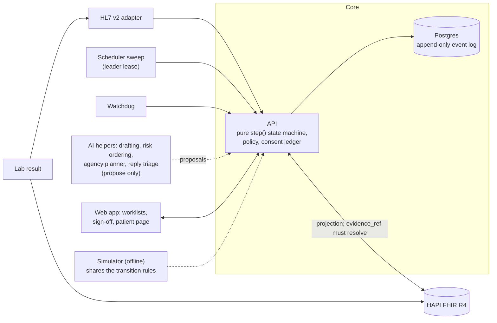
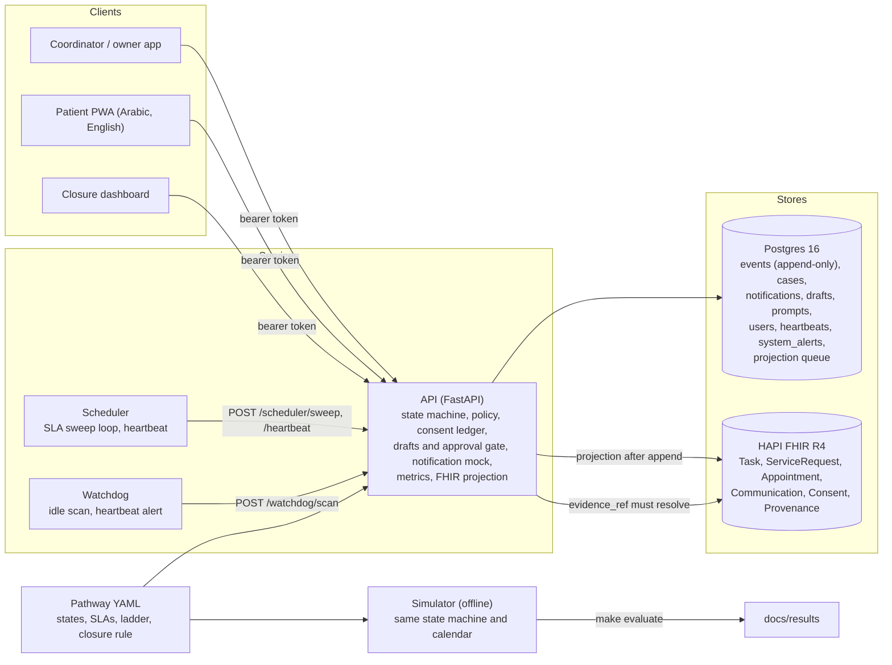
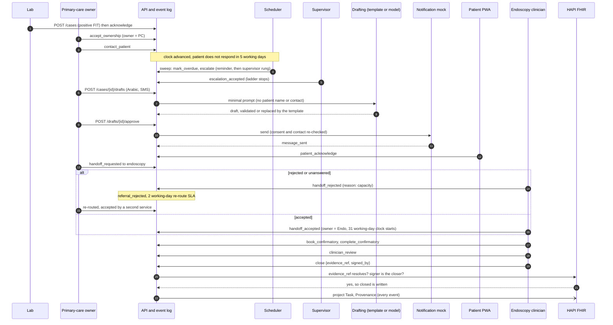

# Screening Closure: technical documentation

Every actionable screening result has a named owner, a clock, an audit trail, and a clinician-signed closure. Nothing is diagnosed.

## Architecture on one page



A positive FIT result enters as an HL7 v2 message through the adapter or as a FHIR resource in the HAPI store, and the API turns it into a case. Every change to a case is an event appended to a Postgres table that the application cannot update or delete. The current state of a case is always recomputed by replaying its events through one pure function, `step()`, which holds the pathway rules and the closure guard. A case cannot reach `closed` without evidence that resolves in the FHIR store and the signature of the closing physician. After each append the API projects the event to FHIR resources; the projection can be rebuilt from the log.

Two background services call the API with their own service tokens. The scheduler runs the working-day sweep: it marks steps overdue, walks the escalation ladder to named people and bounces unanswered referrals. When several replicas run, only the one holding the leader lease sweeps. The watchdog finds open cases nobody has touched and raises an alert when the scheduler's heartbeat goes stale. Neither can close a case or decide anything clinical.

Four AI helpers draft patient messages, order the worklist by a risk score, plan the agency's work queue and classify inbound patient replies. They propose only. The state machine refuses a model actor for every event except a draft, a person approves each message, and a model cannot change consent, move a case or close one. With no model configured, deterministic templates are used.

The web app has three surfaces: worklists for coordinators and owners, the sign-off screen for clinicians and a patient page. It holds no rules. Every action goes to the API under a signed-in role and is checked there.

Two parts of the demo are stand-ins. Patient messages are written to a logged mock and nothing reaches a phone. The FHIR `Appointment` is a proposed stub, not real scheduling.

The simulator runs offline and produces the evaluation numbers. It loads the same pathway file and applies the same transition rules and closure guard to each simulated event. Its timers, escalation, patient behaviour and consent holds are its own code, so it shows what the mechanism does under stated assumptions. It does not run the real scheduler or the database, but a conformance test replays sampled simulated cases through the real scheduler sweep and requires the same overdue flags and escalation steps within one working day.

Challenge 05, Closing the Screening-to-Care Loop. Pathway: positive FIT (faecal immunochemical test) result to confirmatory colonoscopy to a documented, clinician-signed closure.

**The problem.** A positive FIT is a result that needs a colonoscopy, and the one local audit we could find, in Abu Dhabi, found that only 30.5% of positive results ever had a follow-up colonoscopy (Almansoori et al., BMC Cancer 2021; [evidence.md](../evidence.md) section 8b). Between the laboratory, the requesting clinician, the endoscopy service and the patient, nobody owns the gap. The failure is silence: a case stops moving and nobody is told.

**What we built.**

- An owner, a clock and an escalation ladder to named humans for every positive FIT.
- Closure only with evidence that resolves in the FHIR store and the signature of the closing physician, checked inside the state machine; no automated actor can close.
- Four AI uses, all proposing only: drafting patient messages that a human approves before anything is sent, a risk score that only orders the worklist, a planner for the agency's work queue, and triage of inbound patient replies. Messages go to a logged mock and the FHIR `Appointment` is a stub.

**All data in this project is synthetic.** The cohort is generated by Synthea v3.3.0 and the evaluation by a seeded simulator. No real patient, clinician, facility or screening record is used anywhere ([data-provenance.md](../data-provenance.md)). Every evaluation number below is a simulation result on synthetic data, not a measurement of a real programme.

**Where the numbers come from.** Evaluation numbers are quoted from [`docs/results/results.md`](../results/results.md) and its machine-readable twin `docs/results/results.json`, with the JSON key given (for example `scenarios.literature_anchored.arms.orchestrated.completion_180d`). Load numbers are from [`docs/results/load.md`](../results/load.md). Published figures are from the evidence register, [`docs/evidence.md`](../evidence.md), with its section number. Cost figures are the output of `tools/pilot/cost_model.py` as printed in [`docs/pilot-plan.md`](../pilot-plan.md), and every cost input is assumed. Test counts are from the M5-final integration line of [`project/LOG.md`](../../project/LOG.md). Anything not established from a source we could read is marked "to verify".

## Contents

1. [Outcome](#1-outcome)
2. [The problem and who loses today](#2-the-problem-and-who-loses-today)
3. [What the system does and does not do](#3-what-the-system-does-and-does-not-do)
4. [Architecture](#4-architecture)
5. [Automated-versus-human decision matrix](#5-automated-versus-human-decision-matrix)
6. [Responsible AI](#6-responsible-ai)
7. [Data governance](#7-data-governance)
8. [Hazard log summary](#8-hazard-log-summary)
9. [Evaluation](#9-evaluation)
10. [Scalability and deployment](#10-scalability-and-deployment)
11. [Pilot plan](#11-pilot-plan)
12. [Assumptions, dependencies and limitations](#12-assumptions-dependencies-and-limitations)
13. [Design choices: deterministic engine with human gates](#13-design-choices-deterministic-engine-with-human-gates)
14. [Clinician and Arabic reviews](#14-clinician-and-arabic-reviews)
15. [Reproducibility](#15-reproducibility)

## 1. Outcome

In a simulation of 20 replications of 2,000 synthetic positive-FIT cases followed for 360 days, the orchestrated process got 66.8% of patients to a confirmatory colonoscopy within 180 days, against 51.0% under today's unmanaged process, a difference of +15.8 percentage points (95% CI +15.5 to +16.1), a completion ratio of 1.31 at 180 days. The completion ratio (about 1.31 at 180 days) is calibrated to published navigation trials: `orchestration.programme_reach` (0.55) was fitted so the ratio matches the pooled navigation risk ratio of 1.27 (pooled interval 1.10 to 1.46), and it was deliberately not refitted after the later timing change. The model shows the mechanism and what drives it, not new evidence of effect. Only the Azulay comparison is independent of the calibration; the Coronado 2025 comparison is not independent and the Coronado 2021 one only partly, because the pooled estimate probably includes them (validation.md, "The reach decision (circularity)"). (B12, B21.) The share of cases lost and never surfaced to a human (silent loss) fell from 45.3% at baseline to 20.6% at programme level (95% CI 20.2% to 21.0%, under the 0.55 reach assumption); among the cases the programme reaches it is 0%, which is true by construction (every reached case has an owner and a timer). No case in either arm closed without evidence and a human sign-off. The headline is therefore the 180-day completion ratio of 1.31 together with the programme-level silent loss (45.3% to 20.6%), with the in-reach 0% beside it. Held-out validation is mixed. It passed for the Azulay ratio, for the baseline completion level and for exactly two timing claims: about 12% of positives have a colonoscopy within 30 days under today's unmanaged process (11.7% simulated against 14.7% observed in Australia; provisional, because the source is a secondary summary), and the median time to colonoscopy among completers in the managed arm is about 6 weeks (43 days simulated against 37 at Kaiser). It failed for managed programmes: the held-out managed-programme completion levels are under-predicted by 13 to 16 points (Scotland 75.0% against 62.4%, England 76.0% against 62.4%, Kaiser at 30 days 33.3% against 17.4%). The other timing rows still fail and stay withdrawn, and this document still makes no claim about days saved or days sooner; see [validation.md](../results/validation.md). These are the **literature-anchored** figures, all synthetic, and they are the ones we quote: that scenario holds the orchestrated arm near the pooled patient-navigation risk ratio of 1.27 from published trials, gives SMS reminders no effect, and gives escalation to a supervisor or coordinator no more effect than re-contacting the patient. The **upper-range** scenario shows the mechanism ceiling (every case gets the full process and every escalation works as assumed; 82.7% within 180 days, ratio 1.62) and is not a forecast. Sources: [results.md](../results/results.md) headline and summary; `results.json` keys `scenarios.literature_anchored.arms.{baseline,orchestrated}.completion_180d`, `scenarios.literature_anchored.difference.completion_180d`, `scenarios.literature_anchored.arms.*.silent_loss_rate`. All data synthetic.

Headline table, copied from [results.md](../results/results.md) "Headline: baseline vs the two orchestrated scenarios" (synthetic data; 95% bootstrap intervals over replications). **Rows about timing are marked "(timing: not validated)": the timing structure passes held-out validation only for the two claims named above ([validation.md](../results/validation.md), "Which timing claims may be quoted"), so the other timing rows are kept because they reproduce results.md and must not be quoted as speed gains. The 180-day and 360-day completion rows, the ratio (with the calibration caveat above) and the two silent-loss rows, programme level first, are the ones to quote.**

| Metric | Baseline | Orchestrated, literature anchored | Orchestrated, upper range |
|---|---|---|---|
| Colonoscopy completed within 90 days (timing: not validated) | 42.8% (42.4% to 43.1%) | 60.5% (60.1% to 60.8%) | 78.2% (77.9% to 78.6%) |
| Colonoscopy completed within 180 days | 51.0% (50.5% to 51.5%) | 66.8% (66.3% to 67.3%) | 82.7% (82.3% to 83.1%) |
| Colonoscopy completed within 360 days | 54.5% (53.9% to 55.0%) | 68.7% (68.1% to 69.2%) | 83.0% (82.6% to 83.4%) |
| Completion ratio vs baseline at 180 days (navigation RR for comparison: 1.27) | 1.00 | 1.31 | 1.62 |
| Cases still open at 90 days (timing: not validated) | 60.6% (60.2% to 61.0%) | 42.3% (41.9% to 42.7%) | 23.9% (23.6% to 24.3%) |
| Cases closed (evidence and human sign-off) by end of follow-up | 52.8% (52.2% to 53.3%) | 67.8% (67.3% to 68.4%) | 83.0% (82.6% to 83.4%) |
| Time to safe closure, median days (among closed cases only) (timing: not validated) | 57.5 (57.0 to 57.9) | 51.6 (51.2 to 52.0) | 48.9 (48.7 to 49.1) |
| Time to safe closure, Kaplan-Meier median days (censoring-aware) (timing: not validated) | 208.3 (194.7 to 223.2) | 70.6 (70.0 to 71.2) | 54.6 (54.1 to 55.0) |
| Time to safe closure, restricted mean days (censoring-aware) (timing: not validated) | 210.9 (209.5 to 212.4) | 158.8 (157.4 to 160.1) | 106.4 (105.2 to 107.5) |
| Time to first patient contact, median days (timing: not validated) | 3.0 (3.0 to 3.0) | 2.7 (2.7 to 2.8) | 2.5 (2.5 to 2.5) |
| Lost to follow-up (no colonoscopy, no progress for 30+ days) (timing: not validated) | 45.3% (44.7% to 45.9%) | 31.2% (30.7% to 31.7%) | 17.0% (16.6% to 17.3%) |
| Lost AND never surfaced to a human: programme level (all cases) | 45.3% (44.7% to 45.8%) | 20.6% (20.2% to 21.0%) | 0.0% (0.0% to 0.0%) |
| Lost AND never surfaced to a human: in reach (cases the programme reached) | 45.3% (44.7% to 45.8%) | 0.0% (0.0% to 0.0%) | 0.0% (0.0% to 0.0%) |
| No colonoscopy by the delay-harm threshold (270 days) (rests on timing between 180 and 360 days, not validated: indicative) | 46.5% (46.0% to 47.1%) | 31.9% (31.4% to 32.5%) | 17.1% (16.7% to 17.4%) |
| Outreach after consent withdrawn: programme level (all cases) | 0.1% (0.1% to 0.1%) | 0.1% (0.0% to 0.1%) | 0.0% (0.0% to 0.0%) |
| Outreach after consent withdrawn: in reach (cases the programme reached) | 0.1% (0.1% to 0.1%) | 0.0% (0.0% to 0.0%) | 0.0% (0.0% to 0.0%) |
| Escalations per 100 cases (cost nothing in the model, see capacity caveat) | 0.00 (0.00 to 0.00) | 84.44 (83.09 to 85.85) | 142.06 (140.23 to 143.86) |
| Escalation acted-on rate (within 5 working days) | n/a | 30.5% (29.8% to 31.2%) | 35.0% (34.6% to 35.4%) |

Two cautions: every gain is before capacity constraints, because escalations cost nothing in the model (section 9); and the literature-anchored scenario reaches its average effect by letting the process reach only a little over half the cases (`orchestration.programme_reach` 0.55, calibrated), a calibration device rather than a prediction.

**Health impact in patient terms (M7-3).** A post-processor ([outcomes.md](../results/outcomes.md), `make evaluate-outcomes`) reads the simulator's per-case days from positive FIT to colonoscopy and turns them into cancers, stage, deaths and QALYs with published values: Corley 2017's odds ratios for colonoscopy after 9 months, stage-specific 5-year survival from a Saudi registry (SEER as the upper end), WHO life expectancy for the UAE, population utility norms, a 3% discount, and a probabilistic sensitivity analysis over every range. In the literature-anchored scenario it gives about 2.39 advanced-stage cancers and 1.76 colorectal cancer deaths within 5 years avoided per 1,000 positives (95% PSA intervals 1.65 to 4.74 and 1.16 to 2.90), 22.0 discounted QALYs (13.9 to 38.3); at Abu Dhabi's 17,696 positives a year, about 31 deaths (20 to 51) and 389 QALYs a year. With the Abu Dhabi-shaped baseline it is about 18 deaths a year (12 to 30). The illustrative cost per QALY, counting the fee and the extra colonoscopies against first-year treatment cost avoided, is AED 23,626. Gains are not equal. Arabic speakers and patients with wrong contact details start worse off in the simulator, so they gain more per 1,000 (1.98 deaths avoided for Arabic against 1.40 for English; 2.75 with wrong contact details). They also still have the most cases with no colonoscopy after orchestration (32.6% against 29.2% for English; 56.5% with wrong contact details). The four contact channels gain about equally. A 3-point language gap is below the 10-point threshold of the fairness watch, and the watch does not look at contact quality. Cases outside the programme's reach gain nothing, so reach is the largest equity lever in the model. The honest reading: this is the size of the health stake under stated assumptions. It is not a measured effect: the timing between 180 and 360 days is not validated, the odds ratios are observational, the survival figures are not from the UAE, and no clinician has reviewed the model. The parameters and their sources are in [evidence.md](../evidence.md) section 14.

**Labour.** 36.0% fewer staff minutes per case the system handles (literature-anchored, in reach, 95% CI 34.9 to 36.9) and 19.7% programme-level under the 0.55 reach assumption (95% CI 19.1 to 20.2); synthetic; minutes from published time studies and assumptions.\* **The 40% target is not met in realistic scenarios** (36.0% in reach, 19.7% programme level, literature anchored). The upper range comes close (40.0%, 95% CI 39.0 to 40.9; the central estimate is a hair under 40), and that scenario is a mechanism ceiling, not a forecast, and its interval straddles the line. Coordinator time falls 36.1% (anchored) to 70.2% (upper range); specialist time rises (+22.6% and +43.3%) because more patients reach colonoscopy, which is the outcome; owner-clinician time rises by 94.1% (anchored) and 162.6% (upper range) in the current routing, and the planned fix is routing escalations to nurse navigators after the clinician review. At wage ratios taken from published UAE salary pages (a clinician 4 times and a specialist 10 times a coordinator; graded sourced-adjacent, not an official pay scale, [evidence-wages.md](../evidence-wages.md) section 4), weighted staff time per case goes up, not down: 125.0 coordinator-equivalent minutes at baseline against 138.7 under the literature-anchored scenario at programme level (+10.9%), 125.3 against 150.2 in reach (+19.9%) and 147.5 in the upper range (+18.0%). It still rises at the low end of the ranges in that note (clinician 3, specialist 8: +6.2% at programme level) and rises more at the high end (clinician 6, specialist 15: +17.6%); the earlier assumed ratios of 3 and 4 had given roughly flat weighted time. Source: `python3 tools/pilot/cost_model.py`.

\* From `make evaluate` regenerated for B21 ([results.md](../results/results.md), generated_at 25 October 2026, git commit db1d13d4a482, Human effort section): 20 replications x 2,000 synthetic cases; minutes from published time studies (sourced-adjacent) and assumptions.

## 2. The problem and who loses today

A positive FIT is a result that needs an action: a colonoscopy. Between the laboratory, the requesting clinician, the endoscopy service and the patient, nobody is clearly responsible for making sure it happens, and nothing raises a flag when it does not. The published numbers show how often follow-up is lost (all from [evidence.md](../evidence.md)):

- **United States, 39 health systems.** Mohl et al., JAMA Network Open 2023: of 32,769 adults with a positive stool test, 43.3% had a colonoscopy within 90 days, 51.4% within 180 days and 56.1% within 360 days, so about 44% had none within a year (evidence.md section 2). Our simulated baseline is calibrated to this curve.
- **Actively managed programme.** Corley et al., JAMA 2017, Kaiser Permanente, 81,518 positive FITs: 74.2% within 3 months, 80.6% within 6 months, 83.2% within 12 months (evidence.md section 2). This is the nearest published ceiling for a programme that manages follow-up.
- **Harm from delay.** In the Corley cohort, colonoscopy at 10 to 12 months carried higher odds of any colorectal cancer (OR 1.48, 95% CI 1.05 to 2.08) and of advanced-stage disease (OR 1.97, 1.14 to 3.42) than at 8 to 30 days, rising to 2.25 and 3.22 beyond 12 months (evidence.md section 9). A 2021 systematic review says not to delay beyond 9 months, hence the simulator's 270-day delay-harm threshold.
- **Abu Dhabi.** The one local peer-reviewed audit found (Almansoori et al., BMC Cancer 2021, Emirati nationals in Abu Dhabi ambulatory clinics, 2015 to 2016) that only 436 of 1,429 positive results, 30.5%, ever had a follow-up colonoscopy, and that the largest single loss was "referred to GI but did not attend" (evidence.md sections 2 and 8b).
- **The standard the programme is held to.** The UAE National Guideline (3rd edition, 2022, Appendix 2) sets KPIs of referral after a positive FIT for 90% (acceptable) to above 95% (desirable) and colonoscopy completed within 31 working days from referral for above 90%; the 31 is the guideline's figure, not an IFHAS one, and the guideline is internally inconsistent (15 working days in clause 12.5.2, 31 working days in Appendix 2, 31 days in Appendix 3). The DoH IFHAS standard V10 (July 2025) requires recall of positive results and referral to secondary care within 15 working days of releasing results (evidence.md section 8b). Both documents were read first-hand in the official DoH PDFs during the evidence research (evidence.md section 8, check marker P); what stays to verify is that our KPI definitions match the standards' (programme-level shares against our per-case limits; a referral requested against a referral accepted).

Who loses: the patient whose positive test never becomes a colonoscopy and who is recorded nowhere as missing; the clinician who assumes the endoscopy service has the case; the service that rejected a referral and assumes the referrer will re-route it; and the programme, which cannot name the patients in its gap. The common failure is silence: a case simply stops moving.

## 3. What the system does and does not do

**Positioning.** Every actionable screening result has a named owner, a clock, an audit trail, and a clinician-signed closure. Nothing is diagnosed.

**The boundary, in one sentence.** The system tracks whether the follow-up a screening result calls for has happened and who is responsible for it; every clinical judgement, including what the result means and whether the evidence is enough to close, is made and signed by a clinician.

It does: create a case for every positive FIT and keep it as an append-only event log; give it a named owner, moved between providers only when the receiver accepts; run a working-day clock on every open step and, when one runs out, mark the case overdue and walk an escalation ladder to named people who must accept; flag cases nobody has touched and alert when the scheduler stops; record consent per channel and freeze outreach on withdrawal; let the owner approve a drafted Arabic or English message before a logged mock "sends" it; refuse closure without evidence that resolves in the FHIR store and the closing clinician's own sign-off; project every event to FHIR R4.

It does not: diagnose, interpret a result, advise or decide care; let any automated actor (scheduler, watchdog, model, notifier) close or sign; send real messages; integrate with Malaffi or a provider system today (section 7); cover invitations, recall of negatives or any second pathway, which would be configuration.

## 4. Architecture

### 4.1 Components



Services run in Docker Compose (`postgres`, `fhir`, `api`, `scheduler`, `watchdog`; `synthea` under the `tools` profile). The web app is a Vite and React PWA served by `make web-dev` with an in-browser mock adapter by default or the real API with `VITE_API_ADAPTER=http` ([web/README.md](../../web/README.md)). A header "Judge tour" button runs a 7-step, read-only, non-modal overlay over the live surfaces (problem, a case timeline, the closure guard, the agency inbox, the effort counter, the numbers, a summary), and `/judge` is a one-page summary with the positioning line, the headline with its caveats and links to these documents (C13; the C12 design pass gave the app its tokens, status chips, worklist columns, timeline node types and light and dark themes). Design decisions are numbered ADRs in [project/DECISIONS.md](../../project/DECISIONS.md).

### 4.2 Event sourcing

The `events` table is the source of truth; triggers reject `UPDATE`, `DELETE` and `TRUNCATE` (ADR-004). State is derived by replay, and `cases.current_state` is a read model checked against the replay on every append (ADR-002). An append is one transaction: lock the case row, replay, validate with the pure state machine, insert (ADR-003). An invalid transition writes nothing, concurrent writers cannot both win (T-A5, T-A7), and `event_id` makes retries insert once (T-A6).

### 4.3 State machine, side states and annotations

The pathway lives in [`config/pathways/colorectal_fit.yaml`](../../config/pathways/colorectal_fit.yaml) (version 0.3). Nine main states run from `result_received` to `closed`. Five side states change who may act next: `referral_rejected`, `consent_withdrawn`, `lost_contact`, `reopened`, `declined_pending_signoff` (an informed refusal waiting for a physician's sign-off). `overdue` and `escalated` are flags derived by replay, not states, because a case can be overdue and in `patient_contacted` at once (ADR-011). Thirteen annotation events (overdue, escalation, handoff, consent, message and watchdog events) are recorded without moving the main state. Six events are human-only and refused for any automated actor by the state machine itself: `escalation_accepted`, `handoff_accepted`, `consent_updated`, `message_approved`, `callback_requested`, `reopen`.

### 4.4 The closure invariant

A case enters `closed` only through `close`, carrying `evidence_ref` and `signed_by` from a physician (`primary_care_owner` or `specialist_owner`), checked in the state machine and inside the transaction; the pathway loader refuses configs that weaken it. The API also requires `evidence_ref` to be a `DiagnosticReport` or `Procedure` that exists in HAPI (422, or 503 if HAPI cannot answer) and `signed_by` to be the closer (403) (ADR-021). Since A36 (ADR-044) the signer-is-the-closer rule is also checked inside the closure guard in the state machine, so no store or caller can bypass it; the route check stays as a second layer, and the evidence lookup stays in the API. Only a physician may close: since E20a the state machine checks that the actor of `close` and of `clinician_review`, and the target of a `reassign`, has a physician role (`primary_care_owner` or `specialist_owner`), so an in-process caller cannot bypass the HTTP policy. Outside dev the API refuses to start with `FHIR_VERIFY_EVIDENCE=false` or without `DATABASE_URL`, so evidence verification and a durable store cannot be switched off by omission. Only the two clinician roles may close, and a reopened case closes again only through a fresh review and `close`. The property test `test_never_closed_without_evidence_and_human_signoff` (T-A1, `api/tests/test_state_machine.py`) generates 2,000 random event sequences per run over the full vocabulary and asserts that none reaches `closed` without both; T-A2 asserts that replay is deterministic.

**Exhaustive model check.** Property tests sample; `make verify` does not. `tools/verify/model_check.py` drives the real `step()` breadth-first over every event type, every actor of the actor table and 105 representative payloads, keeping one representative per abstract state, and checks eight invariants (closure only by a physician, the signer being the closer, with evidence and a sign-off; no automated actor takes a human decision; a message is sent only for an approved draft or an allow-listed template, with consent and no open hold; no outreach and no referral while consent is frozen or sharing is refused; a person can always act; replay is deterministic; a person can always reach `closed`; erasure only on a closed case from the erasure actor). It covers 23,730 abstract states in three slices (17,954 before A36 added sharing with the specialist to the signature), takes about a minute, and prints a shortest counterexample if a rule breaks. Eight seeded mutations (automation may close, the evidence check removed, a send without approval, the hold bug put back, the consent freeze removed, since A36 the signer check removed and the referral hold removed, and since E20a the physician check removed) are each caught. It found one real bug, now fixed: an approved draft could be sent while an opt-out or wrong-number hold was open (ADR-038). The method, its soundness checks and what it does not cover (time, channels other than SMS, more than two drafts, anything outside `step`) are in [verification.md](../governance/verification.md).
### 4.5 Working-day SLA engine and clock starts

Every open main-path state has a timer in working days (pathway YAML `slas_working_days`): acknowledge 2, accept ownership 1, contact the patient 3, patient acknowledges 5, book the colonoscopy 5, clinician review 5, close (sign-off) 3, and re-route a rejected referral 2. These are design values, not sourced and not yet reviewed by a clinician (H1, L12); the four steps before the referral add up to 11 working days, inside the 15 below. Completing the colonoscopy has no per-step SLA: its clock is the milestone below. Working days are whole days, Monday to Friday, in the Asia/Dubai time zone, with a holiday list that is empty today (ADR-009, limitation L11). Friday is a half day in government (evidence.md section 8d, recorded in `simulator/params.yaml` `working_week.friday_half_day`), but the calendars do not shorten it: a Friday counts as a full working day.

The two national timelines are milestones of their own (A18, ADR-028), each with its own breach and its own escalation ladder beside the state's SLA:

- **`referral_requested`**: a referral is requested within 15 working days of the result's release (DoH IFHAS standard V10, July 2025). The clock runs from `case_created`, taken as the result release, to the first `handoff_requested`. A request meets it, not an acceptance, and any handoff counts.
- **`confirmatory_completed`**: the colonoscopy is completed within 31 working days from referral (UAE National Guideline, 3rd ed. 2022, Appendix 2, via evidence.md section 8b). Our clock starts at the first referral request (`handoff_requested`) and never restarts (A25): a rejected, bounced or re-routed referral does not hand the case a fresh 31 days, which the AI-simulated clinician review had found lenient. With no referral request it starts when the case enters `confirmatory_booked` (ADR-020), and it stops at `complete_confirmatory`. The days before a provider accepts count against the 31 (an unanswered request also bounces back to the referrer after 3 working days). The latest acceptance is kept as `referral_accepted_at` for reporting only. A transfer between primary care owners is also a `handoff_requested`; whether it should start the clock is a question for the clinical lead (H1).

Timers run on an injectable, persisted simulation clock (`POST /clock/advance`, supervisor only, development environment only; T-A17).

### 4.6 Escalation ladder

The sweep (`POST /scheduler/sweep`, scheduler token) emits `mark_overdue` once per breach, then the ladder in working days after the due date: owner reminder at 0, supervisor at 3, coordinator at 7, in order, once each, with ordered catch-up after an outage (T-A15, T-A18). A human in the rung's role accepts with `escalation_accepted`, which stops the ladder (T-A19, ADR-014). The scheduler never closes or changes state (T-A16). There is no regulator rung (L35).

### 4.7 Referral handoff contract

Ownership moves only when a clinician at the receiving provider sends `handoff_accepted` (T-A20). A rejection needs a taxonomy reason (`capacity`, `wrong_service`, `missing_info`, `patient_declined`, else 422) and returns the case to the referrer in `referral_rejected` (T-A21). An unanswered request is bounced by the sweep after 3 working days with reason `timeout`, logged once (T-A22), and the re-route has a 2 working-day SLA that walks the ladder (ADR-016).

### 4.8 Consent ledger

Consent is an append-only history of `consent_updated` events (four channels, sharing with the specialist, `withdrawn`), derived by replay (T-A24). A withdrawal moves the case to `consent_withdrawn`, the state machine refuses drafting, approval, sending and new handoffs with a 409, and `review_requested` flags it for a person; restoring consent resumes the prior state (T-A23, ADR-017). Since A36 (ADR-044) a referral is also held while consent is withdrawn or `share_with_specialist` is false: `handoff_requested` and `handoff_accepted` are refused, the scheduler's timeout bounce is not planned, and when consent returns the referral resumes with a fresh response window. Only the patient, or a coordinator recording their instruction, may change it. Defaults are opt-out, which the clinician review is asked to judge.

### 4.9 Notification mock

The only outbound path, `app.notify.send`, writes messages to an append-only `notifications` table and opens no network connection (T-A25, ADR-018). It re-checks consent and contact validity at send time, logs blocked attempts as `blocked_consent` or `blocked_contact`, and is the only writer of `message_sent`, which it writes in one transaction with the notification row. The state machine itself accepts a `message_sent` only for a draft a human approved on that case, once, on a channel the patient consents to at that moment (SEC-2, ADR-030).

### 4.10 RBAC and opaque actors

Six user roles (`lab`, `primary_care_owner`, `specialist_owner`, `coordinator`, `patient`, `supervisor`) and five service roles that hold a service token (`scheduler`, `watchdog`, `automation`, `agency`, `hl7`; the agency token may only start a run, and the HL7 token may only call `POST /hl7`). In-process system actors with no login (`system:notifier`, `system:consent`, `system:triage`, `system:erasure`, `system:intake`) write only the events their row of the state machine's actor table allows. The actor is derived from a signed token, never from the body; policy tables are default-deny and every route must have an entry (T-A26, ADR-012). Clinicians act only on cases they own (A5). Actors are `role:<opaque id>` with names in an erasable `users` table, and every event type has a strict payload schema (T-A36, ADR-019). A matrix generated from the OpenAPI route list probes every route and event type as every caller, fails on a route without a policy decision and is committed as [rbac-matrix.md](../governance/rbac-matrix.md) (F7, T-F9, `make test-security`); it has no known gaps left (`POST /cases/{id}/drafts` is owner-scoped for clinicians, and `GET /cases?owner=` matches the opaque actor or user id only, never a display name). Two sign-in modes exist (A29, ADR-040): `dev`, whose open login issues tokens that expire after 8 hours, and `oidc`, which verifies JWTs from an OpenID Connect provider (a local Keycloak stands in for UAE PASS, which is not connected or verified; there is no revocation). Outside `APP_ENV=dev` the API refuses to start with dev login on, default or short secrets or equal service tokens, and the `/clock/*` routes are not registered (SEC-1, ADR-029); details in [identity.md](../governance/identity.md).

### 4.11 Watchdog and heartbeats

The watchdog calls `POST /watchdog/scan` every 10 seconds with a token that may emit only `watchdog_flagged`. It flags open cases nobody has acted on for `WATCHDOG_IDLE_DAYS` (7 in `.env.example`) of simulated time, once per idle episode (T-A30); the scheduler's and the notifier's own events do not count as anyone acting (SEC-2, ADR-023). The scheduler posts a heartbeat at the start of every loop, from a thread while the sweep runs, and when it ends; older than 60 seconds opens a persistent `scheduler_down` alert (`GET /alerts`) that a fresh heartbeat clears, and a live but failing scheduler raises `scheduler_failing` (T-A31, ADR-023). The dashboard shows "Cases nobody is looking at" and a red banner.

### 4.12 FHIR projection

After each append the API projects to HAPI FHIR R4: a `Task` per case (status mirrors the state, owner a `Practitioner`), a `ServiceRequest` for the referral, an `Appointment` that is a proposed stub (no slot time is modelled; this is not real scheduling), a `Communication` per message without text, a `Consent`, and a `Provenance` per event (ADR-024). Ids are deterministic, so re-projection changes nothing; failed writes go to a retry queue and never block the log. Projected resources pass HAPI `$validate` (T-A33). FHIR is a rebuildable projection of the log (ADR-008).

### 4.13 Drafts pipeline

`POST /cases/{id}/drafts` builds a minimal prompt from the read model, drafts through `draft_with_fallback`, validates, stores the draft and prompt, and appends `message_drafted` as `model:<provider>` with ids and a hash only (D4). `POST /drafts/{id}/approve` (case owner or supervisor, never the coordinator) commits the approval, `message_approved` and an outbox row in one transaction; the outbox drain then has `notify.send` write `message_sent`, and the scheduler loop drains whatever an interrupted request left (D5, ADR-030). `POST /drafts/{id}/reject` takes `{reason, note?}`, with the reason one of `inaccurate`, `tone`, `wrong_language`, `not_needed` or `other_with_note`; in one transaction it records the rejection on the draft row and appends `message_rejected {draft_id, reason}` as the rejecting human, and the note stays on the draft row, never in the event (A16, `api/tests/test_approval_gate.py`, `test_reject_records_the_decision_and_appends_message_rejected`).

### 4.14 The catch-and-close flow

The flow the demo shows, as calls between actors (actors are opaque ids in the log; names here are for reading):



The rejection branch is simplified: in the pathway a rejected referral returns the case to `owner_accepted` through `handoff_accepted` by another provider or a supervisor or coordinator `reassign`.

The full role-by-event table is in [the decision matrix](../governance/decision-matrix.md).

## 5. Automated-versus-human decision matrix

[docs/governance/decision-matrix.md](../governance/decision-matrix.md) has one row for each of the 24 event types and the routes that matter for control: who may emit it, whether any automated actor may, what evidence or payload it needs, what it changes, and the test that proves the restriction. `make docs-check` fails if the event rows differ from `EVENT_POLICY` in `api/app/policy.py` (T-E6). The short version:

| Who | May do | May never do |
|---|---|---|
| Scheduler (`system:scheduler`) | `mark_overdue`, `escalate` ladder rungs, the timeout bounce of `handoff_rejected` | Close, change a main state, accept anything, touch consent |
| Watchdog (`system:watchdog`) | `watchdog_flagged` | Anything else, including reading or creating cases |
| Model (`model:<provider>`) | `message_drafted`, through the drafts route only | Any state change, approval, sending, closing (T-D2) |
| Notification mock (`system:notifier`) | `message_sent`, only after an approval | Run without an approved draft; send to a withdrawn channel |
| Consent ledger (`system:consent`) | `review_requested` after a withdrawal | Change consent itself |
| Lab, coordinator, supervisor | Create and acknowledge cases; coordinator and supervisor reassign and escalate by hand | Close a case (refused for all three) |
| Primary-care and specialist owners | Accept ownership, hand off, book, complete, review, approve drafts on own cases, sign and close | Act on a case owned by another provider without a handoff |
| Patient | Acknowledge, request a call-back, change consent, on their own case only | See or act on any other case |

Four properties hold in structure rather than by procedure: no closure without evidence and a physician's sign-off, checked inside the state machine; automated actors cannot log in as users; `message_approved` and `message_sent` have no poster through the events route; human-only events are refused for any automated actor by the state machine (decision-matrix.md, "What holds in structure").

## 6. Responsible AI

Models are used in four places, drafting patient messages for human approval, ordering the worklist by a calibrated risk score, planning the agency's work queue, and classifying inbound patient replies, plus automatic sending of deterministic templates, which is off until a clinician signs the outreach policy (the shipped policy is unsigned; the demo runs under a visible "DEMO PLACEHOLDER (clinical sign-off pending, H1)", section 6.7); no model and no agent can move a case between states, approve a message, change consent or close a case.

People act on decisions and conversations; the system does the rest. The phone call after an escalation is the evidence-based intervention, not waste; automation prepares it, a person makes it.

### 6.1 The drafting boundary

A language model is used in four places (section 6.1 describes the first, drafting; the others are risk ordering, the agency planner and reply triage, each proposing only). Drafting a patient message for the owner to approve ([ai-boundary.md](../governance/ai-boundary.md), ADR-007) is the oldest and the one with the strictest rules. It never moves, closes or escalates a case, decides care or contacts a patient, and this is structural: the state machine refuses every event from a `model:` actor except `message_drafted` (T-D2), and there is no path to `message_sent` without owner approval (T-D1, a property test). The prompt carries the owner's name and role, the next step, an appointment date and the pathway name, never the patient's name, contact, identifiers or history. The default provider is `template`, which needs no model or network.

### 6.2 Validation rules

Every model draft is checked before anyone sees it (ai-boundary.md section 4, T-D3, T-D8): not empty, no placeholders, a length limit per channel, the requested language, the owner's name and next step present, no forbidden phrase in either language (diagnosis, disease terms, "positive" as a result, reassurance, urgency, treatment, advice), and no digit runs, emails, identifiers or links. A false rejection costs one template message; a false accept could put a diagnosis in front of a patient. Keyword filters reduce risk and prove nothing, which is why a human approves every draft.

### 6.3 Fallback

Any provider failure or invalid output yields the reviewed template for the same purpose, channel and language, marked `fallback_used` with a reason, and never an exception (ai-boundary.md section 5); every template passes the validator (T-D14). Azure OpenAI and Jais adapters exist with the network off by default, and a prompt-hash cache replays recorded outputs offline, a miss falling back to the template (D6, D7, T-D7).

**Claude as a provider (A35, ADR-043, HZ-42).** Claude Haiku drafts and Claude Sonnet plans the agency queue behind the same validator, approval gate and template fallback, with a daily token budget that refuses a call before it is made and an offline replay cache ([ai-boundary.md](../governance/ai-boundary.md) section 9; `make claude-smoke`, `make claude-record`, `make redteam-generate`). The Claude replay cache is not recorded yet: the owner's API key needs workspace scope (the API answers 400 and asks for `anthropic-workspace-id`), so the demo falls back to the reviewed templates with abstention reason `cache_miss`, and the demo shows template drafts.

### 6.4 Provenance

The `drafts` table holds each draft's text, provider, model id, fallback flag, abstention reason, prompt hash, requester and time, and its one human decision (approver or rejecter, time, reason). The `prompts` table holds the exact prompt for each hash so an auditor can recompute and rerun it; the database refuses edits to both. Every event is also a FHIR `Provenance` with the actor as agent (T-D5, A12).

### 6.5 Abstention metric

The automation abstention rate is abstentions divided by draft attempts, where an abstention is an attempt that ended in the template because the provider failed or its output was rejected (ai-boundary.md section 6). It is stored per draft, reported overall and by reason, language and channel at `GET /metrics/abstention` and in `GET /metrics/closure` (T-D15). Drafts from the `template` provider count as attempts but never as abstentions. In the evaluation the rate is `n/a`, because no real model attempts exist ([results.md](../results/results.md), row "Automation abstention rate"; `results.json` key `automation_abstention_rate` is null by design, [metrics.md](../results/metrics.md)).

### 6.6 Risk score card

One loss-to-follow-up risk score, a seeded logistic regression on simulator features (D8, T-D11), used only to order the worklist (D9, T-D10): `GET /cases` carries `risk_score` for staff roles (null for a patient), and `GET /cases/{id}` the three features that moved it most. Nothing reads it to decide, escalate, close or send: `app.risk` is imported by one router, an AST scan fails the build if the name is read anywhere else, and a property test runs the same seeded world with the real score, none, a constant and a random one and requires identical case logs and read models (`api/tests/test_risk_boundary.py`).

It is a demonstration of the ordering pattern, not a validated model. It is trained on the behaviour simulator's own output, so it has learned the simulator's assumptions; no production or patient data was used. On the held-out split of 13,548 snapshots (n = 4,012) the model reaches AUC 0.9051 and Brier 0.1216 against 0.2497 for the base-rate predictor, and an expected calibration error of 0.0274 against the 0.05 tolerance the card sets (T-D9). Its features are stage, days since result, prior escalations, prior referral bounces, consent withdrawn, contact valid, provider changed, preferred channel and age band (kept as the documented null feature). Language is excluded because it is a proxy for nationality, and appears only as an audit group in the fairness check (D12). The DoH Responsible AI Standard V1 (October 2025) clause 3.1.4.4.2, as recorded in [regulatory-mapping.md](../governance/regulatory-mapping.md) and re-checked there against the official PDF, says production data shall not be used to train the model, so retraining in a pilot on real cases would need DoH approval and consented, de-identified data; whether DoH has an approval route for this is to verify. The reliability plot, the per-group calibration, the fairness table and the retraining procedure are in the score card, [risk-score-card.md](../governance/risk-score-card.md), with the data behind it in `docs/results/risk/` (`risk.json`, `training.md`, `calibration.svg`). `make risk-report` regenerates all of it from the seed and `make risk-check` fails if a committed file differs from a fresh run (T-D12); the check is a stage of `make check`.

### 6.7 Human gates

A human decides wherever a wrong decision could harm a patient: accepting ownership, a referral or an escalation rung; approving each model-drafted message (the fixed templates are sent automatically only under a policy file the clinical lead has signed: the shipped policy is **unsigned** (`approved_by: null`, H1 open) and an unsigned policy sends nothing, ADR-037; the compose demo sets `OUTREACH_DEMO_APPROVAL=1`, which treats the policy as signed by "DEMO PLACEHOLDER (clinical sign-off pending, H1)" and puts that text in a persistent amber banner on the case page and the dashboard; a `message_sent` is either an approved draft or an allow-listed template, under a signed or demo-approved policy, with consent and under the cap); changing consent; reopening; and closing with resolving evidence and the closer's own signature. Each is human-only in the state machine or the policy table, with a test (section 5).

### 6.8 Live reply triage (D15)

A small fine-tuned multilingual classifier (Qwen2.5-1.5B-Instruct, 4-bit, LoRA) labels an inbound patient reply, in Arabic, English, Arabizi or mixed script, with one of nine intents; it only proposes, and a person or the deterministic engine disposes. `make triage-serve` runs it on the host (127.0.0.1:8765, `/health` and `/classify`, Apple MLX) and the API reaches it through `TRIAGE_REMOTE_URL` (in compose, `host.docker.internal:8765`), so the compose demo does call the model when the server is up. A deterministic opt-out keyword gate (English, Arabic, Arabizi) runs before any model and an opt-out always goes to a person. Any error, a 2 s timeout or a malformed answer fails safe to `needs_human`, as do low-confidence replies and every `question` and `other`. Precision of the auto-handled replies is 96.2% (95% interval 93.6% to 97.8%; target 95.0%) on a synthetic test set under the global threshold alone, with Arabizi the weakest language at 81.0% and Gulf dialect at 91.1% (the audit finding before the dialect rule). The shipped dialect rule sends Gulf-dialect replies always to a person and Arabizi replies only above a higher confidence, which brings auto-handled precision to 100% in every group on the test split at the cost of handling 43.6% of replies instead of 58.1% ([fairness.md](../results/fairness.md), "Dialect rule"; [docs/results/triage/eval.md](../results/triage/eval.md), [model card](../governance/reply-triage-card.md), [tools/triage/README.md](../../tools/triage/README.md)). The training data are synthetic and H2 has not reviewed the Arabic. In the demo the Gulf-Arabic reply "ان شاء الله بجي يوم الأحد" is read as `confirm` and STOP is answered by the gate.

## 7. Data governance

**Synthetic only.** 300 living patients from Synthea v3.3.0 (hash-pinned jar run in a container, seed 20261017, fixed reference date, Massachusetts), with FIT results from `simulator/generate_results.py` on the same seed ([data-provenance.md](../data-provenance.md)). The geography is US; language and channel come from simulator parameters (L01). The cohort is ages 40 to 75, the sourced eligible range: the dev stack was regenerated with it (E8) and holds 364 Patient resources in HAPI's own database `hapi` (the 300 living patients aged 40 to 75 plus the deceased Synthea exports), 22 positive FIT reports and 22 cases (L02 resolved).

**Minimisation.** The event log carries references and opaque ids, not the clinical record. Payloads are strict per event type, with no free text: `reason` values come from taxonomies and notes are capped at 200 characters (A14). `message_drafted` carries a hash, never text. The model prompt carries only the fields needed to write the message.

**Opaque actors.** Staff and patients appear in the log as `role:<opaque id>`. Display names live in the `users` table, which can be edited and erased (T-A36).

**Erasure design (ADR-025).** The log is append-only, and a data subject may ask for erasure. ADR-025 makes both possible: the immutable log holds opaque ids only, personal data lives in erasable stores (the FHIR store, the `users` table, and a contact table), and erasure deletes those and the id mapping while the events remain. Erasure is built (A32; migration 016; [erasure.md](../governance/erasure.md)): a supervisor requests it through `/erasures` and a different supervisor approves it; HAPI resources are deleted and expunged, personal data in Postgres is replaced by a random token or a tombstone, a register of opaque ids is kept, and the model checker holds the matching invariant (I8). The append-only guards on the log have one scoped exception, a single `SECURITY DEFINER` function that only the erasure path can reach (HZ-34, HZ-13). Opaque actors, strict payload schemas and the erasable `users` table come from A14. Still open: backups and replicas (a restore from before an erasure brings the data back) and the conflict with the medical-record retention duty, both to verify (L23). Whether the UAE PDPL governs health data, and the minimum retention period for health records, are to verify.

**Data protection impact assessment and ADHICS controls (E18).** [dpia.md](../governance/dpia.md) is a DPIA under the UAE PDPL, with GDPR Article 35 as the reference model, and maps its risks to individuals onto hazards HZ-39 to HZ-41. [adhics-controls.md](../governance/adhics-controls.md) lists 68 control rows: 7 met, 36 partly, 17 not met, 4 not applicable and 4 to verify. The text of ADHICS V2 could not be retrieved, so every control id except CM 4.2 is marked to verify. Neither document is a compliance claim.

**Regulatory mapping summary** ([regulatory-mapping.md](../governance/regulatory-mapping.md); a design-time mapping, not legal advice):

| Instrument | What it is | Status of our reading | Biggest open question |
|---|---|---|---|
| UAE Federal Decree-Law 45 of 2021 (PDPL) | Federal personal data protection law | Secondary sources plus one official page | Whether it applies to health data at all |
| UAE Federal Law 2 of 2019 | Health ICT law with a localisation rule | Secondary only | Exact localisation text and exceptions |
| ADHICS | DoH Abu Dhabi information and cyber security standard | Primary for v0.9; V2 (2024) not retrieved; controls table in [adhics-controls.md](../governance/adhics-controls.md) | v0.9 control CM 4.2 prohibits cloud for health information unless DoH authorises |
| DoH AI policy and Responsible AI Standard | 2018 policy and 2025 standard | Primary | How our two AI uses are risk-classified |
| Malaffi | Abu Dhabi health information exchange | Primary (public site) | Whether any FHIR interface exists |
| Azure UAE North, Core42 | In-country hosting options | Primary for the region list; vendor claims for Core42 | Whether DoH accepts either for health information |

**Hosting order (ADR-026).** For real patient data, host first in a provider-approved environment (the provider's own data centre or private cloud already approved for health information), then in a UAE cloud that DoH has authorised in writing (Azure UAE North or Core42 only after that authorisation), and nowhere else. Backups, disaster recovery and remote administration stay in the UAE. The model host is bound by the same order; without an approved in-country model host, drafting uses the template. The stack has no cloud-managed dependency, so it runs the same way under either option.

**Malaffi adapter plan** ([malaffi-adapter-plan.md](../governance/malaffi-adapter-plan.md)), a target and not a claim. The engine is FHIR R4 inside. The official sources read point to HL7 v2 message feeds at Malaffi's boundary: DoH Circular 2026/10 (19 January 2026), read first-hand in the official PDF for evidence.md section 8c, lists the mandatory minimum dataset as HL7 message types (ADT, ORU, SIU and others), and no official public document confirms a FHIR interface. What stays to verify is the interface specification itself, which we have not seen, and whether any FHIR interface exists. The plan is a separate adapter: HL7 v2 in (ORU results, ADT demographics, SIU appointments), mapped to FHIR and posted through the API under an automated actor that cannot close or sign; the message control id is the `event_id`; the watchdog flags a silent interface. Matching uses a national identifier when present (assumed Emirates ID, to confirm) and never auto-attaches on a fuzzy match. An exchange result never closes a case, and the pilot does not depend on Malaffi.

## 8. Hazard log summary

[docs/governance/hazard-log.md](../governance/hazard-log.md) lists 40 hazards (HZ-01 to HZ-42; HZ-23 and HZ-24 are unused) with cause, likelihood, impact, control, the test that proves the control, residual risk and owner; `make docs-check` checks that every row has ratings, a control and test ids that exist (T-E7). Ratings are the author's judgement for the clinician review (H1) to revise. The eight with high impact and the most direct patient consequence:

| ID | Hazard | Main controls (built unless stated) | Tests |
|---|---|---|---|
| HZ-01 | Missed escalation: a deadline passes and no responsible human learns it or takes it | `mark_overdue` once per breach on the working-day calendar; ordered ladder with catch-up; each rung needs a human; a timer on every open state (A13); idle watchdog | T-A15, T-A16, T-A18, T-A19, T-A30, T-A34, T-A35 |
| HZ-02 | Wrong-patient message | The model never sees the patient's name, contact or identifiers; validation blocks digits, emails, identifiers and links; owner approves each draft against the case; send only to the contact held for that patient | T-D3, T-D8, T-D1, T-D13, T-A25, T-A26; log and URL scans T-F10, T-F11 (`tests/test_phi_scan.py`, `make test-security`) |
| HZ-03 | Silent failure: the scheduler is dead or failing and nobody knows | Heartbeat on every loop; persistent `scheduler_down` and `scheduler_failing` alerts that clear on recovery; ordered catch-up after an outage | T-A15, T-A18, T-A31, T-A32 (`make test-chaos`); T-F5 (`api/tests/test_chaos_kill_sweep.py`, `make test-chaos`); T-F15 (`make demo-kill-scheduler`); T-C16 (`make test-e2e-live`) |
| HZ-04 | Silent failure: an open case sits idle | Watchdog flag once per idle episode from its own token; "Cases nobody is looking at" panel; timers for rejected referrals | T-A30, T-A22, T-A23; T-C16 (panel in `make test-e2e`, banner against the real stack in `make test-e2e-live`) |
| HZ-05 | Consent breach: outreach after withdrawal | Withdrawal freezes outreach in the state machine and the API (409); consent re-read at send time; human review flag | T-A14, T-A23, T-A24, T-A25; T-F7 (`api/tests/test_chaos_ai_consent.py`, including 60 approve-versus-withdraw races on Postgres) |
| HZ-06 | Closure without evidence | Guard in the state machine and the transaction; only clinician roles close; evidence must resolve in HAPI and the signer must be the closer; append-only triggers | T-A1, T-A3, T-A4, T-A8, T-A26, T-A37, T-B6 |
| HZ-09 | Model output with diagnosis, reassurance or advice | Model can only draft; bilingual validation with template fallback; human approval before any send | T-D2, T-D3, T-D8, T-D14, T-D1, T-C13; T-F6 (`api/tests/test_chaos_ai_consent.py`) |
| HZ-15 | A rejected or unanswered referral is lost | Rejection needs a taxonomy reason; ownership changes only on acceptance; unanswered referral bounces after 3 working days; 2 working-day re-route SLA walks the ladder | T-A14, T-A20, T-A21, T-A22 |

Two residual risks stand out. The simulated escalation acted-on rate is 30.5% (literature anchored, synthetic; `results.json` `scenarios.literature_anchored.arms.orchestrated.escalation_acted_on_rate`), so fewer than a third of escalations are acted on within five working days in the model, which makes alert fatigue plausible (HZ-01, L08). And the keyword filters and the Arabic phrase list are unreviewed until H1 and H2 (HZ-09, L17).

## 9. Evaluation

All numbers in this section come from a simulation on synthetic data.

**Method.** A seeded simulator runs two arms over the same synthetic patients and random numbers: a **baseline** modelling today's process (no owner, clocks or escalation) and an **orchestrated** arm driven through the real state machine, calendar, ladder, handoff and consent rules ([simulator/README.md](../../simulator/README.md)). Seed 20261017, 20 replications of 2,000 cases each, 360 days of follow-up, 1,000 bootstrap resamples; intervals are percentile bootstrap 95% intervals over replications, and differences are paired by replication ([results.md](../results/results.md) header; `results.json` `meta`). Every metric has a written definition with numerator, denominator, clocks and censoring in [metrics.md](../results/metrics.md).

**Both scenarios.** The upper-range scenario uses `simulator/params.yaml`. The literature-anchored scenario layers [`simulator/params.conservative.yaml`](../../simulator/params.conservative.yaml) (the file keeps its original name; it holds the literature-anchored overlay), which changes seven orchestrated-arm parameters: SMS reminder effect 0, supervisor and coordinator escalation and contact recovery capped at the owner's level, a human call no better than a digital re-contact at re-engaging a disengaged patient, and `programme_reach` 0.55, calibrated in B12 so that the 180-day completion ratio equalled the pooled navigation risk ratio of 1.27 (95% CI 1.10 to 1.46, J Gen Intern Med 2026, evidence.md section 5); it was not refitted after the B21 timing change, so the ratio is now 1.31, inside that interval. `evaluate` refuses to write results if the baseline event log differs between the two scenarios, so the baseline is provably the same.

**Results with intervals** (literature anchored, synthetic; [results.md](../results/results.md) "Arm comparison: literature anchored scenario"; keys under `scenarios.literature_anchored.difference`). The open-at-90-days and p90 rows depend on the simulator's timing, which passes held-out validation only for the two claims named in section 1; they are marked and are not speed claims:

| Metric | Baseline | Orchestrated | Difference |
|---|---|---|---|
| Colonoscopy within 180 days | 51.0% | 66.8% | +15.8pp (+15.5 to +16.1) |
| Open at 90 days (timing: not validated) | 60.6% | 42.3% | -18.3pp (-18.5 to -18.1) |
| Time to safe closure, p90 days (closed cases) (timing: not validated) | 152.3 | 106.3 | -46.0 (-48.6 to -43.7) |
| Lost and never surfaced to a human (programme level) | 45.3% | 20.6% | -24.7pp (-25.1 to -24.3) |
| No colonoscopy by 270 days (rests on timing between 180 and 360 days, not validated: indicative) | 46.5% | 31.9% | -14.6pp (-14.9 to -14.3) |
| Reopen rate | 3.0% | 3.0% | -0.0pp (-0.1 to +0.1) |
| Outreach sent after consent withdrawn (programme level) | 0.1% | 0.1% | -0.0pp (-0.1 to -0.0) |

The median time to a named owner in the orchestrated arm is 2.4 days in the simulator (`time_to_ownership_median`; timing: not validated, and not a benefit claim); the baseline has no named owner by design. In the literature-anchored arm the residual 0.1% of outreach after a withdrawal comes from cases outside the programme's reach, which are handled as today; in the upper range it is 0.0%.

**Fairness** (literature anchored, synthetic). The gap in final completion between the best and worst language group narrows from 8.9% at baseline to 4.4% orchestrated (difference -4.5pp, -5.4 to -3.6; `fairness.language.completion_gap_max`). By preferred contact channel the completion gap moves from 5.0% to 4.3% (-0.7pp, -1.7 to +0.6), which is not distinguishable from no change. The gap in median days to closure by channel (timing: not validated) widens from 5.6 to 7.2 days (+1.6, +0.2 to +2.8; `fairness.channel.closure_median_gap_max_days`), a small widening whose interval only just excludes zero, and the simulator says letter-preferring patients close more slowly (56.5 days against 50.3 to 51.2; the size is not validated, the direction is a model assumption); a pilot should test a second channel for them. Language and channel shares are assumed (L07), so this shows how the mechanisms treat groups in the model, not real-world fairness.

**Messy cases** (literature anchored, synthetic; [results.md](../results/results.md) "Messy-case handling"). The orchestrated arm explicitly handled 43.5% of wrong-contact cases, 37.6% of provider switches, 53.8% of duplicate results, 55.4% of conflicting ownership claims and 65.1% of consent withdrawals after booking, against 0% at baseline, which has no such mechanism. Completion among wrong-contact cases rises from 21.3% to 43.4%. Consent withdrawal after booking is the one case where completion is lower orchestrated (61.8% against 65.0% at baseline), because the engine freezes outreach until a human reviews the case; that is the intended behaviour. The per-scenario event-sequence tests (T-B7) are not written yet (B5 in review).

**Calibration to literature.** The baseline lands within 1.5 percentage points of the Mohl 2023 curve at 90, 180 and 360 days (42.8%, 51.0%, 54.5% simulated against 43.0%, 51.0%, 56.0% published; [results.md](../results/results.md) "Calibration check"). This is by construction, since the baseline's calibrated parameters were tuned to it (L05), and it is not a validation. The held-out validation is [validation.md](../results/validation.md). It passes for the baseline completion level of typical US usual care (54.5% against 55.6% in San Francisco at 360 days; 47.1% against 47.1% in Israel at 120 days), for the Azulay ratio (1.37 against 1.49, 1.27 to 1.75, at 120 days), the only ratio comparison independent of the calibration. The ratio also sits inside the pooled navigation interval (1.10 to 1.46) and inside the two Coronado trial intervals (1.31 against 1.16, 1.02 to 1.31, for Kaiser NW at 180 days, at the upper edge; 1.26 against 1.31, 1.15 to 1.50, for the 2025 FQHC trial), but those are not independent tests: the reach parameter was fitted to a pooled estimate that probably includes them, and for exactly two timing claims, each quotable with its validation row: about 12% of positives have a colonoscopy within 30 days under today's unmanaged process (11.7% against 14.7% in Australia, provisional) and the managed-arm median time to colonoscopy among completers is about 6 weeks (43 days against 37). The other timing rows still fail and stay withdrawn: the managed arm's 30- and 60-day shares (17.4% and 49.8% against 33.3% and 63.6%), its quartiles, the US usual-care medians (48 days against 184) and any days-saved figure, so this document makes no claim about days saved or days sooner. Validation also fails for the roughly 75% attendance of managed national programmes (Scotland 75.0%, England 76.0%; the baseline with managed adjustments reaches 62.4%): the held-out managed-programme completion levels miss by 13 to 16 points, including Kaiser's early completion (33.3% at 30 days against 17.4%). The upper-range orchestrated arm (78.2%, 82.7%, 83.0%) sits above the managed Kaiser curve at 90 and 180 days and 0.2 points below it at 360 days (74.2%, 80.6%, 83.2%), which is one more reason to read it as a mechanism ceiling and not a forecast. Of 144 parameters, 89 are assumed, 19 calibrated, 8 empirical, 13 sourced and 15 sourced-adjacent (`results.json` `meta.parameter_status_counts`), so the direction of the effect follows from the mechanisms and its size depends on assumed inputs.

**Capacity caveat (the unconstrained headline only).** In the headline run cases are independent: there are no shared endoscopy slots, no staff workload and no queueing, and an escalation is acted on with a fixed probability however many are open. The literature-anchored arm raises 84 escalations per 100 cases (84.44) and the upper range 142 (142.06) (`escalations_per_100_cases`). A real programme needs people and colonoscopy slots to work them, and the gains would shrink without them. Use the escalation count to size a pilot, not the completion gain. The finite-capacity run below removes this assumption and is the better guide to what a programme would see: more people complete, but the queue is endoscopy supply, which is a buyer decision (median time to colonoscopy among completers rises by 15.0 days at base capacity).

**Under finite capacity** (literature anchored, synthetic; [results.md](../results/results.md) "Under finite capacity", `docs/results/capacity.json`; sources and grades for the slot and staffing inputs in [evidence.md](../evidence.md) section 12). A second run, `make evaluate-capacity`, gives every case a shared booking calendar and the supervisor and coordinator a daily minutes budget. At base capacity the 180-day gain in colonoscopy completion is +15.7pp (+15.4 to +16.0), close to the +15.8pp without limits, so by 180 days the gain survives. The 90-day gain is near zero, +0.7pp (+0.5 to +0.9; timing: not validated): the extra bookings queue for slots, and the mean wait for a free slot is 28.9 days against 10.5 at baseline (timing: not validated). The gain does not survive a short supply of slots: at 70% of base supply the 180-day gain is +5.2pp (+4.8 to +5.7) and the 90-day gain is -1.2pp (-1.3 to -1.0). Base capacity is a calibrated scale device (baseline about 84% full), not a measurement, and the slot supply, the refill of a no-show's slot and the staffing ratio are assumed, so read the shape of the result and not its size. The capacity model is built; per-endoscopist rosters, priority classes and overbooking are not (L08).

**How a judge reruns it.**

```
make evaluate          # both scenarios; rewrites docs/results/results.json and results.md (about 25 to 30 s on 10 cores, measured 22 October 2026, now including the capacity layer)
make evaluate-check    # runs evaluate twice (the second single-process) and requires identical results.json
make evaluate PARAMS="simulator/params.yaml my_overrides.yaml"   # layer your own parameter file and rerun
```

Later `PARAMS` files override earlier leaves, and `results.json` records the parameter hash and file list ([simulator/README.md](../../simulator/README.md)). Open in B10: recording an override in the output metadata is untested (T-B13 in [TEST-CASES.md](../../project/TEST-CASES.md)), and the docs-number checker is not built (T-B14 there; tracker row B14 is a different item, the sensitivity sweep, below), so this document gives the file and key for every evaluation number. The sensitivity sweep (`make sensitivity`, tracker B14) moves each parameter that has a plausible range to its low and high end, one at a time, and is written up in [sensitivity.md](../results/sensitivity.md).

## 10. Scalability and deployment

All load numbers come from [load.md](../results/load.md): one scheduler sweep over a freshly seeded throwaway database of synthetic open cases on an Apple M4 laptop with Postgres in Docker. Timings vary by about 10% from run to run.

| Open cases | Single process (s) | `POST /scheduler/sweep`, 4 workers (default) (s) | `POST /scheduler/sweep`, 10 workers (s) | Events emitted | Cases read |
|---|---|---|---|---|---|
| 1,000 | 0.12 | 0.10 | 0.22 | 151 | 93 |
| 10,000 | 1.07 | 0.44 | 0.45 | 1,464 | 908 |
| 100,000 | 8.72 | 3.93 | 3.17 | 14,110 | 8,804 |

**The 100,000-case result, plainly.** The target is a sweep under 5 seconds at 100,000 open cases (T-F8), and it is met at the route's default worker count (A20): 3.93 s with 4 workers, 3.17 s with 10, 8.72 s in one process, with a day's 14,110 events appended, on a laptop at a load average of about 8. The same half hour, the code before A20 took 60.9 s in one process, 32.0 s with 4 workers and 17.5 s with 10. Two changes did it, each measured alone in load.md: a derived per-case due time (`cases.next_due_at`, migration 012, ADR-034) lets the sweep read only the 8,804 cases that can be due instead of all 100,000, and the planned events of up to 100 cases go in one transaction instead of one each. Neither alone is enough (index only 14.0 s with 4 workers, batching only 20.2 s). The due time is a cache of the event log, not a source of truth: it is written in the same transaction as every append, a missing value or one stored under another calendar or pathway is never trusted, and after every timed sweep the harness runs a full scan that must find nothing left. A sweep with nothing to do, which is what the 10-second loop mostly does, takes 0.02 to 0.14 s. What is not fast: the first sweep after migration 012, and the first after a change of holidays or SLAs, reads every case once (100,000 cases: 20.4 s with 4 workers, 15.9 s with 10), and a sweep after a long outage appends everything that is pending (10,000 cases: 2.05 s with 4 workers, 1.75 s with 10; load.md, "Cold start"). Figures on one shared laptop move by 10 to 25% from run to run. At pilot scale (about 155 actionable cases in the 90-day window, pilot-plan.md section 3) the sweep is far below these sizes; the target matters for a programme-wide deployment.

**Stateless services, with one exception.** The scheduler and watchdog are loops that call the API with their own tokens (ADR-013, ADR-023), and the API replays each case under a row lock on every append. The exception is the simulation clock, cached in the API process, which assumes one API replica in the demo; a wall-clock mode and leader election for several replicas exist (`CLOCK_MODE`, `make up-scale`, A30, A31; [operations.md](../governance/operations.md)) but the demo runs on the simulation clock (L31).

**Idempotent events.** `event_id` is an idempotency key (T-A6); case ids derive from the report id; a second sweep emits nothing (asserted by the load test at every size); watchdog flags and FHIR ids are deterministic.

**Migration runner.** Schema changes are numbered SQL files (`api/migrations/001_events.sql` to `016_erasure.sql`) applied by the one-shot `migrate` service (the API repeats the check at start-up) and recorded in `schema_migrations` with a sha256 each; an edited, already-applied migration stops the run (SEC-1). The API connects as the unprivileged role `closure_app` (`009_app_role.sql`, ADR-029). Integration tests run against a separate `closure_test` database, and the test session refuses any database whose name does not end in `_test` (T-F2, ADR-015).

**Observability and deployment templates (F14).** The API emits OpenTelemetry metrics and traces and serves `GET /metrics` behind a token. `make up-obs` adds an OpenTelemetry Collector, Prometheus and Grafana to the compose stack, with the dashboard in `config/grafana/dashboards/closure.json` and 13 alert rules. A Helm chart (`deploy/helm`) and an Azure Bicep template for UAE North (`deploy/bicep`) describe a hosted deployment; they have never been applied to a cluster or a subscription and are templates, not a tested deployment, and DoH authorisation for any cloud is still open (L22). See [deployment.md](../governance/deployment.md).

**Chaos results.** `make test-chaos` stops the scheduler container of the running stack and watches the watchdog. Measured: the `scheduler_down` alert appeared 68 s after the container stopped (the 60 s limit plus up to one 10 s watchdog interval) and cleared about 10 s after the restart, against a 90 s budget (ADR-023). The wider chaos suite is built and also runs under `make test-chaos`. A fault-injection harness that is active only when `APP_ENV=test` (`api/tests/faults.py`, `api/tests/test_chaos_faults.py`) shows that an event delivered many times, including by concurrent clients, has the effect of one (T-F3), that an event dated after the simulation clock is refused with 422 while a backdated one is accepted and flagged (ADR-027, T-F4), and that an event which commits and then fails before its FHIR projection is queued for retry; `api/tests/test_chaos_kill_sweep.py` kills the sweep with SIGKILL part-way through 5,000 open cases, single-process and sharded, and the rerun leaves exactly the planned events, each once, with no case closed (T-F5). `api/tests/test_chaos_ai_consent.py` feeds 18 kinds of bad model output and arbitrary text and requires the template, a counted abstention and no state change (T-F6), and withdraws consent at each point of the approve-and-send path and in 60 races on Postgres with no message sent after the withdrawal (T-F7).

**Offline demo.** The default configuration makes no outbound calls (template provider, model network off, bundled fonts, notification mock), and the web mock adapter runs the API in the browser as a fallback. The network-blocked verification is built (F10, T-F14): `make test-offline` puts the API, HAPI, Postgres, scheduler and watchdog on a Docker network declared internal (no gateway, no outside DNS) and runs `tools/check/offline_check.py`, which reports 17 checks and passed 17 of 17 at the M5 fix wave. They are: the stack comes up; from inside the api, scheduler and watchdog containers (three checks, the only containers probed) connections to 1.1.1.1:443 and 8.8.8.8:53 and a DNS lookup fail; the api still reaches HAPI and Postgres by name; the demo patient is seeded; the demo scenario `tools/demo/scenario.py` runs end to end (this one check runs the demo's own 20 scenario steps, ending with the case closed on Procedure evidence verified in HAPI; the event count is printed on each run and not recorded here); template drafting works; an approval is sent through the notification mock; a reference template draft is available; the FHIR projection queue drains; the scheduler is sweeping; the api restarts with a model provider and no network; the draft falls back to the template quickly; the abstention is counted; the fallback draft is sent once approved; and the api, scheduler and watchdog logs hold no connection errors.

**Compose on a laptop.** `cp .env.example .env` and `make up` start Postgres, HAPI FHIR, the API, the scheduler and the watchdog; `make demo-seed` loads the cohort ([README](../../README.md)). The HAPI image is pinned to `hapiproject/hapi:v8.12.0-2` (ADR-006, L20), and HAPI has its own database `hapi` on the same Postgres server as the case store (SEC-1, ADR-029); a pilot would use separate servers (L20).

**Cost per case** (output of `tools/pilot/cost_model.py` in [pilot-plan.md](../pilot-plan.md) section 8; AED; every input assumed, nothing is a quote). Steady-state cost to serve per actionable case is 481.8 at 10,000 screened members a year, 136.7 at 50,000 and 70.5 at 200,000, because costs are largely fixed (hosting, support, integration). The 90-day pilot, including a 90-day follow-up tail, one-off integration and governance review, costs 577,624 in total, or 3,718 per expected actionable case. The engine itself adds no per-decision charge: a transition is one database transaction, and the model is called only for a draft. Pilot-plan section 8 also describes a low-cost shadow-pilot option and an illustrative value side.

**Before real patients.** [pilot-hardening.md](../governance/pilot-hardening.md) is the checklist of what must change before any real patient is on the system: OIDC (UAE PASS) login in place of dev login, token expiry, a wall-clock mode with API replicas in place of the single-process simulation clock, the Malaffi adapter, DoH authorisation for any cloud hosting, a model retraining policy (section 6.6), and the 100,000-case sweep put against realistic emirate-wide volumes.

## 11. Pilot plan

[docs/pilot-plan.md](../pilot-plan.md) proposes one programme (colorectal screening, positive FIT to colonoscopy and closure) with two or three providers: the screening or primary-care provider, the endoscopy service and optionally a laboratory. Nothing in it has been discussed with a provider or regulator.

- **Phases.** Preparation to gate G0 (agreements, approvals, data feed tested on synthetic data, clinical safety sign-off, Arabic review, baseline audit). Shadow mode, days 1 to 30: the engine observes the real feed, computes owners, clocks and escalation suggestions, and sends and assigns nothing; coordinators review the flags weekly. Active mode, days 31 to 90, with gates at day 60 and 90. A follow-up tail to day 180 so closure outcomes can be measured.
- **KPIs**, each computed from the event log: K1 time to ownership (p90 at most 3 working days: acknowledge 2 plus accept ownership 1, proposed); K2 time to safe closure, censored cases reported, never dropped; K3 open at 90 days, with every open case owned and dated; K4 referral requested within 15 working days of the result's release (pathway milestone `referral_requested`, met by the request and not the acceptance; at least 90%, a proposal taking the guideline's KPI levels); K5 colonoscopy completed within 31 working days from referral (milestone `confirmatory_completed`, counted from the latest referral acceptance, the stated and slightly lenient reading in section 4.5; above 90%); K6 patient acknowledgement rate, within the 5-working-day `patient_acknowledge` SLA; K7 escalations judged necessary by the coordinator, on a reviewed sample (at least 80%, proposed); K8 cases closed without evidence, which must be zero.
- **Stop rule.** At any time, a case closed without evidence, a message to the wrong patient, or a silent loss of the feed that the watchdog failed to flag stops active mode until a root cause is documented.
- **Buyers and commercial model.** The plausible buyers are the DoH and ADPHC screening programme, a payer such as Daman or Thiqa (to verify; no one has been approached), and provider groups. Fees per screened member per year, per actionable case, or a hybrid are illustrative only, and pilot-plan.md section 8 also has a low-cost shadow-pilot option for a first step.
- **Commercial headline** ([business-case.md](../commercial/business-case.md), written before any buyer has seen it). Avoided downstream cost alone does not pay the fee: first-year treatment cost avoided per positive case in the literature-anchored simulation does not by itself pay the illustrative per-case price (figures and method in that document), and the document says not to sell on avoided cost alone. The case rests on capacity (coordinator FTE freed per 10,000 positives a year, which is staff time and not cash, since wage-weighted time per case rises 10.9 percent at programme level) and on whether the Department of Health sets a follow-up standard for positive screening results. No Jawda indicator we could read currently measures colorectal follow-up, so that regulatory pull is to verify, not assumed. No buyer exists and no price has been tested.
- **Pricing and total cost of ownership** ([business-case.md](../commercial/business-case.md) section 9, M7-4, generated by `python3 tools/pilot/cost_model.py --pricing`; a test fails if the committed tables are stale). Three price points: per screened member, per case closed with evidence, and a programme licence across four pathways (FIT, blood-based positives, breast and cervical recall; only FIT is built). Hosting is priced from Azure UAE North list prices for the resources in `deploy/bicep` (about AED 124,000 a year for production and a test environment); the operator's cost to serve the four-pathway programme is about AED 1.71 million a year, AED 69.6 per actionable case, so an illustrative licence of AED 2.0 million carries a 14% margin and a 21-month payback. Avoided treatment cost from the FIT pathway covers 69% of the licence, and wage-weighted labour is a net cost in the current routing; the buyer's net cost is about AED 25,500 per advanced cancer avoided, for about 4,400 positives a year no longer lost silently (synthetic). A sensitivity table varies volume, price, hosting, support staffing, provider count, the stage-pair factor and the odds ratios.
- **Go-to-market** ([go-to-market.md](../commercial/go-to-market.md)): a 90-day read-only shadow run for a public ambulatory network delivering IFHAS screening (periodic HL7 v2 export, no patient contact, KPIs S1 to S8, an exit criterion), the approval path (in-country hosting, ADHICS, PDPL and Federal Law No. 2 of 2019, DoH) and a risk register. The [buyer map](../commercial/buyer-map.md) is sourced and claims no relationship; the [outreach kit](../commercial/outreach/README.md) is for the owner to find a sponsor.

About 155 actionable cases are expected in the window under placeholder volumes, so intervals will be wide; the pilot is a before-and-after comparison with a shadow period, not a trial.

## 12. Assumptions, dependencies and limitations

The full table, with where each item bites, its source, its impact if wrong, how to remove it and its status, is [docs/assumptions-limitations.md](../assumptions-limitations.md) (37 rows, L01 to L37). Summary:

| ID | Assumption or limitation (short) | Status |
|---|---|---|
| L01 | All data synthetic; Synthea cohort is US-shaped, no UAE demographics or Arabic names | open |
| L02 | Demo cohort regenerated for ages 40 to 75 (E8) and reseeded at the M5 fix wave: 300 living patients aged 40-75, 364 Patient resources in HAPI's own database, 22 positive reports, 22 cases | resolved by A-fix and E8 (07e1aed): cohort regenerated as 40-75 and reseeded at the M5 fix wave |
| L03 | FIT results drawn independently of clinical history; no negatives, invitations or repeats | open |
| L04 | 89 of 144 simulator parameters assumed; absolute numbers depend on them; the sensitivity sweep (B14) tests how far the gap depends on them | partly resolved by B14 (f64def0): the sensitivity sweep is built and published; the values themselves stay assumed |
| L05 | Baseline calibrated to a US curve by construction, not validated locally | open |
| L06 | Sourced-adjacent values come from other settings; some evidence rows read from summaries only | open |
| L07 | Language and channel shares assumed; fairness split reflects inputs | open |
| L08 | Capacity model is a single wave on a flat calendar (B19); per-endoscopist rosters, priority classes and overbooking are not modelled; escalations are free in the unconstrained headline | partly resolved by B19 |
| L09 | Upper-range effect above the navigation literature; the literature-anchored scenario is the headline and the upper-range one is kept for contrast | partly resolved by B12 (d8c0ee0) and A19 (9b08a25): the literature-anchored scenario is the headline, the upper-range one is kept for contrast; the effect probabilities stay assumed |
| L10 | Intervals reflect simulation noise only, not parameter uncertainty; sensitivity ranges are published beside them (B14), not combined | partly resolved by B14 (f64def0): sensitivity ranges are published beside the intervals; they are not combined |
| L11 | Calendar Monday to Friday (a Friday counts as a full working day), empty holiday list, one calendar for all providers; the working week is sourced (evidence.md 8d) | partly resolved: the working week is sourced (evidence.md 8d); holidays, the Friday half day and per-provider calendars stay open |
| L12 | SLA values are design choices (acknowledge 2, accept ownership 1, contact patient 3, patient acknowledges 5, book confirmatory 5, clinician review 5, close 3, reassign 2 working days); only the two national milestones (15 and 31) have public anchors | resolved by A13 (9f7cd93; df6d1cf) and A18 (ADR-028): `close: 3` exists and the simulator reads it from the YAML. The per-step values stay design values for H1 |
| L13 | Clock starts for the 15-working-day referral and 31-working-day colonoscopy milestones: the 31 runs from the first referral request and never restarts (A25) | milestones built by A18 (ADR-028); the clock starts and the definitions to reconcile stay with H1 |
| L14 | Lost contact after 3 attempts is an assumption; the engine checks the client-supplied `failed_attempts` and does not count attempts from the notifications log | open |
| L15 | FIT positivity 0.07 assumes a sensitive cut-off | open |
| L16 | LOINC display string checked on one terminology server, to verify | open |
| L17 | Arabic text unreviewed (H2) | open |
| L18 | English wording, states and SLAs unreviewed by a clinician (H1) | open |
| L19 | Dev login exists only in dev and its tokens expire after 8 hours; OIDC is built against a local Keycloak that stands in for UAE PASS, which is not connected; no revocation (SEC-1, A29) | partly resolved by A29 (ADR-040) |
| L20 | HAPI image pinned to `hapiproject/hapi:v8.12.0-2` (F12); own database on the same Postgres server as the case store (SEC-1) | open |
| L21 | Malaffi not integrated; HL7 v2 boundary assumed | open |
| L22 | ADHICS CM 4.2 cloud rule; DoH acceptance of any cloud not established | open |
| L23 | Erasure is built (A32, migration 016: two-supervisor request and approval, HAPI delete and expunge, tombstones, register); backup and replica handling and the conflict with the record-retention duty are open | partly resolved by A14 (21a1ae5) and A32: the procedure, register and HAPI expunge are built; backups and the retention conflict are open (erasure.md) |
| L24 | Opaque-payload rule: opaque actors, strict payloads, display names in the `users` table, draft text outside the log (A14, ADR-019) | resolved by A14 (21a1ae5): opaque actors, strict payloads, display names in the `users` table, draft text outside the log; ADR-019; T-A36 scans stored events for markers. Erasure itself is L23 |
| L25 | Claude provider built (A35) but its replay cache is not recorded (the key needs workspace scope), so the demo drafts from templates (`cache_miss`); no live endpoint exercised in the demo; abstention rate unmeasured | open |
| L26 | No real notification channel | open |
| L27 | Watchdog is partial: idle-case flagging, heartbeats and the scheduler alert exist (A11); nothing outside the stack watches the watchdog | partly resolved by A11 (84641b9): `watchdog_flagged`, heartbeats, `GET /alerts`; ADR-023 |
| L28 | Closure evidence adequacy: `evidence_ref` must resolve in HAPI and `signed_by` must be the closer (A15); what counts as adequate evidence stays with H1 | resolved by A15 (87b504a): `evidence_ref` must resolve in HAPI and `signed_by` must be the closer; ADR-021. What counts as adequate evidence stays with H1 |
| L29 | No per-organisation scoping beyond the provider claim | partly resolved by A5 (4713a28): owner scoping; ADR-016 |
| L30 | Append-only is tamper-evident, not tamper-proof | open |
| L31 | Global simulation clock, single API replica, no wall-clock mode; the `/clock/*` routes exist only in `APP_ENV=dev` (SEC-1) | partly resolved by SEC-1 (ADR-029): the clock routes are dev-only and the reset is guarded; the single cached clock and the missing wall-clock mode stay open |
| L32 | No cross-source deduplication in the engine | open |
| L33 | Consent ledger and send-time check (A6, A7); chaos test T-F7 built | resolved by A6 (f7f0354) and A7 (1084b96): ledger and send-time check; ADR-017, ADR-018; chaos test T-F7 built |
| L34 | Sweep scale: measured, 100,000 open cases take 8.72 s single process and 3.93 s with 4 workers (the default); the 5 s target is met (section 10); the first sweep after migration 012 reads every case once (20.4 s) | resolved by F6 (a198b3c), A17 (7607b4f) and A20 (2aa5e9e): measured, parallel sweep in the production path, sweep index; re-measure on the pilot hardware |
| L35 | No regulator rung on the ladder | open |
| L36 | Regulatory readings incomplete: DoH Circular 2026/10 and IFHAS V10 read first-hand (evidence.md section 8); the legal texts, ADHICS V2 and the cloud exception route are still to read | partly resolved: the circular was read for evidence.md 8c; the legal texts, ADHICS V2 and the exception route stay open |
| L37 | No usability testing; one pathway, one jurisdiction | open |

**Dependencies.** Postgres 16, HAPI FHIR R4 (image pinned to `hapiproject/hapi:v8.12.0-2`, ADR-006), Synthea v3.3.0 (downloaded at run time, hash-pinned), Docker Compose, Python for the API and simulator, Node for the web app. For a pilot: a provider data feed and agreements, an approved in-country host (ADR-026), an in-country model host or the template, an in-country messaging provider, an identity provider, and optionally the Malaffi interface specification.

## 13. Design choices: deterministic engine with human gates

[docs/design-choices.md](../design-choices.md) compares two architectures for the same job: a deterministic engine in which code and people decide state changes and a model only drafts, and an agentic orchestration in which a language model, or a group of model-driven agents, routes, escalates, judges evidence and closes cases using tools. Agentic designs suit many problems, especially where inputs are unstructured and mistakes are cheap to reverse. Here a wrong closure is a patient recorded as finished when they are not, and closure is the state that removes every timer and every worklist entry.

| Dimension | Deterministic engine with human gates | Agentic orchestration |
|---|---|---|
| Auditability | The event log is the audit trail: actor, time, evidence, signer | Inputs, outputs and a generated rationale, not the rule that decided |
| Replayability | Replaying the log reproduces the state exactly (T-A2) | The same inputs may give a different decision; replay needs stored outputs |
| Latency | One database transaction per transition | One or more model calls per decision |
| Cost per case | Compute and storage; no per-decision charge | Per-decision model charges that grow with events and context, including sweeps over idle cases |
| Failure modes | Fails closed: an invalid transition is refused | A plausible wrong decision, including a closure, looks like a correct one |
| Model unavailable | No effect on state handling; drafting falls back to the template | Decisions stop or degrade unless a deterministic path exists anyway |
| Regulator explainability | A short versioned config and a pure function | Prompts, model versions and sampled behaviour that change with each model update |
| Testability | Properties proved over thousands of random sequences, pass or fail | Error rates estimated on samples; zero cannot be shown |

The conclusion is a hybrid: the model proposes where input is unstructured and a person reviews the output (drafting a message), and deterministic code disposes where the answer must be the same every time and an error would be silent (is this overdue, who is told next, may it close). Guardrails lower the rate of a hallucinated closure; a rate is not a guarantee.

## 14. Clinician and Arabic reviews

Both reviews are human-owner tasks and are **pending**: H1, a 30-minute clinician review of the pathway, states, SLAs and English wording (T-E13), and H2, a native Arabic speaker's review of every patient-facing string (T-E14). Both are to be booked in the week of 25 October and held by 7 November (tracker H1, H2). No reviewer has seen the material yet, so this section lists what we will change rather than what we changed.

The reviewer packs are generated from the sources and checked against them by `make check` (T-E17):

- [Clinician pack](../review/clinician-pack.md) (for H1): the pathway as a Mermaid chart, states and events in plain language, every SLA with its clock start, the escalation ladder, handoff reasons, two rules flagged for challenge (lost contact after 3 attempts; opt-out consent), every English patient string, the forbidden phrases, ten questions and a feedback table.
- [Arabic pack](../review/arabic-pack.md) (for H2): every Arabic patient string beside its English source with context, RTL and digit conventions, the Arabic forbidden phrases, a checklist and a feedback table.

What changes when they land: SLA values, clock starts and the lost-contact threshold are YAML edits followed by `make evaluate`; wording changes are text edits followed by `make review-packs`; forbidden phrases change in `api/app/ai/forbidden_phrases.yaml`; hazard ratings are revised; and the feedback is recorded in `docs/governance/clinician-review.md` and `docs/governance/arabic-review.md`, then summarised here. Until H2, the Arabic text is labelled an unreviewed draft everywhere it appears. The regenerated clinician pack carries the milestone clock starts and asks the reviewer to confirm the acceptance-based reading of the 31-working-day colonoscopy clock.

## 15. Reproducibility

**One command for each job.** `make up` starts the stack; `make demo-seed` loads the synthetic cohort and creates cases; `make evaluate` regenerates every evaluation number in `docs/results`; `make test-load` regenerates `docs/results/load.md`; `make check` runs the fast tier of the gates and `make check-full` the whole set.

**`make check` stages (F15).** The fast tier runs 16 stages concurrently (a pool of min(cores, 6); `CHECK_SERIAL=1` for one at a time): `test`, `verify` (the exhaustive model check, section 4.4), `test-db`, `web-test`, `web-build`, `web-e2e` (after `web-build`), `docs-check`, `tracker-lint`, `test-security`, `test-tools`, `test-redteam`, `load-check`, `review-packs-check`, `test-review-packs`, `effort-check` and `evaluate-smoke` (the determinism check at 1 replication). `make check-full` adds the simulator-heavy checks: `sensitivity-check`, the full `evaluate-check`, `validate-check`, `evaluate-capacity-check`, `evaluate-outcomes-check` (M7-3), `risk-check` and `calibrate-check`; `make check` adds them by itself when the diff against main touches the simulator, the pathway, calibration, results or the risk module (the rule is in `tools/check/run_check.py`). The serial run took 14.7 minutes before the speed-up (pytest-xdist with a database per worker, concurrent stages); the fast tier takes 2 minutes 25 seconds and the full tier 10 minutes 56 seconds ([check-timing.md](../results/check-timing.md)). `test-db` and `load-check` are skipped loudly when Postgres on :5433 is down.

**Merge process while Actions is unavailable.** GitHub Actions is unavailable for billing reasons, so the workflows in `.github/workflows` are defined but not currently running and the CI badge in the README is not current. Pull requests are merged on a green local `make check` (or `make check-full`) with the stack up, recorded as a PR comment ("Merged on green local check (Actions unavailable: billing)") with the stage list. This was the owner's decision.

**Test counts.** At the M5 final merge `make check` was green over 17 of 17 stages: 2154 API and simulator tests, 230 integration tests, 287 web unit tests, 51 end-to-end tests (mock adapter), 188 tool tests, 72 security-gate tests (secrets, RBAC matrix, PHI scans), 19 reviewer-pack tests, 20 effort tests and 21 calibration tests. Outside `make check`: `make test-chaos` 45 passed, `make test-demo` 2 passed, `make test-e2e-live` 3 passed and `make test-offline` 17 of 17 checks ([project/LOG.md](../../project/LOG.md), line "M5-final", 2026-10-18). Later M6 tickets were merged on green local checks recorded in their pull requests.

**Determinism.** `results.json` has sorted keys and no timestamps and records the seed, hashes and commit; `make evaluate-check` diffs two runs. Synthea runs with a pinned jar, seed and reference date.

**Fresh clone.** [`tools/check/fresh_clone.sh`](../../tools/check/fresh_clone.sh) (`make fresh-clone`, F12, T-F13) clones the committed repository into a temporary directory and runs what a second machine would run (`cp .env.example .env`, `make up`, `make demo-seed`, `make evaluate` in under two minutes, `make check`) against its own compose project and shifted ports, timing each step and printing the checklist for the person on the second machine. The HAPI image is pinned (`hapiproject/hapi:v8.12.0-2`, ADR-006, L20). The run on a second machine is a human-owner task (H5) and is pending.
