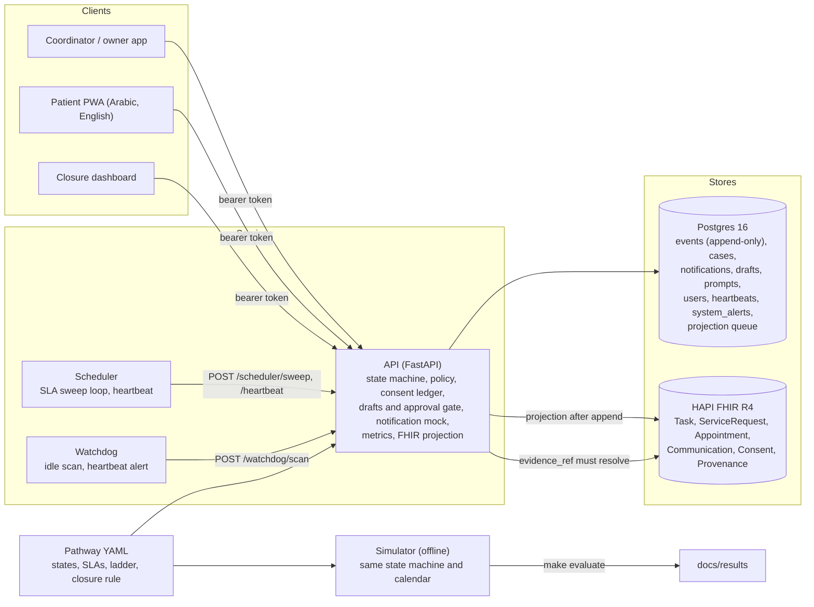
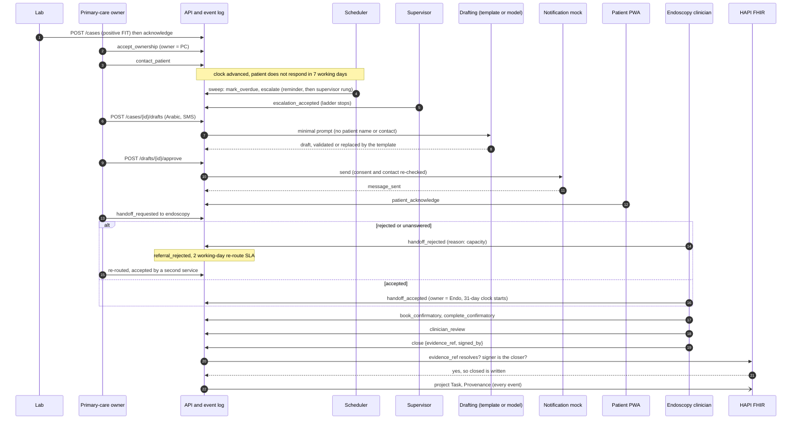

# Screening Closure: technical documentation

Every actionable screening result has a named owner, a clock, an audit trail, and a clinician-signed closure. Nothing is diagnosed.

Challenge 05, Closing the Screening-to-Care Loop. Pathway: positive FIT (faecal immunochemical test) result to confirmatory colonoscopy to a documented, clinician-signed closure.

**All data in this project is synthetic.** The cohort is generated by Synthea v3.3.0 and the evaluation by a seeded simulator. No real patient, clinician, facility or screening record is used anywhere ([data-provenance.md](../data-provenance.md)). Every evaluation number below is a simulation result on synthetic data, not a measurement of a real programme.

**Where the numbers come from.** Evaluation numbers are quoted from [`docs/results/results.md`](../results/results.md) and its machine-readable twin `docs/results/results.json`, with the JSON key given (for example `scenarios.literature_anchored.arms.orchestrated.completion_180d`). Load numbers are from [`docs/results/load.md`](../results/load.md). Published figures are from the evidence register, [`docs/evidence.md`](../evidence.md), with its section number. Cost figures are the output of `tools/pilot/cost_model.py` as printed in [`docs/pilot-plan.md`](../pilot-plan.md), and every cost input is assumed. Test counts are from the M2/M3 integration line of [`project/LOG.md`](../../project/LOG.md). Anything not established from a source we could read is marked "to verify".

## Contents

1. [Outcome](#1-outcome)
2. [The problem and who loses today](#2-the-problem-and-who-loses-today)
3. [What the system does and does not do](#3-what-the-system-does-and-does-not-do)
4. [Architecture](#4-architecture)
5. [Automated-versus-human decision matrix](#5-automated-versus-human-decision-matrix)
6. [Responsible AI](#6-responsible-ai)
7. [Data governance](#7-data-governance)
8. [Hazard log summary](#8-hazard-log-summary)
9. [Evaluation](#9-evaluation)
10. [Scalability and deployment](#10-scalability-and-deployment)
11. [Pilot plan](#11-pilot-plan)
12. [Assumptions, dependencies and limitations](#12-assumptions-dependencies-and-limitations)
13. [Design choices: deterministic engine with human gates](#13-design-choices-deterministic-engine-with-human-gates)
14. [Clinician and Arabic reviews](#14-clinician-and-arabic-reviews)
15. [Reproducibility](#15-reproducibility)

## 1. Outcome

In a simulation of 20 replications of 2,000 synthetic positive-FIT cases followed for 360 days, the orchestrated process got 66.2% of patients to a confirmatory colonoscopy within 180 days, against 52.1% under today's unmanaged process, a difference of +14.2 percentage points (95% CI +13.8 to +14.5). The share of cases lost without any human being told fell from 44.5% to 22.5%, and no case in either arm closed without evidence and a human sign-off. These are the **literature-anchored** figures, and they are the ones we quote: that scenario holds the orchestrated arm to the pooled patient-navigation risk ratio of 1.27 from published trials, gives SMS reminders no effect, and gives escalation to a supervisor or coordinator no more effect than re-contacting the patient. The **upper-range** scenario shows the mechanism ceiling (every case gets the full process and every escalation works as assumed) and is not a forecast. Sources: [results.md](../results/results.md) headline and summary; `results.json` keys `scenarios.literature_anchored.arms.{baseline,orchestrated}.completion_180d`, `scenarios.literature_anchored.difference.completion_180d`, `scenarios.literature_anchored.arms.*.silent_loss_rate`. All data synthetic.

Headline table, copied from [results.md](../results/results.md) "Headline: baseline vs the two orchestrated scenarios" (synthetic data; 95% bootstrap intervals over replications):

| Metric | Baseline | Orchestrated, literature anchored | Orchestrated, upper range |
|---|---|---|---|
| Colonoscopy completed within 90 days | 42.7% (42.3% to 43.1%) | 58.0% (57.6% to 58.4%) | 76.0% (75.8% to 76.4%) |
| Colonoscopy completed within 180 days | 52.1% (51.5% to 52.6%) | 66.2% (65.8% to 66.7%) | 83.0% (82.7% to 83.4%) |
| Colonoscopy completed within 360 days | 55.2% (54.6% to 55.8%) | 68.0% (67.5% to 68.5%) | 83.2% (82.9% to 83.6%) |
| Completion ratio vs baseline at 180 days (navigation RR for comparison: 1.27) | 1.00 | 1.27 | 1.59 |
| Cases still open at 90 days | 62.4% (62.0% to 62.8%) | 47.2% (46.8% to 47.5%) | 28.8% (28.6% to 29.1%) |
| Cases closed (evidence and human sign-off) by end of follow-up | 53.4% (52.8% to 54.0%) | 67.0% (66.5% to 67.5%) | 83.2% (82.9% to 83.6%) |
| Time to safe closure, median days (closed cases only) | 70.3 (70.0 to 70.6) | 65.6 (65.3 to 65.9) | 62.9 (62.8 to 63.1) |
| Time to first patient contact, median days | 12.4 (12.2 to 12.6) | 11.7 (11.6 to 11.8) | 11.1 (11.1 to 11.2) |
| Lost to follow-up (no colonoscopy, no progress for 30+ days) | 44.5% (44.0% to 45.2%) | 31.9% (31.4% to 32.4%) | 16.8% (16.4% to 17.1%) |
| Lost AND never surfaced to a human | 44.5% (44.0% to 45.1%) | 22.5% (22.0% to 22.9%) | 0.0% (0.0% to 0.0%) |
| No colonoscopy by the delay-harm threshold (270 days) | 45.7% (45.2% to 46.3%) | 32.5% (32.1% to 33.1%) | 16.8% (16.5% to 17.1%) |
| Escalations per 100 cases (cost nothing in the model, see capacity caveat) | 0.00 (0.00 to 0.00) | 52.78 (51.80 to 53.68) | 99.09 (98.15 to 99.87) |
| Escalation precision (acted on within 5 working days) | n/a | 43.3% (42.8% to 43.8%) | 48.2% (47.9% to 48.6%) |

Two cautions: every gain is before capacity constraints, because escalations cost nothing in the model (section 9); and the literature-anchored scenario reaches its average effect by letting the process reach only half the cases (`orchestration.programme_reach` 0.5, calibrated), a calibration device rather than a prediction.

## 2. The problem and who loses today

A positive FIT is a result that needs an action: a colonoscopy. Between the laboratory, the requesting clinician, the endoscopy service and the patient, nobody is clearly responsible for making sure it happens, and nothing raises a flag when it does not. The published numbers show how often follow-up is lost (all from [evidence.md](../evidence.md)):

- **United States, 39 health systems.** Mohl et al., JAMA Network Open 2023: of 32,769 adults with a positive stool test, 43.3% had a colonoscopy within 90 days, 51.4% within 180 days and 56.1% within 360 days, so about 44% had none within a year (evidence.md section 2). Our simulated baseline is calibrated to this curve.
- **Actively managed programme.** Corley et al., JAMA 2017, Kaiser Permanente, 81,518 positive FITs: 74.2% within 3 months, 80.6% within 6 months, 83.2% within 12 months (evidence.md section 2). This is the nearest published ceiling for a programme that manages follow-up.
- **Harm from delay.** In the Corley cohort, colonoscopy at 10 to 12 months carried higher odds of any colorectal cancer (OR 1.48, 95% CI 1.05 to 2.08) and of advanced-stage disease (OR 1.97, 1.14 to 3.42) than at 8 to 30 days, rising to 2.25 and 3.22 beyond 12 months (evidence.md section 9). A 2021 systematic review says not to delay beyond 9 months, hence the simulator's 270-day delay-harm threshold.
- **Abu Dhabi.** The one local peer-reviewed audit found (Almansoori et al., BMC Cancer 2021, Emirati nationals in Abu Dhabi ambulatory clinics, 2015 to 2016) that only 436 of 1,429 positive results, 30.5%, ever had a follow-up colonoscopy, and that the largest single loss was "referred to GI but did not attend" (evidence.md sections 2 and 8b).
- **The standard the programme is held to.** The UAE National Guideline (3rd edition, 2022, Appendix 2) sets KPIs of referral after a positive FIT for 90% (acceptable) to above 95% (desirable) and follow-up colonoscopy within 31 working days of referral for above 90%. The DoH IFHAS standard V10 (July 2025) requires recall of positive results and referral to secondary care within 15 working days of releasing results (evidence.md section 8b). The pilot plan still cites the IFHAS KPI figures as relayed and to verify, while evidence.md records them as read in the primary source; the definitions are to reconcile with ours.

Who loses: the patient whose positive test never becomes a colonoscopy and who is recorded nowhere as missing; the clinician who assumes the endoscopy service has the case; the service that rejected a referral and assumes the referrer will re-route it; and the programme, which cannot name the patients in its gap. The common failure is silence: a case simply stops moving.

## 3. What the system does and does not do

**Positioning.** Every actionable screening result has a named owner, a clock, an audit trail, and a clinician-signed closure. Nothing is diagnosed.

**The boundary, in one sentence.** The system tracks whether the follow-up a screening result calls for has happened and who is responsible for it; every clinical judgement, including what the result means and whether the evidence is enough to close, is made and signed by a clinician.

It does: create a case for every positive FIT and keep it as an append-only event log; give it a named owner, moved between providers only when the receiver accepts; run a working-day clock on every open step and, when one runs out, mark the case overdue and walk an escalation ladder to named people who must accept; flag cases nobody has touched and alert when the scheduler stops; record consent per channel and freeze outreach on withdrawal; let the owner approve a drafted Arabic or English message before a logged mock "sends" it; refuse closure without evidence that resolves in the FHIR store and the closing clinician's own sign-off; project every event to FHIR R4.

It does not: diagnose, interpret a result, advise or decide care; let any automated actor (scheduler, watchdog, model, notifier) close or sign; send real messages; integrate with Malaffi or a provider system today (section 7); cover invitations, recall of negatives or any second pathway, which would be configuration.

## 4. Architecture

### 4.1 Components



Services run in Docker Compose (`postgres`, `fhir`, `api`, `scheduler`, `watchdog`; `synthea` under the `tools` profile). The web app is a Vite and React PWA served by `make web-dev` with an in-browser mock adapter by default or the real API with `VITE_API_ADAPTER=http` ([web/README.md](../../web/README.md)). Design decisions are numbered ADRs in [project/DECISIONS.md](../../project/DECISIONS.md).

### 4.2 Event sourcing

The `events` table is the source of truth; triggers reject `UPDATE`, `DELETE` and `TRUNCATE` (ADR-004). State is derived by replay, and `cases.current_state` is a read model checked against the replay on every append (ADR-002). An append is one transaction: lock the case row, replay, validate with the pure state machine, insert (ADR-003). An invalid transition writes nothing, concurrent writers cannot both win (T-A5, T-A7), and `event_id` makes retries insert once (T-A6).

### 4.3 State machine, side states and annotations

The pathway lives in [`config/pathways/colorectal_fit.yaml`](../../config/pathways/colorectal_fit.yaml) (version 0.2). Nine main states run from `result_received` to `closed`. Four side states change who may act next: `referral_rejected`, `consent_withdrawn`, `lost_contact`, `reopened`. `overdue` and `escalated` are flags derived by replay, not states, because a case can be overdue and in `patient_contacted` at once (ADR-011). Thirteen annotation events (overdue, escalation, handoff, consent, message and watchdog events) are recorded without moving the main state. Six events are human-only and refused for any automated actor by the state machine itself: `escalation_accepted`, `handoff_accepted`, `consent_updated`, `message_approved`, `callback_requested`, `reopen`.

### 4.4 The closure invariant

A case enters `closed` only through `close`, carrying `evidence_ref` and `signed_by` from a non-automated actor, checked in the state machine and inside the transaction; the pathway loader refuses configs that weaken it. The API also requires `evidence_ref` to be a `DiagnosticReport` or `Procedure` that exists in HAPI (422, or 503 if HAPI cannot answer) and `signed_by` to be the closer (403) (ADR-021). Only the two clinician roles may close, and a reopened case closes again only through a fresh review and `close`. The property test `test_never_closed_without_evidence_and_human_signoff` (T-A1, `api/tests/test_state_machine.py`) generates 2,000 random event sequences per run over the full vocabulary and asserts that none reaches `closed` without both; T-A2 asserts that replay is deterministic.

### 4.5 Working-day SLA engine and clock starts

Every open main-path state has a timer in working days: acknowledge 2, accept ownership 2, contact the patient 5, patient acknowledges 7, book the colonoscopy 14, complete it 31, clinician review 5, close (sign-off) 3, and re-route a rejected referral 2 (pathway YAML `slas_working_days`). Working days use a configurable calendar with a UAE default of Monday to Friday and an optional holiday list, which is empty today (ADR-009, limitation L11). Clocks start at state entry, except the 31-working-day colonoscopy clock, which starts at referral acceptance (`handoff_accepted`) as the national standard measures it (`sla_clock_start`, ADR-020). Timers run on an injectable, persisted simulation clock (`POST /clock/advance`, supervisor only; T-A17).

### 4.6 Escalation ladder

The sweep (`POST /scheduler/sweep`, scheduler token) emits `mark_overdue` once per breach, then the ladder in working days after the due date: owner reminder at 0, supervisor at 3, coordinator at 7, in order, once each, with ordered catch-up after an outage (T-A15, T-A18). A human in the rung's role accepts with `escalation_accepted`, which stops the ladder (T-A19, ADR-014). The scheduler never closes or changes state (T-A16). There is no regulator rung (L35).

### 4.7 Referral handoff contract

Ownership moves only when a clinician at the receiving provider sends `handoff_accepted` (T-A20). A rejection needs a taxonomy reason (`capacity`, `wrong_service`, `missing_info`, `patient_declined`, else 422) and returns the case to the referrer in `referral_rejected` (T-A21). An unanswered request is bounced by the sweep after 3 working days with reason `timeout`, logged once (T-A22), and the re-route has a 2 working-day SLA that walks the ladder (ADR-016).

### 4.8 Consent ledger

Consent is an append-only history of `consent_updated` events (four channels, sharing with the specialist, `withdrawn`), derived by replay (T-A24). A withdrawal moves the case to `consent_withdrawn`, the state machine refuses drafting, approval, sending and new handoffs with a 409, and `review_requested` flags it for a person; restoring consent resumes the prior state (T-A23, ADR-017). Only the patient, or a coordinator recording their instruction, may change it. Defaults are opt-out, which the clinician review is asked to judge.

### 4.9 Notification mock

The only outbound path, `app.notify.send`, writes messages to an append-only `notifications` table and opens no network connection (T-A25, ADR-018). It re-checks consent and contact validity at send time, logs blocked attempts as `blocked_consent` or `blocked_contact`, and is the only writer of `message_sent`.

### 4.10 RBAC and opaque actors

Six user roles (`lab`, `primary_care_owner`, `specialist_owner`, `coordinator`, `patient`, `supervisor`) and two service roles (`scheduler`, `watchdog`). The actor is derived from a signed token, never from the body; policy tables are default-deny and every route must have an entry (T-A26, ADR-012). Clinicians act only on cases they own (A5). Actors are `role:<opaque id>` with names in an erasable `users` table, and every event type has a strict payload schema (T-A36, ADR-019). Dev login is open and tokens do not expire (L19).

### 4.11 Watchdog and heartbeats

The watchdog calls `POST /watchdog/scan` every 10 seconds with a token that may emit only `watchdog_flagged`. It flags open cases idle for `WATCHDOG_IDLE_DAYS` (7 in `.env.example`) of simulated time, once per idle episode (T-A30). The scheduler posts a heartbeat every loop; older than 60 seconds opens a persistent `scheduler_down` alert (`GET /alerts`) that a fresh heartbeat clears, and a live but failing scheduler raises `scheduler_failing` (T-A31, ADR-023). The dashboard shows "Cases nobody is looking at" and a red banner.

### 4.12 FHIR projection

After each append the API projects to HAPI FHIR R4: a `Task` per case (status mirrors the state, owner a `Practitioner`), a `ServiceRequest` for the referral, an `Appointment` stub, a `Communication` per message without text, a `Consent`, and a `Provenance` per event (ADR-024). Ids are deterministic, so re-projection changes nothing; failed writes go to a retry queue and never block the log. Projected resources pass HAPI `$validate` (T-A33). FHIR is a rebuildable projection of the log (ADR-008).

### 4.13 Drafts pipeline

`POST /cases/{id}/drafts` builds a minimal prompt from the read model, drafts through `draft_with_fallback`, validates, stores the draft and prompt, and appends `message_drafted` as `model:<provider>` with ids and a hash only (D4). `POST /drafts/{id}/approve` (case owner or supervisor, never the coordinator) commits the approval and `message_approved` in one transaction before `notify.send` writes `message_sent` (D5). Rejection is recorded on the draft row; the `message_rejected` event is planned (A16).

### 4.14 The catch-and-close flow

The flow the demo shows, as calls between actors (actors are opaque ids in the log; names here are for reading):



The rejection branch is simplified: in the pathway a rejected referral returns the case to `owner_accepted` through `handoff_accepted` by another provider or a supervisor or coordinator `reassign`.

The full role-by-event table is in [the decision matrix](../governance/decision-matrix.md).

## 5. Automated-versus-human decision matrix

[docs/governance/decision-matrix.md](../governance/decision-matrix.md) has one row for each of the 24 event types and the routes that matter for control: who may emit it, whether any automated actor may, what evidence or payload it needs, what it changes, and the test that proves the restriction. `make docs-check` fails if the event rows differ from `EVENT_POLICY` in `api/app/policy.py` (T-E6). The short version:

| Who | May do | May never do |
|---|---|---|
| Scheduler (`system:scheduler`) | `mark_overdue`, `escalate` ladder rungs, the timeout bounce of `handoff_rejected` | Close, change a main state, accept anything, touch consent |
| Watchdog (`system:watchdog`) | `watchdog_flagged` | Anything else, including reading or creating cases |
| Model (`model:<provider>`) | `message_drafted`, through the drafts route only | Any state change, approval, sending, closing (T-D2) |
| Notification mock (`system:notifier`) | `message_sent`, only after an approval | Run without an approved draft; send to a withdrawn channel |
| Consent ledger (`system:consent`) | `review_requested` after a withdrawal | Change consent itself |
| Lab, coordinator, supervisor | Create and acknowledge cases; coordinator and supervisor reassign and escalate by hand | Close a case (refused for all three) |
| Primary-care and specialist owners | Accept ownership, hand off, book, complete, review, approve drafts on own cases, sign and close | Act on a case owned by another provider without a handoff |
| Patient | Acknowledge, request a call-back, change consent, on their own case only | See or act on any other case |

Four properties hold in structure rather than by procedure: no closure without evidence and a human clinician; automated actors cannot log in as users; `message_approved` and `message_sent` have no poster through the events route; human-only events are refused for any automated actor by the state machine (decision-matrix.md, "What holds in structure").

## 6. Responsible AI

### 6.1 The drafting boundary

A language model is used in one place: drafting a patient message for the owner to approve ([ai-boundary.md](../governance/ai-boundary.md), ADR-007). It never moves, closes or escalates a case, decides care or contacts a patient, and this is structural: the state machine refuses every event from a `model:` actor except `message_drafted` (T-D2), and there is no path to `message_sent` without owner approval (T-D1, a property test). The prompt carries the owner's name and role, the next step, an appointment date and the pathway name, never the patient's name, contact, identifiers or history. The default provider is `template`, which needs no model or network.

### 6.2 Validation rules

Every model draft is checked before anyone sees it (ai-boundary.md section 4, T-D3, T-D8): not empty, no placeholders, a length limit per channel, the requested language, the owner's name and next step present, no forbidden phrase in either language (diagnosis, disease terms, "positive" as a result, reassurance, urgency, treatment, advice), and no digit runs, emails, identifiers or links. A false rejection costs one template message; a false accept could put a diagnosis in front of a patient. Keyword filters reduce risk and prove nothing, which is why a human approves every draft.

### 6.3 Fallback

Any provider failure or invalid output yields the reviewed template for the same purpose, channel and language, marked `fallback_used` with a reason, and never an exception (ai-boundary.md section 5); every template passes the validator (T-D14). Azure OpenAI and Jais adapters exist with the network off by default, and a prompt-hash cache replays recorded outputs offline, a miss falling back to the template (D6, D7, T-D7). The committed cache is empty, so the demo shows template drafts.

### 6.4 Provenance

The `drafts` table holds each draft's text, provider, model id, fallback flag, abstention reason, prompt hash, requester and time, and its one human decision (approver or rejecter, time, reason). The `prompts` table holds the exact prompt for each hash so an auditor can recompute and rerun it; the database refuses edits to both. Every event is also a FHIR `Provenance` with the actor as agent (T-D5, A12).

### 6.5 Abstention metric

The automation abstention rate is abstentions divided by draft attempts, where an abstention is an attempt that ended in the template because the provider failed or its output was rejected (ai-boundary.md section 6). It is stored per draft, reported overall and by reason, language and channel at `GET /metrics/abstention` and in `GET /metrics/closure` (T-D15). Drafts from the `template` provider count as attempts but never as abstentions. In the evaluation the rate is `n/a`, because no real model attempts exist ([results.md](../results/results.md), row "Automation abstention rate"; `results.json` key `automation_abstention_rate` is null by design, [metrics.md](../results/metrics.md)).

### 6.6 Risk score card

Planned: one loss-to-follow-up risk score, a logistic regression on simulator features with seeded training (D8, T-D11), used only to order the worklist (D9, T-D10: removing or shuffling it changes list order only), with a reliability plot from `make risk-report` and a score card (D10, T-D9, T-D12; proposed tolerance an expected calibration error at or below 0.05). **Not built on this branch**; see risk-score-card.md (`docs/governance/risk-score-card.md`) when it lands. Until then the worklist orders by SLA breach (C2), `risk_score` is null, and the cut line keeps SLA ordering.

### 6.7 Human gates

A human decides wherever a wrong decision could harm a patient: accepting ownership, a referral or an escalation rung; approving each message; changing consent; reopening; and closing with resolving evidence and the closer's own signature. Each is human-only in the state machine or the policy table, with a test (section 5).

## 7. Data governance

**Synthetic only.** 300 living patients from Synthea v3.3.0 (hash-pinned jar run in a container, seed 20261017, fixed reference date, Massachusetts), with FIT results from `simulator/generate_results.py` on the same seed ([data-provenance.md](../data-provenance.md)). The geography is US; language and channel come from simulator parameters (L01). The loaded cohort is ages 45 to 75 while the code now selects the sourced 40 to 75, until it is regenerated (L02).

**Minimisation.** The event log carries references and opaque ids, not the clinical record. Payloads are strict per event type, with no free text: `reason` values come from taxonomies and notes are capped at 200 characters (A14). `message_drafted` carries a hash, never text. The model prompt carries only the fields needed to write the message.

**Opaque actors.** Staff and patients appear in the log as `role:<opaque id>`. Display names live in the `users` table, which can be edited and erased (T-A36).

**Erasure design (ADR-025).** The log is append-only, and a data subject may ask for erasure. ADR-025 makes both possible: the immutable log holds opaque ids only, personal data lives in erasable stores (the FHIR store, the `users` table, and a contact table), and erasure deletes those and the id mapping while the events remain. Opaque actors and strict payloads are built (A14). The contact table, the erasure procedure and register, hard deletion in HAPI and backup handling are not built and have no ticket yet (L23, HZ-13). Whether the UAE PDPL governs health data, and the minimum retention period for health records, are to verify.

**Regulatory mapping summary** ([regulatory-mapping.md](../governance/regulatory-mapping.md); a design-time mapping, not legal advice):

| Instrument | What it is | Status of our reading | Biggest open question |
|---|---|---|---|
| UAE Federal Decree-Law 45 of 2021 (PDPL) | Federal personal data protection law | Secondary sources plus one official page | Whether it applies to health data at all |
| UAE Federal Law 2 of 2019 | Health ICT law with a localisation rule | Secondary only | Exact localisation text and exceptions |
| ADHICS | DoH Abu Dhabi information and cyber security standard | Primary for v0.9; V2 (2024) not retrieved | v0.9 control CM 4.2 prohibits cloud for health information unless DoH authorises |
| DoH AI policy and Responsible AI Standard | 2018 policy and 2025 standard | Primary | How our two AI uses are risk-classified |
| Malaffi | Abu Dhabi health information exchange | Primary (public site) | Whether any FHIR interface exists |
| Azure UAE North, Core42 | In-country hosting options | Primary for the region list; vendor claims for Core42 | Whether DoH accepts either for health information |

**Hosting order (ADR-026).** For real patient data, host first in a provider-approved environment (the provider's own data centre or private cloud already approved for health information), then in a UAE cloud that DoH has authorised in writing (Azure UAE North or Core42 only after that authorisation), and nowhere else. Backups, disaster recovery and remote administration stay in the UAE. The model host is bound by the same order; without an approved in-country model host, drafting uses the template. The stack has no cloud-managed dependency, so it runs the same way under either option.

**Malaffi adapter plan** ([malaffi-adapter-plan.md](../governance/malaffi-adapter-plan.md)), a target and not a claim. The engine is FHIR R4 inside. The official sources read point to HL7 v2 message feeds at Malaffi's boundary: DoH Circular 2026/10 lists the mandatory minimum dataset as HL7 message types (ADT, ORU, SIU and others), and no official public document confirms a FHIR interface (evidence.md section 8c; the adapter plan still marks the circular reading to verify). The plan is a separate adapter: HL7 v2 in (ORU results, ADT demographics, SIU appointments), mapped to FHIR and posted through the API under an automated actor that cannot close or sign; the message control id is the `event_id`; the watchdog flags a silent interface. Matching uses a national identifier when present (assumed Emirates ID, to confirm) and never auto-attaches on a fuzzy match. An exchange result never closes a case, and the pilot does not depend on Malaffi.

## 8. Hazard log summary

[docs/governance/hazard-log.md](../governance/hazard-log.md) lists 20 hazards with cause, likelihood, impact, control, the test that proves the control, residual risk and owner; `make docs-check` checks that every row has ratings, a control and test ids that exist (T-E7). Ratings are the author's judgement for the clinician review (H1) to revise. The eight with high impact and the most direct patient consequence:

| ID | Hazard | Main controls (built unless stated) | Tests |
|---|---|---|---|
| HZ-01 | Missed escalation: a deadline passes and no responsible human learns it or takes it | `mark_overdue` once per breach on the working-day calendar; ordered ladder with catch-up; each rung needs a human; a timer on every open state (A13); idle watchdog | T-A15, T-A16, T-A18, T-A19, T-A30, T-A34, T-A35 |
| HZ-02 | Wrong-patient message | The model never sees the patient's name, contact or identifiers; validation blocks digits, emails, identifiers and links; owner approves each draft against the case; send only to the contact held for that patient | T-D3, T-D8, T-D1, T-D13, T-A25, T-A26; log scans T-F10, T-F11 pending F8 |
| HZ-03 | Silent failure: the scheduler is dead or failing and nobody knows | Heartbeat on every loop; persistent `scheduler_down` and `scheduler_failing` alerts that clear on recovery; ordered catch-up after an outage | T-A15, T-A18, T-A31, T-A32 (`make test-chaos`); T-F5 pending F4 |
| HZ-04 | Silent failure: an open case sits idle | Watchdog flag once per idle episode from its own token; "Cases nobody is looking at" panel; timers for rejected referrals | T-A30, T-A22, T-A23; T-C16 pending (C9 in review) |
| HZ-05 | Consent breach: outreach after withdrawal | Withdrawal freezes outreach in the state machine and the API (409); consent re-read at send time; human review flag | T-A14, T-A23, T-A24, T-A25; race test T-F7 pending F5 |
| HZ-06 | Closure without evidence | Guard in the state machine and the transaction; only clinician roles close; evidence must resolve in HAPI and the signer must be the closer; append-only triggers | T-A1, T-A3, T-A4, T-A8, T-A26, T-A37, T-B6 |
| HZ-09 | Model output with diagnosis, reassurance or advice | Model can only draft; bilingual validation with template fallback; human approval before any send | T-D2, T-D3, T-D8, T-D14, T-D1, T-C13; T-F6 pending F5 |
| HZ-15 | A rejected or unanswered referral is lost | Rejection needs a taxonomy reason; ownership changes only on acceptance; unanswered referral bounces after 3 working days; 2 working-day re-route SLA walks the ladder | T-A14, T-A20, T-A21, T-A22 |

Two residual risks stand out. The simulated escalation precision is 43.3% (literature anchored, synthetic; `results.json` `scenarios.literature_anchored.arms.orchestrated.escalation_precision`), so fewer than half of escalations are acted on within five working days in the model, which makes alert fatigue plausible (HZ-01, L08). And the keyword filters and the Arabic phrase list are unreviewed until H1 and H2 (HZ-09, L17).

## 9. Evaluation

All numbers in this section come from a simulation on synthetic data.

**Method.** A seeded simulator runs two arms over the same synthetic patients and random numbers: a **baseline** modelling today's process (no owner, clocks or escalation) and an **orchestrated** arm driven through the real state machine, calendar, ladder, handoff and consent rules ([simulator/README.md](../../simulator/README.md)). Seed 20261017, 20 replications of 2,000 cases each, 360 days of follow-up, 1,000 bootstrap resamples; intervals are percentile bootstrap 95% intervals over replications, and differences are paired by replication ([results.md](../results/results.md) header; `results.json` `meta`). Every metric has a written definition with numerator, denominator, clocks and censoring in [metrics.md](../results/metrics.md).

**Both scenarios.** The upper-range scenario uses `simulator/params.yaml`. The literature-anchored scenario layers [`simulator/params.conservative.yaml`](../../simulator/params.conservative.yaml), which changes seven orchestrated-arm parameters: SMS reminder effect 0, supervisor and coordinator escalation and contact recovery capped at the owner's level, a human call no better than a digital re-contact at re-engaging a disengaged patient, and `programme_reach` 0.5, calibrated so that the 180-day completion ratio equals the pooled navigation risk ratio of 1.27 (95% CI 1.10 to 1.46, J Gen Intern Med 2026, evidence.md section 5). `evaluate` refuses to write results if the baseline event log differs between the two scenarios, so the baseline is provably the same.

**Results with intervals** (literature anchored, synthetic; [results.md](../results/results.md) "Arm comparison: literature anchored scenario"; keys under `scenarios.literature_anchored.difference`):

| Metric | Baseline | Orchestrated | Difference |
|---|---|---|---|
| Colonoscopy within 180 days | 52.1% | 66.2% | +14.2pp (+13.8 to +14.5) |
| Open at 90 days | 62.4% | 47.2% | -15.2pp (-15.5 to -15.0) |
| Time to safe closure, p90 days (closed cases) | 143.2 | 112.0 | -31.2 (-33.3 to -29.3) |
| Lost and never surfaced to a human | 44.5% | 22.5% | -22.1pp (-22.5 to -21.7) |
| No colonoscopy by 270 days | 45.7% | 32.5% | -13.2pp (-13.6 to -12.8) |
| Reopen rate | 3.0% | 3.0% | +0.0pp (-0.1 to +0.1) |
| Outreach sent after consent withdrawn | 0.4% | 0.2% | -0.2pp (-0.2 to -0.1) |

The median time to a named owner in the orchestrated arm is 5.2 days (`time_to_ownership_median`); the baseline has no named owner by design. In the literature-anchored arm the residual 0.2% of outreach after a withdrawal comes from cases outside the programme's reach, which are handled as today; in the upper range it is 0.0%.

**Fairness** (literature anchored, synthetic). The gap in final completion between the best and worst language group narrows from 8.9% at baseline to 5.2% orchestrated (difference -3.7pp, -4.4 to -3.0; `fairness.language.completion_gap_max`). By preferred contact channel the completion gap moves from 5.1% to 4.5% (-0.6pp, -1.8 to +0.7), which is not distinguishable from no change. The gap in median days to closure by channel widens from 4.4 to 5.9 days (+1.5, +0.2 to +2.6; `fairness.channel.closure_median_gap_max_days`) because letter-preferring patients close more slowly (69.7 days against 64.3 to 65.3); a pilot should test a second channel for them. Language and channel shares are assumed (L07), so this shows how the mechanisms treat groups in the model, not real-world fairness.

**Messy cases** (literature anchored, synthetic; [results.md](../results/results.md) "Messy-case handling"). The orchestrated arm explicitly handled 39.4% of wrong-contact cases, 44.5% of provider switches, 48.8% of duplicate results, 51.0% of conflicting ownership claims and 59.1% of consent withdrawals after booking, against 0% at baseline, which has no such mechanism. Completion among wrong-contact cases rises from 21.5% to 42.7%. Consent withdrawal after booking is the one case where completion is lower orchestrated (63.1% against 66.0%), because the engine freezes outreach until a human reviews the case; that is the intended behaviour. The per-scenario event-sequence tests (T-B7) are not written yet (B5 in review).

**Calibration to literature.** The baseline lands within 1.1 percentage points of the Mohl 2023 curve at 90, 180 and 360 days (42.7%, 52.1%, 55.2% simulated against 43.0%, 51.0%, 56.0% published; [results.md](../results/results.md) "Calibration check"). This is by construction, since 16 parameters were tuned to it (L05), and it is not a validation. The upper-range orchestrated arm (76.0%, 83.0%, 83.2%) sits just at or below the managed Kaiser curve (74.2%, 80.6%, 83.2%), which bounds it from above. Of 132 parameters, 88 are assumed, 16 calibrated, 13 sourced and 15 sourced-adjacent (`results.json` `meta.parameter_status_counts`), so the direction of the effect follows from the mechanisms and its size depends on assumed inputs.

**Capacity caveat.** Cases are independent in the simulator: there are no shared endoscopy slots, no staff workload and no queueing, and an escalation is acted on with a fixed probability however many are open. The literature-anchored arm raises 52.78 escalations per 100 cases and the upper range 99.09 (`escalations_per_100_cases`). A real programme needs people and colonoscopy slots to work them, and the gains would shrink without them. Use the escalation count to size a pilot, not the completion gain. A capacity model is future work (L08).

**How a judge reruns it.**

```
make evaluate          # both scenarios; rewrites docs/results/results.json and results.md (about 10 s with 8 to 10 workers)
make evaluate-check    # runs evaluate twice (the second single-process) and requires identical results.json
make evaluate PARAMS="simulator/params.yaml my_overrides.yaml"   # layer your own parameter file and rerun
```

Later `PARAMS` files override earlier leaves, and `results.json` records the parameter hash and file list ([simulator/README.md](../../simulator/README.md)). Open in B10: recording an override in the output metadata is untested (T-B13), and the docs-number checker is not built (T-B14), so this document gives the file and key for every evaluation number.

## 10. Scalability and deployment

All load numbers come from [load.md](../results/load.md): one scheduler sweep over a freshly seeded throwaway database of synthetic open cases on an Apple M4 laptop with Postgres in Docker. Timings vary by about 10% from run to run.

| Open cases | Single process (s) | Sharded over 10 workers (s) | Events emitted |
|---|---|---|---|
| 1,000 | 0.18 | 0.14 | 120 |
| 10,000 | 1.56 | 0.63 | 1,088 |
| 100,000 | 18.80 | 5.99 | 10,697 |

**The 100,000-case result, plainly.** The target is a sweep under 5 seconds at 100,000 open cases (T-F8). The single-process sweep takes 18.80 s and does not meet it. Sharded over 10 worker processes it took 5.99 s in the committed run, and 4.4 s to 6.1 s over repeated runs on the same shared laptop, so the target is met on a quiet machine and missed by up to about 20% on a busy one. The scheduler route still calls the single-process sweep; switching it to `run_sweep_parallel` with a long-lived pool is a follow-up, and F6 stays in review. A cold start after a long outage, where every breach and rung is pending, takes 6.66 s for 10,000 cases single-process and 2.83 s sharded, bound by the per-case append transaction that re-verifies the replay (load.md, "Cold start"). At pilot scale (about 155 actionable cases in the 90-day window, pilot-plan.md section 3) the sweep is far below these sizes; the target matters for a programme-wide deployment.

**Stateless services, with one exception.** The scheduler and watchdog are loops that call the API with their own tokens (ADR-013, ADR-023), and the API replays each case under a row lock on every append. The exception is the simulation clock, cached in the API process, which assumes one API replica; there is no wall-clock mode yet (L31).

**Idempotent events.** `event_id` is an idempotency key (T-A6); case ids derive from the report id; a second sweep emits nothing (asserted by the load test at every size); watchdog flags and FHIR ids are deterministic.

**Migration runner.** Schema changes are numbered SQL files (`api/migrations/001_events.sql` to `008_draft_decisions.sql`) applied at API startup and recorded in `schema_migrations`. Integration tests run against a separate `closure_test` database, and the test session refuses any database whose name does not end in `_test` (T-F2, ADR-015).

**Chaos results.** `make test-chaos` stops the scheduler container of the running stack and watches the watchdog. Measured: the `scheduler_down` alert appeared 68 s after the container stopped (the 60 s limit plus up to one 10 s watchdog interval) and cleared about 10 s after the restart, against a 90 s budget (ADR-023). The wider chaos suite (duplicate events and clock skew, F3; kill mid-sweep and assert no lost or duplicated events, F4; bad model output and consent withdrawn mid-transition, F5) is not built.

**Offline demo.** The default configuration makes no outbound calls (template provider, model network off, bundled fonts, notification mock), and the web mock adapter runs the API in the browser as a fallback. The network-blocked verification (F10, T-F14) is not built.

**Compose on a laptop.** `cp .env.example .env` and `make up` start Postgres, HAPI FHIR, the API, the scheduler and the watchdog; `make demo-seed` loads the cohort ([README](../../README.md)). The HAPI image is not yet pinned (`latest`, L20), and HAPI shares the Postgres instance with the case store, which a pilot would separate.

**Cost per case** (output of `tools/pilot/cost_model.py` in [pilot-plan.md](../pilot-plan.md) section 8; AED; every input assumed, nothing is a quote). Steady-state cost to serve per actionable case is 481.8 at 10,000 screened members a year, 136.7 at 50,000 and 70.5 at 200,000, because costs are largely fixed (hosting, support, integration). The 90-day pilot, including a 90-day follow-up tail, one-off integration and governance review, costs 577,624 in total, or 3,718 per expected actionable case. The engine itself adds no per-decision charge: a transition is one database transaction, and the model is called only for a draft.

## 11. Pilot plan

[docs/pilot-plan.md](../pilot-plan.md) proposes one programme (colorectal screening, positive FIT to colonoscopy and closure) with two or three providers: the screening or primary-care provider, the endoscopy service and optionally a laboratory. Nothing in it has been discussed with a provider or regulator.

- **Phases.** Preparation to gate G0 (agreements, approvals, data feed tested on synthetic data, clinical safety sign-off, Arabic review, baseline audit). Shadow mode, days 1 to 30: the engine observes the real feed, computes owners, clocks and escalation suggestions, and sends and assigns nothing; coordinators review the flags weekly. Active mode, days 31 to 90, with gates at day 60 and 90. A follow-up tail to day 180 so closure outcomes can be measured.
- **KPIs**, each computed from the event log: K1 time to ownership (p90 at most 4 working days, proposed); K2 time to safe closure, censored cases reported, never dropped; K3 open at 90 days, with every open case owned and dated; K4 referral made and accepted after a positive FIT (at least 90%, from the national standard, wording to reconcile); K5 colonoscopy within 31 working days of referral (above 90%); K6 patient acknowledgement rate; K7 escalation precision judged by a coordinator on a sample (at least 80%, proposed); K8 cases closed without evidence, which must be zero.
- **Stop rule.** At any time, a case closed without evidence, a message to the wrong patient, or a silent loss of the feed that the watchdog failed to flag stops active mode until a root cause is documented.
- **Commercial model.** Per screened member per year, or per actionable case, or a hybrid; illustrative fees only (pilot-plan.md section 8).

About 155 actionable cases are expected in the window under placeholder volumes, so intervals will be wide; the pilot is a before-and-after comparison with a shadow period, not a trial.

## 12. Assumptions, dependencies and limitations

The full table, with where each item bites, its source, its impact if wrong, how to remove it and its status, is [docs/assumptions-limitations.md](../assumptions-limitations.md) (37 rows, L01 to L37). Summary:

| ID | Assumption or limitation (short) | Status |
|---|---|---|
| L01 | All data synthetic; Synthea cohort is US-shaped, no UAE demographics or Arabic names | open |
| L02 | Loaded demo cohort is ages 45 to 75; code now selects 40 to 75 | open |
| L03 | FIT results drawn independently of clinical history; no negatives, invitations or repeats | open |
| L04 | 88 of 132 simulator parameters assumed; absolute numbers depend on them | open |
| L05 | Baseline calibrated to a US curve by construction, not validated locally | open |
| L06 | Sourced-adjacent values come from other settings; some evidence rows read from summaries only | open |
| L07 | Language and channel shares assumed; fairness split reflects inputs | open |
| L08 | No capacity model; escalations cost nothing | open |
| L09 | Upper-range effect above the navigation literature | partly resolved (literature-anchored scenario, B12) |
| L10 | Intervals reflect simulation noise only, not parameter uncertainty | open |
| L11 | Calendar Monday to Friday, empty holiday list, one calendar for all providers | open |
| L12 | SLA values are design choices; only the 31 has a public anchor | resolved for the missing close SLA (A13); clinician review pending |
| L13 | 31-working-day clock start | resolved (runs from referral acceptance, A13); 15 versus 31 reading with H1 |
| L14 | Lost contact after 3 attempts is an assumption; attempts not counted by the engine | open |
| L15 | FIT positivity 0.07 assumes a sensitive cut-off | open |
| L16 | LOINC display string checked on one terminology server, to verify | open |
| L17 | Arabic text unreviewed (H2) | open |
| L18 | English wording, states and SLAs unreviewed by a clinician (H1) | open |
| L19 | Development tokens never expire; open dev login | open |
| L20 | HAPI image unpinned; shares Postgres with the case store | open |
| L21 | Malaffi not integrated; HL7 v2 boundary assumed | open |
| L22 | ADHICS CM 4.2 cloud rule; DoH acceptance of any cloud not established | open |
| L23 | Erasure procedure and contact table not built | open |
| L24 | Opaque-payload rule | resolved (A14); marker scan of stored events still open |
| L25 | Model drafting cached or template; no live endpoint exercised; abstention rate unmeasured | open |
| L26 | No real notification channel | open |
| L27 | Nothing outside the stack watches the watchdog | partly resolved (A11) |
| L28 | Closure evidence adequacy | resolved for resolution and signer (A15); adequacy with H1 |
| L29 | No per-organisation scoping beyond the provider claim | partly resolved (A5) |
| L30 | Append-only is tamper-evident, not tamper-proof | open |
| L31 | Global simulation clock, single API replica, no wall-clock mode | open |
| L32 | No cross-source deduplication in the engine | open |
| L33 | Consent ledger and send-time check | resolved (A6, A7) |
| L34 | Sweep scale | measured since (F6, section 10); the table row still says open |
| L35 | No regulator rung on the ladder | open |
| L36 | Regulatory readings incomplete | open |
| L37 | No usability testing; one pathway, one jurisdiction | open |

**Dependencies.** Postgres 16, HAPI FHIR R4 (image to pin), Synthea v3.3.0 (downloaded at run time, hash-pinned), Docker Compose, Python for the API and simulator, Node for the web app. For a pilot: a provider data feed and agreements, an approved in-country host (ADR-026), an in-country model host or the template, an in-country messaging provider, an identity provider, and optionally the Malaffi interface specification.

## 13. Design choices: deterministic engine with human gates

[docs/design-choices.md](../design-choices.md) compares two architectures for the same job: a deterministic engine in which code and people decide state changes and a model only drafts, and an agentic orchestration in which a language model, or a group of model-driven agents, routes, escalates, judges evidence and closes cases using tools. Agentic designs suit many problems, especially where inputs are unstructured and mistakes are cheap to reverse. Here a wrong closure is a patient recorded as finished when they are not, and closure is the state that removes every timer and every worklist entry.

| Dimension | Deterministic engine with human gates | Agentic orchestration |
|---|---|---|
| Auditability | The event log is the audit trail: actor, time, evidence, signer | Inputs, outputs and a generated rationale, not the rule that decided |
| Replayability | Replaying the log reproduces the state exactly (T-A2) | The same inputs may give a different decision; replay needs stored outputs |
| Latency | One database transaction per transition | One or more model calls per decision |
| Cost per case | Compute and storage; no per-decision charge | Per-decision model charges that grow with events and context, including sweeps over idle cases |
| Failure modes | Fails closed: an invalid transition is refused | A plausible wrong decision, including a closure, looks like a correct one |
| Model unavailable | No effect on state handling; drafting falls back to the template | Decisions stop or degrade unless a deterministic path exists anyway |
| Regulator explainability | A short versioned config and a pure function | Prompts, model versions and sampled behaviour that change with each model update |
| Testability | Properties proved over thousands of random sequences, pass or fail | Error rates estimated on samples; zero cannot be shown |

The conclusion is a hybrid: the model proposes where input is unstructured and a person reviews the output (drafting a message), and deterministic code disposes where the answer must be the same every time and an error would be silent (is this overdue, who is told next, may it close). Guardrails lower the rate of a hallucinated closure; a rate is not a guarantee.

## 14. Clinician and Arabic reviews

Both reviews are human-owner tasks and are **pending**: H1, a 30-minute clinician review of the pathway, states, SLAs and English wording (T-E13), and H2, a native Arabic speaker's review of every patient-facing string (T-E14). Both are to be booked in the week of 25 October and held by 7 November (tracker H1, H2). No reviewer has seen the material yet, so this section lists what we will change rather than what we changed.

The reviewer packs are generated from the sources and checked against them by `make check` (T-E17):

- [Clinician pack](../review/clinician-pack.md) (for H1): the pathway as a Mermaid chart, states and events in plain language, every SLA with its clock start, the escalation ladder, handoff reasons, two rules flagged for challenge (lost contact after 3 attempts; opt-out consent), every English patient string, the forbidden phrases, ten questions and a feedback table.
- [Arabic pack](../review/arabic-pack.md) (for H2): every Arabic patient string beside its English source with context, RTL and digit conventions, the Arabic forbidden phrases, a checklist and a feedback table.

What changes when they land: SLA values, clock starts and the lost-contact threshold are YAML edits followed by `make evaluate`; wording changes are text edits followed by `make review-packs`; forbidden phrases change in `api/app/ai/forbidden_phrases.yaml`; hazard ratings are revised; and the feedback is recorded in `docs/governance/clinician-review.md` and `docs/governance/arabic-review.md`, then summarised here. Until H2, the Arabic text is labelled an unreviewed draft everywhere it appears. One clinician-pack question (question 4, on the 31-working-day clock start) predates the A13 change that now runs that clock from referral acceptance; the pack will be regenerated before the review.

## 15. Reproducibility

**One command for each job.** `make up` starts the stack; `make demo-seed` loads the synthetic cohort and creates cases; `make evaluate` regenerates every evaluation number in `docs/results`; `make test-load` regenerates `docs/results/load.md`; `make check` runs every gate.

**`make check` stages**, in order, stopping at the first failure (`CHECK_KEEP_GOING=1` runs all): `test` (unit and property), `test-db` (Postgres integration against `closure_test`), `web-test`, `web-build`, `evaluate-check` (byte-for-byte reproducible `results.json`), `docs-check` (links, tables, review markers, decision matrix and hazard log completeness), `tracker-lint`, `test-security` (secret scan of the tree and history), `test-tools`, `load-check` (the 1,000-case sweep with its correctness assertions), `review-packs-check`, `test-review-packs`, `web-e2e`.

**Test counts.** At the M2/M3 integration `make check` was green over 13 stages: 1133 API and simulator tests, 94 integration tests, 147 web unit tests, 33 end-to-end tests, 52 tool tests and 17 reviewer-pack tests ([project/LOG.md](../../project/LOG.md), M2-M3-integration line). The end-to-end tests run against the web app's mock adapter; a run against the real stack is not built.

**Determinism.** `results.json` has sorted keys and no timestamps and records the seed, hashes and commit; `make evaluate-check` diffs two runs. Synthea runs with a pinned jar, seed and reference date.

**Fresh clone.** The fresh-clone script for a second machine is not built (F12, T-F13). The checklist it will automate is: `git clone`, `cp .env.example .env`, `make up`, `make demo-seed`, `make evaluate` in under two minutes, `make check`; pin the HAPI image tag first (L20). The run on a second machine is a human-owner task (H5).
